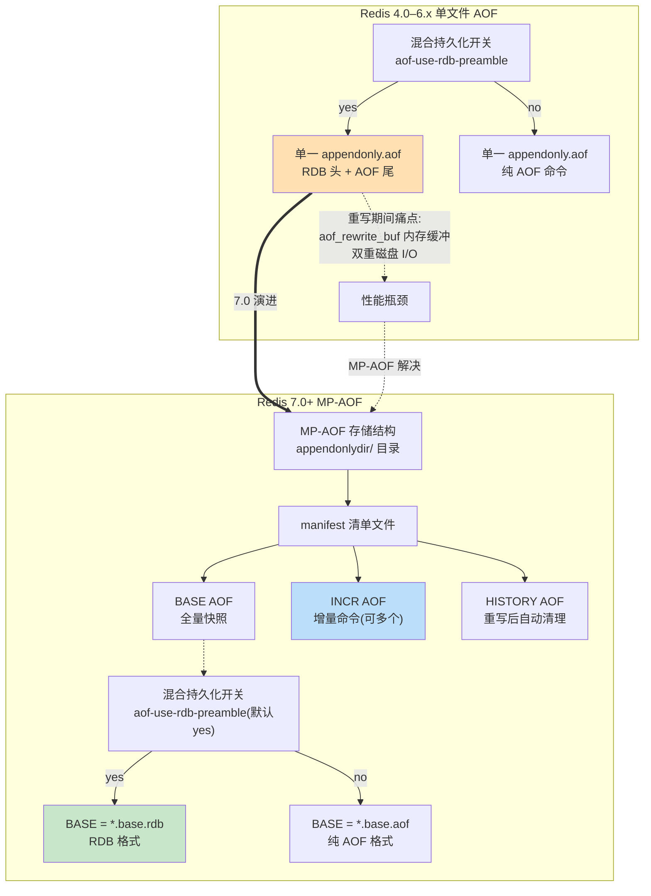

---
tags:
  - redis
  - 持久化
  - 混合持久化
  - MP-AOF
created: 2026-07-26
updated: 2026-07-26
source:
  - "https://juejin.cn/post/7656467869551558697"
  - "https://developer.aliyun.com/article/193034"
  - "https://www.alibabacloud.com/blog/design-and-implementation-of-redis-7-0-multi-part-aof_599199"
---

# 混合持久化与 MP-AOF 对比：RDB+AOF 的两种演进路径

> 混合持久化是 AOF 重写时「文件内格式」的选择，MP-AOF 是 Redis 7.0 对 AOF「物理存储结构」的重构，二者一内一外、正交协同。

---

## 一、混合持久化：一个文件里「RDB 头 + AOF 尾」

混合持久化由 **Redis 4.0** 引入，通过配置项 `aof-use-rdb-preamble yes` 开启（4.0–6.x 默认关闭，7.0+ 默认启用）。

### 核心机制

执行 AOF 重写（`bgrewriteaof`）时，子进程不再逐条把数据库状态写成 AOF 命令，而是：

1. 以 **RDB 二进制格式**把内存快照写入新 AOF 文件的开头
2. 重写期间产生的增量写命令以 **AOF 命令格式**追加到文件尾部
3. 最终形成 `[RDB file][AOF tail]` 的单文件结构

### 加载流程

Redis 读取 AOF 文件前 5 个字节，若为 `REDIS` 则判定为混合格式：
- 先用 `rdbLoadRio` 加载 RDB 部分（快速恢复大部分数据）
- 再以 AOF 格式继续解析后续增量命令

### 收益与代价

| 维度 | 说明 |
|------|------|
| **恢复速度** | 大部分数据走 RDB 的快速加载路径，显著快于纯 AOF 逐条重放 |
| **文件体积** | RDB 二进制比 AOF 文本更紧凑 |
| **可读性** | 文件变为二进制+文本混合，不再方便用 `cat` 查看 |
| **重写开销** | 重写期间仍需在内存中维护 `aof_rewrite_buf` 缓冲区，存在内存和双重 I/O 开销 |

### 面试话术

> 混合持久化是 AOF 重写时的一个格式选择——「是否用 RDB 作为前导」。它解决的是单个 AOF 文件内部的格式问题。关闭它不影响 AOF 正常工作，只是恢复速度会变慢。Redis 7.0+ 默认开启。

---

## 二、MP-AOF：把单个 AOF 文件拆成 BASE + INCR + HISTORY

MP-AOF（Multi-Part AOF）由**阿里云 Tair 团队贡献**并随 **Redis 7.0** 发布，目的是解决旧版 AOF 重写期间内存缓冲和磁盘双写的痛点。

### 核心机制：三类文件 + 一个清单

MP-AOF 把原本的单个 AOF 文件拆分为：

| 文件类型 | 作用 | 数量 |
|----------|------|------|
| **manifest** | 清单文件，统一跟踪当前 AOF 由哪些文件组成 | 1 个 |
| **BASE AOF** | 基础全量文件，最多一个，由子进程重写产生 | ≤1 |
| **INCR AOF** | 增量命令日志，重写开始时由父进程直接创建并写入 | ≥0，可多个 |
| **HISTORY AOF** | 每次重写成功后，上一代 BASE 和 INCR 转为 HISTORY 类型，Redis 自动删除 | 临时 |

### BASE 文件的两种格式

- 开启混合持久化（`aof-use-rdb-preamble yes`，默认）：`*.base.rdb` — RDB 二进制格式
- 关闭混合持久化：`*.base.aof` — 纯 AOF 文本格式

### 重写流程（vs 旧方案）

**Redis 7.0 之前（单文件 + 重写缓冲区）：**
1. 子进程扫描全量数据 → 生成新 AOF 文件
2. 主进程同时维护 `aof_rewrite_buf`，记录重写期间的新写命令
3. 重写完成后，主进程把缓冲区内容追加到新文件
4. 原子替换旧文件

**Redis 7.0（MP-AOF）：**
1. 重写开始时，主进程直接打开新的 `incr` 文件，新写命令直接追加，不再需要 `aof_rewrite_buf`
2. 子进程负责把当前内存状态以 RDB 格式写入到新的 `base` 文件
3. 重写完成后，Redis 原子更新 `manifest` 文件，指向新的 base 和 incr
4. 旧的 base 和 incr 转为 HISTORY，自动删除

### 消除了什么

| 旧方案痛点 | MP-AOF 解决方式 |
|------------|----------------|
| `aof_rewrite_buf` 内存缓冲 | 主进程直接写 `incr` 文件，零缓冲 |
| 父子进程管道同步增量命令 | 各写各的文件，无需同步 |
| 重写末尾一次性合并缓冲区 | 仅需更新 `manifest` 指针 |

---

## 三、二者的关系：格式选择 × 存储结构，正交协同

可以把两者的关系理解为**两个独立的维度**：

| 维度 | 混合持久化 | MP-AOF |
|------|-----------|--------|
| **解决的问题** | BASE 文件用什么格式存储（RDB 还是纯 AOF） | AOF 持久化数据如何被拆分、组织和管理 |
| **作用范围** | 单个 AOF 文件的内部结构 | 整个 AOF 持久化体系的物理存储结构 |
| **演进版本** | Redis 4.0 引入 | Redis 7.0 引入 |
| **默认状态** | 7.0+ 默认开启 | 7.0+ 默认启用 |

在 Redis 7.0+ 中，二者天然配合：

```
混合持久化开关(aof-use-rdb-preamble=yes)
        ↓
   决定 BASE 文件格式
        ↓
  ┌─────┴─────┐
  yes         no
  ↓           ↓
*.base.rdb   *.base.aof
(RDB 格式)   (纯 AOF 格式)
```

**MP-AOF 在物理存储上升级了混合持久化，而非推翻重来。** 当 `aof-use-rdb-preamble yes` 时，MP-AOF 的 BASE 文件默认就是 RDB 格式，配合 INCR 增量文件，自然实现了「RDB 全量 + AOF 增量」的效果。

### 存储结构示意



---

## 四、一句话总结

混合持久化是 AOF 重写时「**是否用 RDB 作为前导**」的格式选择，属于 AOF 的优化机制，关闭它不影响 AOF 正常工作；MP-AOF 则是 Redis 7.0 对 AOF 文件组织方式的**物理结构升级**，让「BASE 全量 + INCR 增量」分文件存储，既保留了混合持久化「RDB 全量 + AOF 增量」的思想，又从根本上消除了重写期间的内存与 I/O 浪费。

**Redis 7.0+ 默认行为：** `aof-use-rdb-preamble` 已默认开启，所以 MP-AOF 的 BASE 文件默认就是 RDB 格式，无需额外配置即可享受「快速恢复 + 增量补全」的混合持久化效果。

---

## 关联知识点

- [[AOF 持久化是怎么实现的？]] — AOF 基础概念、写回策略、重写机制
- [[RDB 快照是怎么实现的？]] — RDB 持久化原理、fork + COW
- [[Redis fork 全量同步优化案例]] — fork 系统调用在持久化中的应用
- [[Redis 大 Key 对持久化有什么影响？]] — 大 Key 导致 COW 内存放大的问题
