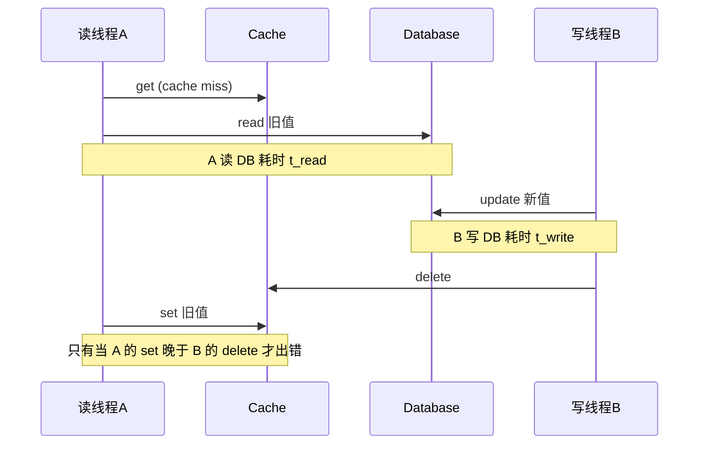
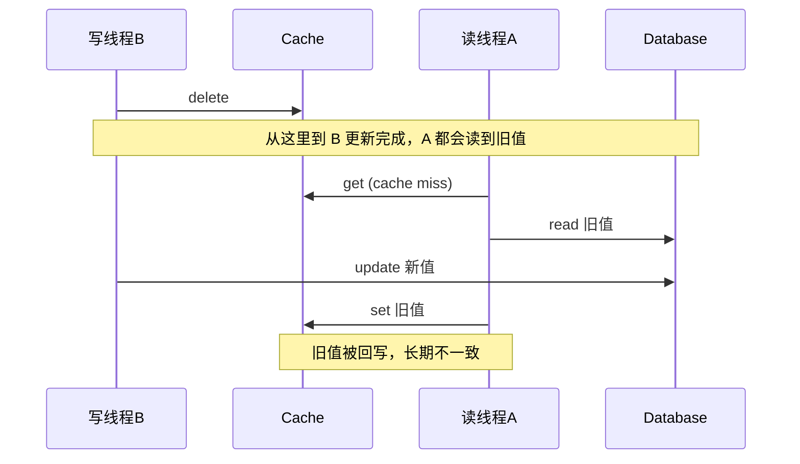

---
tags:
  - redis
  - 缓存
  - 一致性
  - Cache Aside
  - 面试
created: 2026-07-31
updated: 2026-07-31
source: [[数据库和缓存如何保证一致性？]]
---

# Cache Aside 写策略满分拆解

> 核心判断：两种策略**都有**不一致的可能，区别只在触发概率。

---

## 一、两种策略的"出问题场景"

### 策略一：先更新数据库，再删除缓存

正常不出问题，唯一出问题的极端时序：



出错的前提：**A 的 set cache 必须发生在 B 的 delete cache 之后**。

时间条件展开：要出错需要 `t_read(A 读 DB 的耗时) > t_write(B 写 DB 的耗时)`。读 DB 通常比写 DB 快（写有 redo/undo log、索引维护、刷盘等开销），所以这个不等式**几乎天然不成立**。

> **"窗口窄"的真正原因**：不是"微秒级时间窗口"，而是"读 DB 慢于写 DB"这个条件本身几乎不成立。

### 策略二：先删除缓存，再更新数据库

出问题轻松得多：



不一致窗口：**"B 删缓存" → "B 更新 DB 完成"**，大小约等于一次 DB 写的耗时。读线程落入这个窗口非常容易，且回写旧值后会造成**长期不一致**（直到下次缓存失效或下次写）。

> **"窗口宽"的原因**：窗口大小约等于一次 DB 写的耗时，且读线程极易命中。

### 对比总结

| 维度 | 先更新 DB，再删除缓存 | 先删除缓存，再更新 DB |
|:----:|:----:|:----:|
| 出错前提 | 读 DB 慢于写 DB（几乎不成立） | 读线程落在删缓存→更新DB窗口内（极易命中） |
| 不一致窗口 | 极窄（几乎不触发） | 宽（约等于一次 DB 写耗时） |
| 不一致持续时间 | 极短（下次读即自愈） | 长期（直到缓存失效） |
| 实际概率 | 极低 | 高 |

---

## 二、为什么是"删除"而不是"更新"缓存？

这是面试官最爱的追问，三个理由：

### 1. 并发安全（最关键）

如果是"更新缓存"，两个写线程并发时会出现 A 先更新 DB、B 后更新 DB，但 B 先更新缓存、A 后更新缓存的乱序，导致缓存存的是旧值。**删除是幂等操作，乱序执行不会产生脏数据。**

### 2. 懒加载省资源

很多缓存项更新后根本没人读，提前更新是浪费；删除后等真正有读请求时再回源加载，更经济。这是 **Lazy Loading** 思想的直接应用。

### 3. 计算成本低

有些缓存值是聚合/计算得来的（如商品详情关联多张表），更新需要重算，直接删掉重建更简单。

---

## 三、删缓存失败怎么办？——失败补偿

先更新 DB 再删缓存，如果**删缓存这一步失败了**，缓存就会一直留着旧值。

### 方案 1：消息队列重试

```
更新 DB → 成功 → 投递"删除缓存"消息到 MQ → 消费者执行删除
                    ↓ 失败
                  MQ 自动重试（指数退避）
```

- 优点：实现简单，保证最终一致
- 缺点：代码入侵性强，需改造业务代码

### 方案 2：订阅 MySQL binlog（推荐）

```
更新 DB → 产生 binlog → Canal 订阅 → 解析 → 异步删除缓存
```

Canal 伪装成 MySQL 从节点，接收主节点推送的 binlog，解析后供下游消费。

- 优点：与业务代码解耦，天然可靠
- 缺点：引入组件多，运维成本高
- 注意：**必须删除缓存成功后再回 ACK**，否则提前 ACK 会导致消息丢失、无法重试

**工程实践**：两者常组合使用——Canal + MQ + 重试 + ACK，构成完整的异步删除链路。

---

## 四、为什么不能"先更新缓存，再更新 DB"？

这个方案最差，一票否决。两个原因：

1. **缓存成功但 DB 失败时无纠正**：缓存是新值、DB 是旧值，没有任何后续操作能修正
2. **并发乱序**：与"更新缓存"同理，两个写线程并发时仍会出现乱序

---

## 五、延迟双删——先删方案的补救

针对"先删除缓存，再更新 DB"方案的不一致问题：

```
# 第一次删除（立即）
redis.delKey(X)
# 更新 DB
db.update(X)
# 睡眠（覆盖读线程的读+回写时间）
Thread.sleep(N)
# 第二次删除（兜底）
redis.delKey(X)
```

睡眠时间需大于读线程"从 DB 读取 + 写入缓存"的总耗时。实际中很难精确评估，只是**尽可能**保证一致性，极端场景下仍可能不一致。

---

## 六、满分回答框架

面试中可以这样组织，逻辑层层递进：

1. **结论先行**：推荐先更新 DB 再删缓存，核心是**不一致概率最低**。
2. **解释为什么概率低**：会出错的前置条件是"读 DB 慢于写 DB"，而读天然快于写，条件几乎不成立。
3. **对比反方案**：先删缓存再更新 DB，不一致窗口宽（约等于一次 DB 写），读线程极易命中，且造成长期不一致。
4. **为什么用删不用更新**：并发安全（幂等）+ 懒加载（Lazy Loading）+ 计算成本低。
5. **兜底机制**：删缓存失败的补偿（MQ 重试 / binlog 订阅），以及先删方案对应的延迟双删。

---

## 关联知识点

- [[数据库和缓存如何保证一致性？]] — Cache Aside 策略基础介绍
- [[什么是缓存雪崩、击穿、穿透？]] — 三大缓存问题及对策
- [[redis八股]] — Redis 核心八股总览
