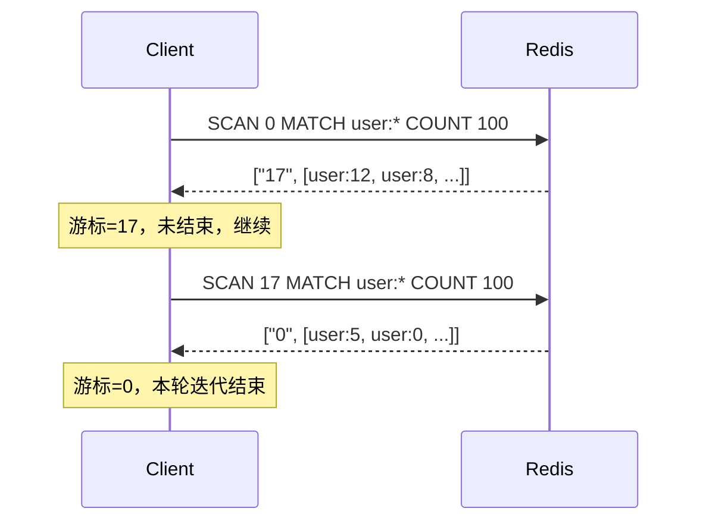

---
tags:
  - redis
  - SCAN
  - 遍历
  - 哈希表
created: 2026-07-28
updated: 2026-07-28
source:
---

# SCAN 命令原理详解

> SCAN — Cursor-based incremental iterator（基于游标的渐进式迭代器）

---

## SCAN 基础

### 为什么需要 SCAN

Redis 处理命令是单线程的。`KEYS pattern` 会一次性遍历整个键空间，时间复杂度 O(N)。当库里有几百万个 key 时，`KEYS` 可能让主线程阻塞数十毫秒甚至更久，期间所有其他命令都被挂起，在高并发下容易引发请求堆积、超时乃至雪崩。因此生产环境通常禁止 `KEYS`，甚至通过 `rename-command KEYS ""` 直接屏蔽掉它。

`SCAN` 就是为解决这个痛点而生的"渐进式 KEYS"。它同样要做 O(N) 的全量遍历，但把工作切成很多小份，每次只处理一小批就返回，把控制权交还给事件循环去处理其他命令，从而不长时间阻塞主线程。

> [!info]- 什么是事件循环（Event Loop）
> Redis 的核心处理逻辑跑在一个单线程事件循环里，大致长这样：
>
> ```
> forever:
>   1. 从 epoll/kqueue 获取"哪些 socket 有数据可读/可写"
>   2. 处理已就绪的 socket（读请求、写响应）
>   3. 处理已到期的定时任务（定期删除、持久化子进程通信等）
>   4. 回到第 1 步，继续循环
> ```
>
> 正常情况下，Redis 处理一条命令（如 `SET key value`）是**微秒级**的，处理完立即回到事件循环处理下一个请求。但 `KEYS *` 要遍历几百万个 key，可能要花**几十毫秒**——在这段时间里，事件循环被独占，其他客户端的读写请求全部排队等待，这就是"阻塞"。
>
> `SCAN` 的做法是：每次只处理一小批桶（由 `COUNT` 控制），处理完立即返回给客户端，把控制权交回事件循环。客户端拿到结果后，再发一条 `SCAN` 继续下一批。如此往复，直到游标为 0。
>
> 类比：`KEYS` 像一口气把整个仓库的货物全点一遍才出去——门卫在此期间不让任何人进出；`SCAN` 像每次点 100 件就出去喘口气，让门卫先处理其他人的事，下次再来点下一批。
>
> 代价是总遍历时间变长（多了多次客户端-服务器往返），但主线程每次只被占一小会儿，不会影响其他请求。

### 基本语法与参数

```
SCAN cursor [MATCH pattern] [COUNT count] [TYPE type]
```

- **cursor**（游标）：第一次传 `0` 表示开启新一轮迭代；命令返回的第一个元素就是下一次要用的游标；当返回游标为 `0` 时，表示本轮迭代结束。
- **MATCH pattern**：glob 风格的通配模式，如 `user:*`。注意它是在"取出元素之后、返回客户端之前"做的过滤，所以即便结果为空也不代表遍历结束。
- **COUNT count**：给服务器的"工作提示"，约等于每次扫描多少个哈希桶，而非严格限制返回多少个 key。默认 10，生产环境建议设 100～1000，甚至到 1 万。
- **TYPE type**（Redis 6.0+）：只返回指定数据类型的 key。

返回值是一个二元数组：`[next_cursor, [key1, key2, ...]]`。下面是一次典型迭代的示意：



同一个家族还有 `SSCAN`（遍历集合）、`HSCAN`（遍历哈希 field）、`ZSCAN`（遍历有序集合），用法一致，只是第一个参数是具体 key 名。

### 使用时的几个关键约束

理解这几条，才能正确使用 SCAN，也是面试常考的"坑点"：

1. **结束条件只看游标是否为 0**，不能凭"返回结果为空"判断结束。因为 MATCH 过滤后某次可能返回空数组，但游标不是 0，说明后面还有桶没扫。
2. **结果可能重复**，客户端必须自行去重。原因是 SCAN 采用的遍历顺序与 rehash 兼容有关，缩容时会重复访问某些桶。
3. **遍历期间数据若被修改，改动后的 key 可能被扫到也可能扫不到**，SCAN 只对返回元素提供"有限保证"。
4. **COUNT 只是提示**，实际返回数量可多可少。遍历大哈希表时通常接近 COUNT；但遍历小集合（intset/ziplist 编码）时，SCAN 会在一次调用里返回全部元素，无视 COUNT。

---

## 底层原理

### SCAN 遍历的是哈希桶

Redis 的全局键空间底层是一个字典（哈希表），结构是"数组 + 链表"，数组大小为 $2^n$，扩容时长度翻倍。SCAN 实际上是在遍历这个一维数组的每个桶（bucket），每次返回的游标就是桶的下标。`COUNT` 限制的是"每次扫多少个桶"，而每个桶上挂的链表长度不同，所以每次返回的 key 数量并不固定。

### 逆二进制迭代法：为什么游标顺序是 0→4→2→6→1→5→3→7

SCAN 是增量迭代：每次调用返回一批 key 和一个不透明的 `cursor`，客户端把 `cursor` 再传回来继续，直到返回 `0` 表示结束。最朴素的想法是让游标就是个普通计数器 `0,1,2,...,7`。但 Redis 的字典在 rehash 时大小会变（比如 4↔8 个桶），两次 SCAN 之间表一旦扩容或缩容，普通计数就会"对不上号"——可能漏桶，也可能把已经看过的桶再扫一遍。

所以 Redis 用了**反转二进制计数**（也叫"高位加一"）。前进公式是：

$$\text{cursor}_{\text{next}} = \operatorname{rev}(\operatorname{rev}(\text{cursor}) + 1)$$

即：先把游标的二进制位反转，加 1，再反转回来。效果是"高位变得最快、低位变得最慢"。以 size=8 为例，访问顺序不是 `0,1,2,3,4,5,6,7`，而是：

```
0, 4, 2, 6, 1, 5, 3, 7
```

### 真正的关键：嵌套配对

这个奇怪顺序的妙处在于一个递归性质：**在 size=2N 的顺序里，桶 b 和 b+N 总是相邻地被连续访问，组成一对；把每一对折叠成一个桶，正好得到 size=N 的顺序。**

- size=8：`0 4 | 2 6 | 1 5 | 3 7` → 折叠得 size=4：`0 2 1 3`
- size=4：`0 2 | 1 3` → 折叠得 size=2：`0 1`

也就是说，大小不同的表，访问顺序在"组"的层面是自洽的。这正是下面一切保证的根基。

### 扩容（小→大）：不重不漏

假设 size=4 扫到一半，已访问桶 0，随后表扩成 size=8。size=4 的桶 0 在 size=8 里分裂成 `{0, 4}`——而在扩容那一刻，这两个桶的元素本来就都装在旧的桶 0 里，**都已经看过**。由于逆二进制顺序下 `{0,4}` 恰是序列开头相邻的一对，游标正好指向"这一对之后"，于是 0 和 4 都被整对跳过：已访问的不被错误重访，新分裂出的桶 4 也不会漏。

### 缩容（大→小）：必要的重复 = 重复的根源

反过来，size=8 扫到一半（已访问桶 0，即对 `{0,4}` 的一半），表缩成 size=4。`{0,4}` 合并回 size=4 的桶 0，但**桶 4 的元素还没访问过**，现在却落进了 size=4 的桶 0。为了不漏，size=4 必须重新访问桶 0，于是桶 0 里"已经看过的那一半"会被再看一次——这就是 SCAN 结果可能重复的来源。注意：这是"必要的"重复，代价是换来**绝不漏**。

Redis 官方对 SCAN 的保证正是这样两条：自始至终都在的元素一定会被返回（不漏）；但某个元素可能被返回不止一次（可重复）。

### 游标即全部状态

服务器不需要为"这是第几号迭代、扫到哪个桶"做任何簿记，全部进度都编码在游标里。后果很实际：迭代可随时中断、可同时并发开多个 SCAN、客户端崩了只要还留着 cursor 就能续上。这对单线程的 Redis 尤其重要——它不必为成千上万个并发迭代维护状态机。

---

## 结合面试题

### Q1：生产环境为什么用 SCAN 而不是 KEYS？

核心是"阻塞"与"渐进"的区别。`KEYS` 一次性返回所有匹配 key，期间主线程被独占；`SCAN` 分批返回，每批只占用很短时间，期间能穿插执行其他命令。在大 key 集合下，`KEYS` 可能阻塞数秒，`SCAN` 则不会。代价是 `SCAN` 总耗时会略长（多了多次交互开销），且结果可能重复需要去重。

| 维度 | KEYS | SCAN |
|:----:|:----:|:----:|
| 返回方式 | 一次性返回全部 | 基于游标分批返回 |
| 是否阻塞 | 长时间阻塞主线程 | 单次很短，可穿插其他命令 |
| 结果准确性 | 精确快照 | 可能重复/遗漏，需客户端去重 |
| 生产环境 | 应禁用 | 推荐使用 |
| 总耗时 | 较短（无多次交互） | 略长（多次往返） |

### Q2：SCAN 真的完全不阻塞吗？

严格说不是。SCAN 单次执行仍是 O(N)，N 是这次扫描的桶数。它不阻塞是因为每次只扫一小批（由 COUNT 控制）就返回，把长任务切成很多短任务。但如果把 COUNT 设得极大（接近总 key 数），SCAN 的单次耗时就会逼近 KEYS，也就失去了意义。所以 COUNT 要在"单次阻塞时间"和"总交互次数"间取舍：COUNT 越大总耗时越短，但单次阻塞越长；实测推荐 COUNT 在 1 万左右，边际收益开始递减。

### Q3：为什么 SCAN 结果可能重复？客户端怎么处理？

因为逆二进制迭代法在兼容 rehash（尤其缩容）时，会把某些桶"重复访问"。官方明确说同一个元素可能被返回多次，去重工作交由应用程序负责，建议只把结果用于幂等操作（比如重复 DEL 也没关系）。实现上通常用一个 `Set` 收集返回的 key。

### Q4：SCAN 遍历期间有 key 增删会怎样？

SCAN 不加锁、不快照，只提供"有限保证"：遍历过程中新增的 key 可能被扫到也可能扫不到，被删除的 key 可能不会被返回。这是渐进式迭代的固有代价——为了不阻塞，必须容忍数据集在迭代期间变化。大多数场景（如批量清理过期前缀 key）都能接受这种弱一致性。

### Q5：游标能不能当页码用？能不能用错误游标？

不能。游标不是递增的页码，它内部编码了 rehash 状态，必须严格用上一次返回的值。官方明确：只有两类合法游标——开新迭代的 `0`，和上一次返回的游标。传入负数、越界或随意构造的游标不会让服务器崩溃，但会产生未定义行为，SCAN 的保证（如不漏不重）将不再成立。

### Q6：如何用 SCAN 实现安全的批量删除？

典型做法是"SCAN + DEL"循环：用 `SCAN 0 MATCH prefix:* COUNT 1000` 找出匹配 key，再用 `DEL`（或异步 `UNLINK`）分批删除，避免一次性 DEL 大量 key 造成主线程阻塞。伪代码：

```
cursor = 0
repeat
    cursor, keys = SCAN cursor MATCH old:* COUNT 1000
    if keys: DEL keys   # 或 UNLINK keys
until cursor == 0
```

这种模式在生产环境清理大前缀 key、平滑迁移数据时很常用。

### Q7：如果数据集一直在增长，SCAN 能遍历完吗？

不一定。官方文档指出，SCAN 的算法只保证在"数据集大小有界"时迭代会终止。如果数据集增长速度比迭代速度还快，理论上可能永远也遍历不完。这虽然是极端情况，但它说明 SCAN 的终止保证是有前提的。

---

## 一句话总结（面试话术）

> SCAN 用逆二进制游标遍历哈希桶、把全量遍历切成渐进小份，换取不阻塞主线程，代价是弱一致性（可能重复、可能遗漏），需要在客户端做去重并容忍并发修改。核心要理解三个点：游标不是页码而是哈希桶下标、高位加一的逆二进制顺序是为了兼容 rehash（嵌套配对保证扩容不重不漏、缩容必要重复换来绝不漏）、COUNT 只是 hint 不是硬限制。

---

## 关联知识点

- [[SCAN命令查找大key详解]] — SCAN 在大 key 排查中的实际应用
- [[Redis 大 Key 对持久化有什么影响？]] — 大 Key 对 AOF/RDB 的阻塞影响
- [[Redis 常见数据类型和应用场景]] — 5 种基础类型的用途与命令
- [[redis八股]] — Redis 核心八股总览
