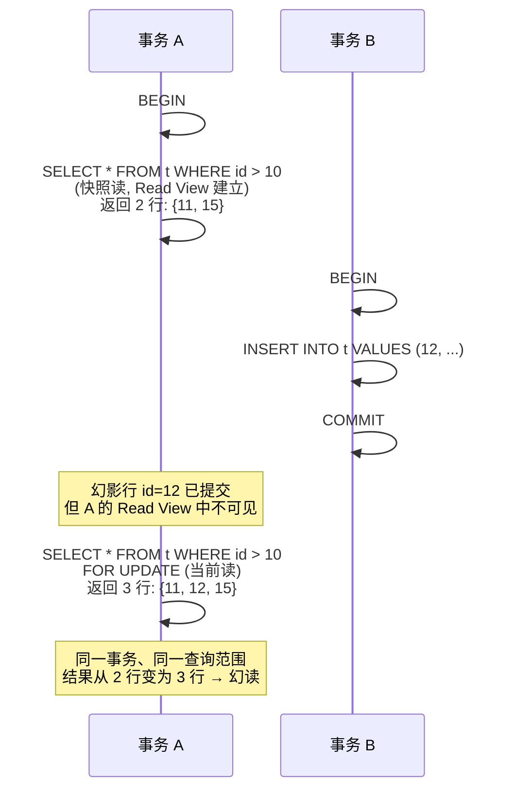

---
tags:
  - mysql
  - mvcc
  - 幻读
  - 间隙锁
created: 2026-06-18
updated: 2026-06-18
---
### **简单回答**

InnoDB 的可重复读通过 MVCC 保证**快照读**在同一事务中结果一致、通过间隙锁/Next-Key Lock 阻止其他事务向**当前读**扫描的范围插入新行——但这套机制只在"纯快照读"或"纯当前读"各自闭环时有效。一旦同一个事务中**混用快照读和当前读**，当前读会绕过 MVCC 读取最新已提交数据，从而看到快照读时还不存在的"幻影行"，幻读便由此产生。这正是"大多数场景避免、但未完全杜绝"的根本原因。

---

### **两套防幻读机制，各管一段**

InnoDB 在 RR（Repeatable Read）级别下并非依靠单一手段，而是用两套互补机制覆盖两类读取：

**MVCC 守住快照读**

当事务中第一次执行普通 `SELECT`（不加锁的"快照读"）时，InnoDB 基于当前活跃事务列表生成一个 **Read View（读视图）**。在 RR 级别下，这个 Read View 会在整个事务生命周期内复用——后续所有普通 `SELECT` 都参照同一份快照判断可见性。因此，只要你的事务只做快照读，无论其他事务如何插入提交，你看到的行集始终恒定，幻读不会发生。这套机制不依赖锁、不阻塞写入，是高并发下 RR 的主力防线。

**间隙锁 + Next-Key Lock 守住当前读**

对于 `SELECT ... FOR UPDATE`、`SELECT ... LOCK IN SHARE MODE`、`UPDATE`、`DELETE` 这类"当前读"，InnoDB 会读取最新已提交版本并加锁。为防止其他事务在扫描范围内部插入新行（这正是幻读的定义），InnoDB 采用 **Next-Key Lock**（记录锁 + 间隙锁的组合）锁住索引记录及其"前方的间隙"。例如对 `id > 10` 的范围查询，不仅锁住已有记录，还锁住记录之间的空白间隙，使并发插入的事务被阻塞，直至当前事务提交释放锁后才能继续。这样，纯当前读场景下幻读也被挡在门外。

---

### **幻读的缝隙：快照读与当前读混用**

问题出在两套机制的**交接边界**上。MVCC 的 Read View 是在第一次快照读时建立的，此后冻结；而当前读每次都读最新版本，它不参照 Read View。这两套"时间基准"并不统一。

下面这个时序清晰地展示了幻读如何产生：



事务 A 先做快照读，看到 `{11, 15}` 两条；事务 B 此时插入并提交了 `id=12`；事务 A 随后做当前读（`FOR UPDATE`），当前读不走 MVCC、直接读取最新已提交数据，于是看到了刚被插入的 `id=12` 这条"幻影行"。**同一个事务、同一个查询条件，结果集行数发生了变化——这就是幻读，而 RR 并没有阻止它。**

本质原因在于：间隙锁只能阻止"当前读加锁之后"的并发插入，却无法回溯撤销"快照读与当前读之间"已经提交的插入。Read View 的快照与当前读的实时视图之间存在时间窗口，穿过这个窗口的已提交插入就是幻读的来源。

---

### **其他未能完全杜绝的边缘场景**

除上述主因外，还有几类情况可能让幻读穿透防线：

**间隙锁的覆盖取决于索引使用**。Next-Key Lock 依赖于索引来界定间隙范围。如果查询条件未命中合适的索引（例如全表扫描），InnoDB 会对所有行和所有间隙加锁——这虽然能防幻读，但并发性极差；反之，如果查询走了索引但范围界定不完全，某些间隙可能未被锁定，理论上存在并发插入的缝隙。

**唯一索引等值查询的退化**。当对唯一索引做等值查询且记录存在时，Next-Key Lock 会退化为记录锁（无需间隙锁），因为唯一约束本身就阻止了重复值插入。这在逻辑上是安全的，但如果后续同一事务改用范围查询做当前读，之前未加锁的间隙就可能已被人插入。

**不同隔离级别切换或会话配置差异**。若实例层面将间隙锁关闭（如 `innodb_locks_unsafe_for_binlog` 旧参数，或会话设为 READ COMMITTED），RR 的间隙锁防线将失效。此外，早期 MySQL 版本中存在过间隙锁在特定条件下的实现缺陷，虽已修复，但也说明该机制并非"数学证明级"的绝对保证。

---

### **实践建议**

若业务逻辑要求**绝对杜绝幻读**（如库存对账、序列号审计等场景），最稳妥的做法是让事务中涉及范围一致性的所有读取统一使用**当前读**（`SELECT ... FOR UPDATE` 或 `LOCK IN SHARE MODE`），让间隙锁贯穿整个临界区。避免在同一事务中混用快照读与当前读，从根源上消除两套时间基准的冲突。这才是真正利用 InnoDB 的加锁机制来达成可串行化的幻读隔离效果。

---

## 间隙锁的细节

### 间隙锁加锁时机

间隙锁是在**当前读的语句执行时**才加上的，不是事务一开始就有。

```sql
-- 事务A
SELECT * FROM student WHERE age > 18;         
-- 普通快照读，不加任何锁，没有间隙锁

-- 事务B 此时插入 age=20 的记录并提交  ← 此时可以成功，因为没有间隙锁

-- 事务A
UPDATE student SET name='x' WHERE age > 18;   
-- 当前读，此时才加间隙锁 + 行锁
-- 但已经晚了，事务B的数据已经插进来了

SELECT * FROM student WHERE age > 18;         -- 看到幻行
```

如果想一开始就防住，事务A 开头就用当前读：

```sql
-- 事务A
SELECT * FROM student WHERE age > 18 FOR UPDATE;
-- 立刻加上间隙锁，锁住 age>18 的范围

-- 事务B 想插入 age=20 ← 阻塞！插不进来

-- 事务A 后续无论怎么读，都不会出现幻行
```

| 时机 | 是否有间隙锁 |
|---|---|
| 事务开始时 | ❌ |
| 执行普通 SELECT | ❌ |
| 执行 SELECT FOR UPDATE / UPDATE / DELETE | ✅ 此时才加 |

所以间隙锁是**按需加锁**，不是事务级别的自动保护。

---

### 什么时候释放间隙锁？

间隙锁（包括 InnoDB 中的所有行锁、下一个键锁 Next-Key Lock）都是在当前事务结束（提交 `COMMIT` 或回滚 `ROLLBACK`）时才统一释放的。

---

## 关联知识点

- [[MVCC 多版本并发控制详解]]
- [[InnoDB 锁机制详解]]
- [[MySQL 事务隔离级别详解]]
- [[当前读与快照读]]

---
# 🎯 面试题 · 2026-08-01 14:49（基于《为什么MVCC无法完全避免幻读现象》）

> [!question]- 面试题 1：InnoDB 在可重复读级别下主要通过哪两套机制来防止幻读？为什么即便如此，幻读仍然无法完全避免？
> InnoDB 在可重复读级别下主要通过两套互补机制来防御幻读。第一套是 MVCC，它负责保护快照读，事务第一次执行普通 SELECT 时生成 Read View 并在整个生命周期复用，确保看到的行集恒定。第二套是间隙锁和 Next-Key Lock，它们负责保护当前读，通过锁住索引记录及其前方间隙，阻止其他事务在扫描范围内插入新行。然而，这两套机制的时间基准并不统一，导致幻读无法完全杜绝。根本原因在于同一事务中混用了快照读和当前读。快照读基于冻结的 Read View 不可见新数据，而当前读直接读取最新已提交数据。如果另一个事务在这两次读取之间插入了数据并提交，当前读就会看到这条“幻影行”，造成同一个查询条件结果集行数变化。

> [!question]- 面试题 2：间隙锁（Gap Lock）是在什么时机被加上的？如果在事务开始阶段只执行普通查询，后续再执行更新操作，会出现什么问题？
> 间隙锁并非在事务开始时自动加上，而是在执行当前读的语句时才按需添加，例如执行 SELECT FOR UPDATE、UPDATE 或 DELETE 时。这意味着如果事务一开始只执行普通 SELECT（快照读），此时没有任何间隙锁，其他事务完全可以向该范围插入数据并提交。当该事务随后执行更新操作（如 `UPDATE ... WHERE age > 18`）时，虽然间隙锁此刻才被加上，但之前 B 的插入已经生效且无法被撤销。UPDATE 语句本身会触发一次**当前读**来定位要修改的行，当前读不走 MVCC，直接读取最新已提交数据，因此 A 在 UPDATE 的当前读中就能看到 B 已提交的幻影行——这就是典型的幻读。所有的间隙锁、行锁以及 Next-Key Lock 都会在当前事务结束（执行 COMMIT 或 ROLLBACK）时统一释放。

> [!question]- 面试题 3：如果业务场景要求绝对杜绝幻读，应该如何设计事务中的读取方式？此外，还有哪些边缘情况可能影响间隙锁的防幻读效果？
> 若业务逻辑要求绝对杜绝幻读，最稳妥的做法是让事务中涉及范围一致性的所有读取统一使用当前读，例如全程使用 SELECT FOR UPDATE 或 LOCK IN SHARE MODE。这样可以利用间隙锁贯穿整个临界区，从根源上消除快照读与当前读时间基准冲突的问题。此外，还需要注意几个边缘场景：间隙锁的覆盖依赖于索引，如果查询未命中合适索引导致全表扫描，虽能防幻读但并发性极差。若走了索引但范围界定不完全，可能存在未被锁定的间隙。另外，对唯一索引做等值查询且记录存在时，Next-Key Lock 会退化为记录锁，如果后续改用范围查询，之前未加锁的间隙就可能已被人插入。


[[间隙锁防幻读的边缘场景]]