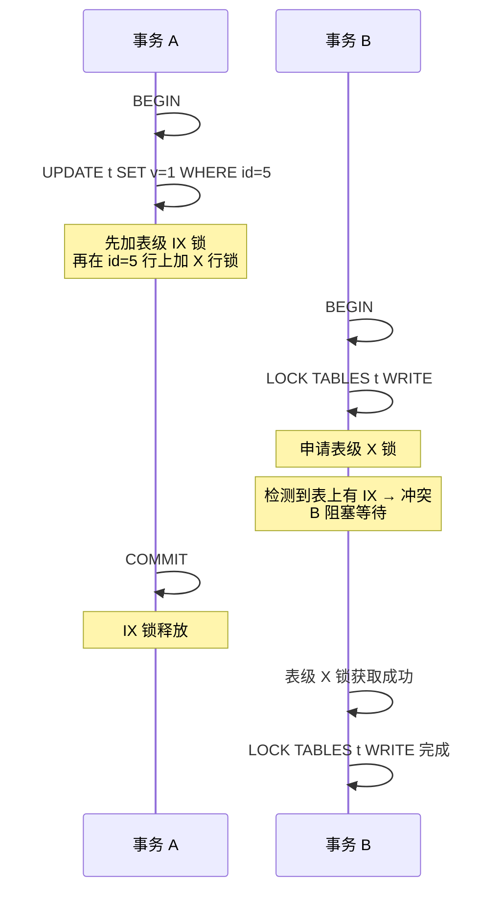

---
tags:
  - mysql
  - 锁
  - 意向锁
created: 2026-10-25
updated: 2026-10-25
source: 合并自《意向锁的意义》《意向锁与行级锁的冲突关系》《意向锁为什么不是独占行锁》《共享锁与独占锁的对应关系》《插入意向锁的意义》
---

# MySQL 意向锁详解

> 2026-10-25 把散落的五篇意向锁笔记合并成一页（原共 298 行），重复段落只留一处，原文的信息量与图示全部保留。
> 一句话结论：**意向锁之间不冲突，其余都是读写冲突、读读不冲突**；它存在的唯一目的，是让表锁能 O(1) 判断表内有没有行锁。

---

## 一、是什么

InnoDB 使用**多粒度锁（Multi-Granularity Locking）**，意向锁是**表级锁**，用于表达"事务打算在表内某些行上加共享 / 排他锁"，从而让表级锁申请时无需遍历所有行就能判断冲突。

| 锁 | 符号 | 说明 |
|---|---|---|
| 共享锁（行级） | S | `SELECT ... FOR SHARE`，也叫读锁 |
| 排他锁（行级） | X | `SELECT ... FOR UPDATE` / DML，也叫写锁、独占锁 |
| 意向共享锁（表级） | IS | 加行级 S 锁前，先在表上加 IS，自动加 |
| 意向排他锁（表级） | IX | 加行级 X 锁前，先在表上加 IX，自动加 |

---

## 二、为什么需要：用 O(1) 的表级检查替代 O(n) 的逐行扫描

```
事务A：对某几行加了行级独占锁（X锁）
事务B：想加 lock tables ... write（独占表锁）
```

事务B 加独占表锁之前，需要判断：**表里有没有行已经被加了锁？**

- **没有意向锁**：只能遍历所有行，逐行检查
- **有意向锁**：事务A 加行锁时已经顺手在表上打了 IX 标记，事务B 直接看表上有没有 IX，有就阻塞，O(1) 搞定

在百万行级别的表上，这个差别是致命的：逐行扫描的代价极高，而看一个表级标记是一步判断。意向锁在这里充当了行锁的"**哨兵**"。

### 为什么不是「独占行锁」

意向锁解决的问题是：

> **表锁** 和 **行锁** 之间如何高效判断冲突

如果改成"独占行锁"，逻辑就变成"加行锁前先检查行锁"，那意向锁就没有存在的意义了——**意向锁本身就是为表锁服务的快捷标记**。

---

## 三、行级锁与表级意向锁的对应关系

```
行级锁
├── 共享锁 S锁    → 加之前，表上先打 意向共享锁 IS
└── 独占锁 X锁    → 加之前，表上先打 意向独占锁 IX

表级锁
├── 意向共享锁 IS  ← 自动加，配合行级S锁
├── 意向独占锁 IX  ← 自动加，配合行级X锁
├── 共享表锁       lock tables ... read
└── 独占表锁       lock tables ... write
```

行级锁的两种，以及各自的加锁方式：

| 锁 | 别名 | 加锁方式 |
|---|---|---|
| 共享锁（S锁） | 读锁 | `SELECT ... LOCK IN SHARE MODE` |
| 独占锁（X锁） | 排他锁 / 写锁 | `SELECT ... FOR UPDATE` 或 `UPDATE` / `DELETE` |

**意向锁与行级锁的关系**：意向锁本身是表级的，它与行级锁**不直接冲突**，两者处于不同粒度层次。真正的冲突发生在**同一粒度**内：

```
事务 A 持有某行的 X 锁
    ↓ 同时在表上持有 IX（意向排他锁）

事务 B 想加全表 S 锁（LOCK TABLE ... READ）
    → 发现表上有 IX → 冲突，阻塞
    → 无需检查每一行是否有 X 锁
```

行级锁之间的兼容性（同一行）：

![[Pasted image 20260529123309.png]]

---

## 四、冲突矩阵

### 完整矩阵

InnoDB 中四类表级锁的兼容关系如下：

| 请求锁 \ 已持有锁 | IS | IX | S | X |
|:---:|:---:|:---:|:---:|:---:|
| **IS** | 兼容 | 兼容 | 兼容 | 冲突 |
| **IX** | 兼容 | 兼容 | 冲突 | 冲突 |
| **S** | 兼容 | 冲突 | 兼容 | 冲突 |
| **X** | 冲突 | 冲突 | 冲突 | 冲突 |

行列读法：**行**是"新请求的锁"，**列**是"已持有的锁"，交叉处表示两者能否共存。

同样的关系用简表看更直观（只列意向锁与表锁）：

| | IS | IX | 共享表锁 | 独占表锁 |
|---|---|---|---|---|
| **IS** | ✅ | ✅ | ✅ | ❌ |
| **IX** | ✅ | ✅ | ❌ | ❌ |

![[Pasted image 20260529123259.png]]

> 意向锁之间**永远兼容**（IS/IX 互相不冲突），它们只与**表级** S/X 冲突。
> 一句话总结：意向锁之间不冲突，其他的都是读写冲突，读读不冲突。

### 逐条拆解

**意向锁之间：全部兼容**

IS 与 IS、IS 与 IX、IX 与 IX 三种组合都不冲突。原因在于意向锁只是"声明"——事务打算在表中某些行上加行锁，它并不真正锁住任何行或表。两个事务完全可以同时打算在同一张表上加行锁，只要它们锁的是不同的行（行级锁之间互不干扰），意向锁层面就不需要互相阻塞。这保证了细粒度锁不会因为表级的意向声明而互相牵制。

**意向锁 vs 共享表锁（S）：IS 兼容，IX 冲突**

当事务想加 S 表锁时（如 `LOCK TABLES ... READ`），它与已持有的 IS 兼容——因为 IS 说明另一个事务只是在行级别加了共享锁，行级 S 锁与表级 S 锁并不矛盾（都是"读"意图）。但 S 与 IX 冲突——IX 表示另一个事务打算在某些行上加排他锁（写操作），而表级 S 锁要求整个表可读，两者语义对立，必须等待 IX 对应事务释放。

**意向锁 vs 排他表锁（X）：全部冲突**

无论 IS 还是 IX，只要表上已有意向锁，新的 X 表锁请求就会被阻塞，反之亦然。因为 X 表锁意味着独占整张表（读写全包），而意向锁代表有事务正在操作表内行数据，两者的排他性天然对立。

### 冲突关系的底层逻辑

意向锁的核心价值在于**快速冲突检测**，而非真正锁定数据。

**没有意向锁时的困境**：假设事务 A 对表 T 中某行加了行级 X 锁，事务 B 想对整张表加 X 表锁。InnoDB 要判断能否授予表锁，就必须扫描表 T 的所有行锁——逐行检查是否有冲突。这在百万行级别的表上代价极高。

**有意向锁后的解法**：事务 A 在加行级 X 锁之前，先在表级加一个 IX 锁（轻量的"意向声明"，不阻塞行操作）。事务 B 申请表级 X 锁时，只需检查表上是否存在 IX 锁——一步判断即可发现冲突，立即阻塞。意向锁充当了行锁的"哨兵"，用 O(1) 的表级检查替代了 O(n) 的逐行扫描。

这个设计也解释了冲突矩阵的形状：**意向锁与意向锁之间不冲突**（都是哨兵，不影响彼此），**意向锁与表锁的冲突取决于"写意图"是否对立**——IX（排他意图）与 S（共享表锁）冲突，而 IS（共享意图）与 S 兼容；对 X 表锁而言，任何行操作意图都与之对立，因此一律冲突。

---

## 五、加锁流程与典型场景

**加锁协议就两条**：

```
加行级 S 锁：先获取表级 IS → 再获取行级 S
加行级 X 锁：先获取表级 IX → 再获取行级 X
```

意向锁的作用是**协议桥梁**，保证表级操作（如 `LOCK TABLE`、DDL）能快速判断是否与行级操作冲突，而不用扫描全表行锁。

**场景 1：DDL 与 DML 并发**

```
事务 A：UPDATE t SET ... WHERE id=1   → 表上加 IX，行上加 X
事务 B：ALTER TABLE t ADD COLUMN ...  → 需要表级 X 锁，发现 IX → 阻塞
```

**场景 2：全表读锁与行写锁并发**

```
事务 A：SELECT ... FOR UPDATE（某行） → 表上加 IX
事务 B：LOCK TABLE t READ            → 需要表级 S 锁，发现 IX → 阻塞
```

**场景 3：两个行级写操作（不冲突）**

```
事务 A：UPDATE t WHERE id=1  → IX + 行X(id=1)
事务 B：UPDATE t WHERE id=2  → IX + 行X(id=2)
→ 表上 IX 与 IX 兼容，行上锁不同行 → 互不阻塞
```

### 一个完整时序



事务 A 对 `id=5` 加行锁前先放了 IX 哨兵；事务 B 的 `LOCK TABLES t WRITE` 申请 X 表锁，发现 IX 存在即被阻塞，无需扫描表中数百万行去寻找那个唯一的行锁。事务 A 提交释放 IX 后，B 才获锁继续。这正是意向锁机制高效运作的缩影。

### 核心记忆点

- 意向锁 **IS/IX 互相兼容**，它们的存在只是为了阻止粗粒度的表级 S/X 锁
- 行级锁冲突只看**同一行**：S/X、X/X 冲突，S/S 兼容
- 意向锁不与行级锁直接比较，两者粒度不同，通过"先表后行"的协议配合使用

---

## 六、插入意向锁：为什么 INSERT 也要一把表级意向锁

这里有个乍看很怪的疑问——插入意向锁确实在"已经被间隙锁阻塞"的前提下才出现，那为什么还要专门设计这一层锁？直接让 INSERT 排队等不就行了？

核心答案：**插入意向锁是为了抢间隙锁和 Insert 之间的"十字路口"调度权。**

想清楚三个场景：

**场景一：没有插入意向锁会怎样？**

假设事务 A 持有 (5, 10) 的间隙锁。事务 B 想 `INSERT INTO t VALUES (7)`，它没有显式锁标记，只能被动等在间隙锁释放。这时候事务 C 来了，也想给 (5, 10) 加一个间隙锁。锁系统一看间隙锁——跟事务 A 的间隙锁冲突吗？不冲突，间隙锁之间是兼容的。那么 C 的间隙锁就直接加上了。

A 提交，释放间隙锁。现在 B 能插了吗？不能——C 持有间隙锁，B 还是被阻塞（INSERT 与任何间隙锁冲突）。B 可能一直被后续新来的间隙锁插队，永远无法插入——这就是**活锁（livelock）**。

**场景二：有插入意向锁会怎样？**

A 持有 (5, 10) 间隙锁。B 执行 INSERT，先申请插入意向锁——与 A 的间隙锁冲突，B 进入等待队列。现在 C 来了，也想加间隙锁——C 的间隙锁与 B 的插入意向锁**冲突**，C 被阻塞，只能排在 B 后面。

A 提交 → B 的插入意向锁获得 → B 完成插入 → C 的间隙锁获得。

**所以插入意向锁的真正意义是：在间隙锁和并发 INSERT 之间充当"红绿灯"。** 它把一个被动的、没有话语权的等待 INSERT 变成了锁队列中一个有明确身份的参与者，让新来的间隙锁申请者不能插队。说白了，它保障了"先来先服务"——Insert 事务的公平调度，防止活锁。

它不是为"告知别人"而存在的，而是为了让锁系统在**间隙锁兼容（间隙锁与间隙锁不互斥）但 Insert 与间隙锁冲突**这种不对称兼容关系下，维持合理的等锁顺序。

### 配套面试题

> [!question]- 面试题 1：插入意向锁的核心设计意义是什么？为什么不能直接让 INSERT 事务被动等待间隙锁释放？
> 插入意向锁的核心设计目的，是为了解决间隙锁与并发 INSERT 操作之间的调度公平性问题，防止因锁竞争导致的活锁现象。其本质是在间隙锁相互兼容、但 INSERT 与间隙锁冲突这种不对称兼容关系下，充当一个"红绿灯"角色。如果没有它，INSERT 事务面对间隙锁时只能被动等待，没有话语权，容易被后续新申请的间隙锁插队；而有了插入意向锁，INSERT 就成为了锁队列中有明确身份的参与者，新来的间隙锁申请者会与之冲突并被阻塞。这保障了"先来先服务"的原则，让被阻塞的 INSERT 有机会在后续间隙锁之前完成操作，从而维持了合理的等锁顺序。

> [!question]- 面试题 2：请结合笔记中的场景一和场景二，解释插入意向锁是如何防止活锁发生的？
> 我们可以通过对比两个具体场景来说明。首先是无插入意向锁的情况：事务 A 持有 (5, 10) 间隙锁，事务 B 要插入 7 只能被动等待；此时事务 C 申请同样的间隙锁，因为间隙锁之间兼容，C 可以直接获得锁并排在 B 前面。当 A 提交释放后，B 依然被 C 阻塞，若不断有新间隙锁插入，B 将陷入活锁。其次是有插入意向锁的情况：B 在执行 INSERT 前先申请插入意向锁，这与 A 的间隙锁冲突，B 进入等待队列；此时 C 再来申请间隙锁，会与 B 的插入意向锁冲突，因此 C 被强制排在 B 后面。最终 A 提交后，B 优先获得锁完成插入，然后 C 才能获得间隙锁。通过这种机制，插入意向锁确保了 INSERT 事务不会被后续的间隙锁无限插队，有效避免了活锁风险。

---

## 关联知识点

- [[MySQL锁机制]] — 全局锁、表级锁（MDL / 意向锁 / AUTO-INC）、行级锁全景
- [[间隙锁防幻读的边缘场景]] — 间隙锁与 Next-Key Lock 的 8 类边缘场景
- [[INSERT...SELECT 间隙锁与死锁详解]] — 插入场景下的加锁范围与死锁
- [[怎么查MDL锁]] — 元数据锁的排查方法
