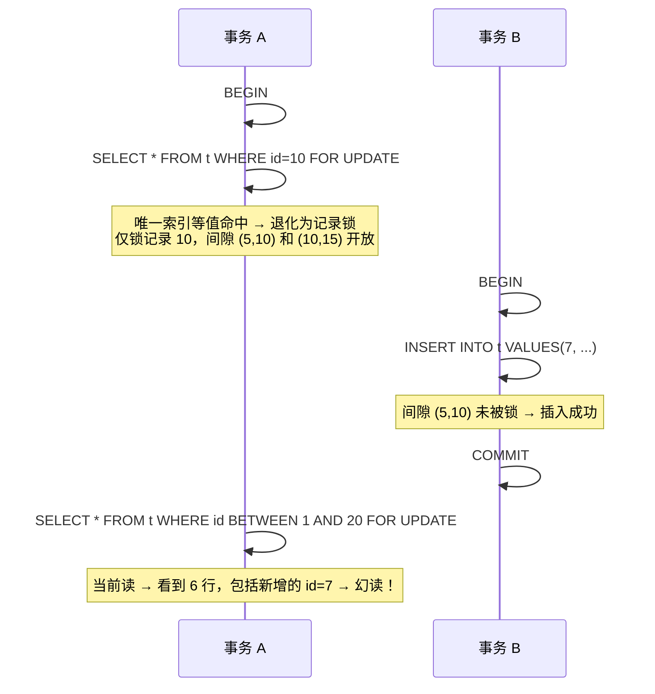

---
tags:
  - mysql
  - 间隙锁
  - 幻读
  - 边缘场景
created: 2026-08-01
updated: 2026-08-01
source: 基于《为什么MVCC无法完全避免幻读现象》面试题整理
---

## 绝对杜绝幻读的核心设计原则

业务若要求绝对杜绝幻读，必须保证事务中所有涉及范围一致性的读取统一走"当前读"路径——即全程使用 `SELECT ... FOR UPDATE` 或 `SELECT ... LOCK IN SHARE MODE`，让间隙锁贯穿整个临界区。根本原因在于 InnoDB 的 RR 隔离级别下存在两套读取基准：

**快照读**（普通 `SELECT`）依赖事务首次读取时建立的 Read View，此后该事务内的所有快照读都复用同一视图，只能看到该时刻之前已提交的数据版本。而**当前读**（`SELECT FOR UPDATE`、`UPDATE`、`DELETE` 等）始终读取最新已提交数据。一旦在同一事务中混用两者，时间基准的裂缝就会出现。

最典型的"幻读泄漏"场景是这样的：事务 A 先做一次快照读 `SELECT` 看到若干行，事务 B 随后插入一行并提交，事务 A 接着执行 `UPDATE ... WHERE` 语句——此时 `UPDATE` 是当前读，会扫描到事务 B 新插入的那行并修改它。一旦事务 A 修改了该行，该行的事务 ID 就被改写为事务 A 的 ID，后续事务 A 的快照读就会把这行也读出来，因为"自己修改过的行对自身可见"。幻读就这样通过 DML 语句从当前读的口径泄漏到了快照读的视图中。

因此，统一使用当前读的价值在于：所有读取操作既共享同一套"最新数据"口径，又通过间隙锁在物理层面封堵了其他事务向相关间隙插入新行的可能，从根源上消除了两套读取基准冲突的问题。

---

## 间隙锁防幻读的边缘场景

间隙锁的防幻读效果并非无条件的，它高度依赖索引结构和查询模式。

### 一、索引依赖：全表扫描的代价

间隙锁始终附着在索引记录上。如果查询的 `WHERE` 条件没有命中任何合适的索引，InnoDB 只能对聚簇索引做全表扫描，此时它会在每条记录上加 Next-Key Lock，等同于锁住整张表的所有间隙。这确实能杜绝幻读——任何位置的新行插入都会被阻塞——但并发性极差，整个事务期间实际上变成了表级排他锁，其他事务的任何插入操作都必须等待。

更隐蔽的问题在于索引选择是优化器层面的决策。同一句 SQL 在不同数据分布下可能走索引也可能不走索引，导致同一业务逻辑在不同环境下表现截然不同的锁行为。如果依赖间隙锁做正确性保障，建议通过 `FORCE INDEX` 或确保统计信息准确来锁定执行计划。

### 二、Next-Key Lock 的退化规则

这是理解间隙锁覆盖范围的关键。InnoDB 默认使用 Next-Key Lock（记录锁 + 前方间隙锁），但在特定条件下会发生退化：

| 查询条件 | 索引类型 | 记录是否存在 | 实际加锁类型 | 间隙是否被保护 |
|---|---|---|---|---|
| 等值查询 | 唯一索引 | 存在 | 退化为记录锁 | 否，相邻间隙开放 |
| 等值查询 | 唯一索引 | 不存在 | 退化为间隙锁 | 是，锁定目标间隙 |
| 等值查询 | 非唯一索引 | 存在 | Next-Key Lock + 向后扫描至首个不匹配记录 | 是，且覆盖范围扩大 |
| 范围查询 | 任意索引 | — | Next-Key Lock | 是，但受边界定义影响 |

唯一索引等值查询命中记录时的退化，是防幻读最危险的盲区，下面单独展开。

### 三、退化陷阱：等值查询到范围查询的切换

假设有表 `t`，唯一索引列 `id` 上已有记录 `1, 5, 10, 15, 20`，执行以下操作：



问题的本质是：第一次等值查询只为命中记录加了记录锁，两侧间隙完全开放。事务 B 趁机在间隙中插入了新行。当事务 A 后续改用范围查询时，之前未加锁的间隙已被侵入，幻读已经发生且无法回溯。

这个场景的教训是：如果事务后续可能涉及范围查询，第一次加锁就应该用范围谓词来覆盖完整的逻辑边界，而不是用等值查询偷懒。例如直接用 `WHERE id BETWEEN 1 AND 20 FOR UPDATE` 替代分步操作，让间隙锁从一开始就覆盖整个目标区间。

### 四、LIMIT 子句导致的间隙截断

```sql
SELECT * FROM t WHERE age &gt; 20 FOR UPDATE LIMIT 5;
```

InnoDB 在扫描到第 5 条匹配记录后即停止，间隙锁只覆盖已扫描的那段索引区间。超出第 5 条匹配之后的所有间隙都未被锁定，其他事务可以在这些位置自由插入。如果业务逻辑的完整性依赖于"不存在 age &gt; 20 的记录"这类断言，`LIMIT` 的使用会在断言的尾部留下真实的缺口。

> [!warning] 原表述有误
> "业务断言"场景不自然——如果断言是"`age > 20` 的记录不存在"，加 LIMIT 本身就不合逻辑。LIMIT 截断间隙锁的真正合理触发场景是**分页消费/批量处理**，问题也出在**后续批次**而非当前批次。

**问题情境**：服务端定时任务逐批处理 `orders` 表中 `status = 'pending'` 的订单，每次取 100 条加锁处理：

```sql
-- 第1批
SELECT * FROM orders WHERE status = 'pending' FOR UPDATE LIMIT 100;
-- 业务逻辑：逐条处理这100条...
COMMIT;

-- 第2批
SELECT * FROM orders WHERE status = 'pending' FOR UPDATE LIMIT 100 OFFSET 100;
```

第一批处理完提交后，锁已释放。但第一批扫描到第 100 条后停止，`(100, 101)` 之间的间隙未被锁定。此时另一个事务可以往这个开放间隙插入一条新订单：

```
orders(status):  ... 第100条 | 新订单 | 第101条 | 第102条 | ... | 第200条 | ...
                              ^^^^^^^^^^^^  第一批锁覆盖    ^^^^^^^^^^^^  没锁！可插入
```

第二批 `OFFSET 100` 取到的是：新订单 + 第 101~199 条，原第 200 条被漏掉。

| 问题 | 机制 |
|------|------|
| **漏处理** | 新行插入把原有行往后挤，OFFSET 导致末尾行永远追不上 |
| **重复处理** | 如果同时有删除，OFFSET 跳过不同的行，某些行被两个批次各处理一次 |

**结论**：`LIMIT` + `OFFSET` 分页消费时，间隙锁无法保证批次间数据一致性。应改用基于主键的游标分页：`WHERE id &gt; 上次最大id LIMIT 100`。

### 五、非唯一索引等值查询的"向后多扫一行"

对非唯一索引做等值查询时，InnoDB 无法仅凭单条记录判断匹配范围的结束点，必须继续向后扫描到第一条不满足条件的记录才能停机。这意味着锁范围会比实际匹配集合多出一个 Next-Key Lock。例如 `age` 为非唯一索引，查询 `WHERE age = 25` 命中记录 `25, 25, 25, 28`，锁会覆盖最后一条 `25` 到 `28` 之间的间隙以及 `28` 的前方间隙。这个额外锁定虽然扩大了防幻读的范围，但也会意外阻塞与查询条件无关的插入操作，可能导致意料之外的锁等待甚至死锁。

### 六、锁等待超时的静默失败

当间隙锁的获取因冲突而等待，若等待时间超过 `innodb_lock_wait_timeout`（默认 50 秒），当前语句会被回滚，但**事务本身不会回滚**。事务继续执行后续语句，但那个本应被锁定的间隙实际上是开放的。此时后续的读取或写入操作可能看到本不该出现的行——一种被静默掩盖的幻读风险。在高并发场景下，务必在业务层捕获锁超时异常并主动回滚整个事务，而非仅重试单条语句。

### 七、隔离级别切换导致间隙锁整体失效

如果将隔离级别调整为 `READ COMMITTED`，InnoDB 会禁用间隙锁机制，所有等值查询退化为记录锁，范围查询也只锁实际命中的记录而非间隙。这意味着上述所有依赖间隙锁的防幻读策略在这一隔离级别下全部失效。`READ COMMITTED` 下不存在间隙锁这个武器，幻读是其设计预期的一部分。

### 八、INSERT ... SELECT 的隐式当前读

在 RR 隔离级别下，`INSERT ... SELECT` 语句中的 `SELECT` 部分默认走当前读并加 Next-Key Lock。这虽然能防止源表层面的幻读，但容易在源表上持有大范围间隙锁，是生产环境中死锁的高发场景。如果业务不需要源表的强一致性，可以考虑通过 `SET TRANSACTION ISOLATION LEVEL READ COMMITTED` 将该单语句降级，或使用逻辑层面的幂等校验替代锁保护。

详见 [[INSERT...SELECT 间隙锁与死锁详解]]。


---

## 总结

绝对杜绝幻读不仅是"用当前读"那么简单，还需要确保每一条当前读的谓词和索引路径能完整覆盖业务所需的逻辑区间，并且警惕锁退化、截断、超时等在运行时悄然打开的缺口。设计时应将"锁覆盖范围必须与业务一致性边界严格对齐"作为核心审查准则。

---

## 关联知识点

- [[为什么MVCC无法完全避免幻读现象]]
- [[InnoDB 锁机制详解]]
- [[MySQL 事务隔离级别详解]]
- [[当前读与快照读]]
