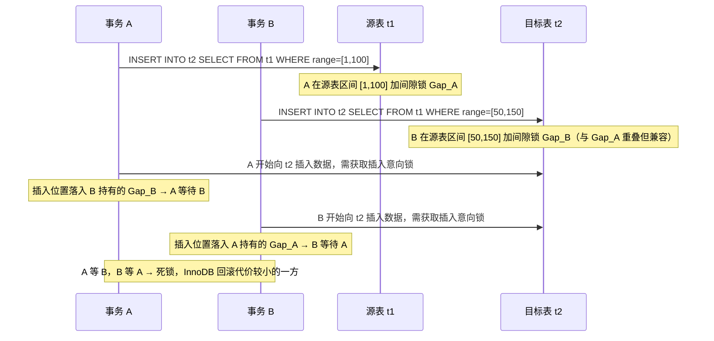

---
tags:
  - mysql
  - 间隙锁
  - 插入意向锁
  - 死锁
  - INSERT...SELECT
created: 2026-08-01
updated: 2026-08-01
source: 基于《间隙锁防幻读的边缘场景》第八节扩展
---

## 扫描范围即锁定范围，这是问题的根

`INSERT ... SELECT` 的锁来自它对源表的扫描过程。在 RR 隔离级别下，SELECT 部分作为当前读执行，InnoDB 对扫描路径上经过的**每一条索引记录**都加 Next-Key Lock（记录锁 + 前方间隙锁）。这意味着锁定的不是"最终匹配的结果集"，而是"扫描器走过的整个索引区间"。两者的差距正是"大范围"的来源。

---

### 一、范围扫描：锁的是整个扫描区间，而非匹配集合

假设源表 `t1` 上有二级索引 `idx_status`，记录分布为：

```
status: 1, 2, 2, 3, 5, 5, 7, 8
```

执行：

```sql
INSERT INTO t2 SELECT * FROM t1 WHERE status = 5;
```

InnoDB 通过 `idx_status` 定位到第一条 `status=5`，然后继续向后扫描，直到遇到第一条不满足条件的记录（`status=7`）才停机。整段扫描路径上加的锁是：

```
(3, 5 的第一条]     ← Next-Key（防止在 3 和 5 之间插入新的 5）
(5 的第一条, 5 的最后一条]   ← Next-Key
(5 的最后一条, 7)   ← Gap Lock（退化，不锁 7，但封锁间隙）
```

InnoDB 通过 B+ 树的二分查找直接空降到第一条 `status=5`，并不需要扫描前面的记录。但为了防止幻读，它必须封锁"这条 5 前面的间隙"——即 `3` 和第一条 `5` 之间的区间。这就是 Next-Key Lock `(3, 5]` 的来源。

接着沿索引链表向后扫描，第二条 `5` 被 Next-Key Lock 覆盖。遇到 `7` 时查找结束，但最后一条 `5` 和 `7` 之间的间隙必须被封锁，以防止新插入 `status=6` 的事务破坏一致性。这里退化为纯 Gap Lock `(5, 7)`，只锁间隙、不锁 `7` 本身。

实际匹配的只有两条 `status=5`，但锁覆盖了从 `3` 之后到 `7` 之前的**全部间隙**。任何想往这段区间插入 `status=4` 或 `status=6` 的事务都会被阻塞——即使它们与查询条件毫无关系。这就是非唯一索引等值查询的间隙锁放大效应。

---

### 二、范围谓词：边界之外也可能被锁

```sql
INSERT INTO t2 SELECT * FROM t1 WHERE id BETWEEN 100 AND 200;
```

若 `id` 是主键，扫描从 `id=100` 开始到 `id=200` 结束，Next-Key Lock 覆盖 `(99, 100]` 到 `(199, 200]` 的整段区间。这段区间内所有记录的前方间隙都被封锁，包括中间那些并不满足条件的记录所在间隙。范围越大，锁住的间隙越多。

如果 `WHERE` 条件是开放的，比如 `WHERE id > 100`（无上界），扫描会一直延伸到索引末尾，锁覆盖从 `id=100` 之后到正无穷的全部间隙——一个"无限"的锁范围。

---

### 三、无索引：最坏情况下的"表锁"

如果 SELECT 部分的 `WHERE` 条件没有命中任何可用索引，优化器只能对聚簇索引做全表扫描。InnoDB 会对**每一条聚簇索引记录**都加 Next-Key Lock，等价于锁住所有记录之间的全部间隙。此时源表实际上变成了一张"插入禁区"——在事务结束前，任何位置的 INSERT 都会被阻塞。这虽然名义上还是行锁，效果上已经是表级排他锁。

这也是为什么生产环境里 `INSERT ... SELECT` 配合不当索引是最容易出问题的组合：扫描全表 + 锁全表 + 长事务，三者叠加会迅速耗尽连接池和锁队列。

---

### 四、为什么大范围间隙锁是死锁的高发地

关键要理解一个反直觉的点：**间隙锁之间是兼容的**。两个事务可以同时持有同一间隙的 S 型间隙锁，互不阻塞。真正引发死锁的是间隙锁与**插入意向锁（Insert Intention Lock）**之间的冲突关系。

插入意向锁是 INSERT 操作在真正写入行之前需要获取的一种特殊锁，它的作用是"声明我要往这个间隙里插一条记录"。它的冲突规则是：**与任何已存在的间隙锁冲突**。也就是说，只要某个间隙被任意事务的间隙锁占据，所有想往该间隙插入的事务都必须等待。

这就构成了一组经典的死锁拓扑：



更隐蔽的死锁形态出现在**自连接式插入**（`INSERT INTO t SELECT ... FROM t`）：

- 事务 A 扫描 `t` 时在某区间加间隙锁 Gap_A
- 事务 A 随后要向 `t` 插入新行，需要在该区间获取插入意向锁
- 但事务 B 恰好也扫描了同一区间并持有间隙锁 Gap_B
- 事务 A 的插入意向锁被 Gap_B 阻塞，事务 B 的插入意向锁被 Gap_A 阻塞
- 双方互等，触发死锁

这种场景之所以危险，是因为源表和目标表是同一张表，"读"和"写"作用在同一组锁对象上，几乎天然构成循环等待。

---

### 五、降级方案的本质：撤销间隙锁这一武器

原文提到的几种缓解手段，其作用机制都指向同一个目标——**让 SELECT 部分不再持有间隙锁**：

将单语句降级到 `READ COMMITTED` 隔离级别后，InnoDB 关闭间隙锁机制，等值查询退化为纯记录锁，范围查询也只锁实际命中的记录。源表上不再有大范围间隙锁，其他事务的插入操作不会被阻塞，死锁的冲突链路被从根部切断。代价是源表读取不再保证范围一致性——如果 SELECT 扫描过程中源表被其他事务插入或删除了新行，本次 `INSERT ... SELECT` 会读到这些变化，结果集可能包含"本不该出现"或"本该出现但已消失"的行。对于"搬运历史数据""幂等同步"这类不要求源表强一致性的业务，这个代价是可接受的；对于"必须保证搬运快照完整"的业务，则不能降级。

至于"逻辑层面幂等校验替代锁保护"，本质是把并发控制从数据库锁层上移到应用层，通过唯一键约束、版本号比对、CAS 式的条件更新来保证幂等，让多个事务可以并发读取源表而互不阻塞，由业务逻辑在写入端处理冲突。这种做法放弃了数据库层面的强一致性，换取并发能力，适用于对最终一致性可接受的场景。

---

一句话收束：`INSERT ... SELECT` 持有大范围间隙锁，是因为它的锁定对象是"扫描器走过的索引区间"而非"匹配的结果集"，加上非唯一索引的向后多扫、范围谓词的边界蔓延、无索引时的全表扫描，三者叠加把锁范围放大到足以阻塞大量无关插入；而间隙锁与插入意向锁的冲突规则，又在并发事务间天然构成循环等待的拓扑，这就是它成为死锁高发场景的根本机制。

---

## 关联知识点

- [[间隙锁防幻读的边缘场景]]
- [[插入意向锁的意义]]
- [[意向锁与行级锁的冲突关系]]
- [[MySQL锁机制]]
