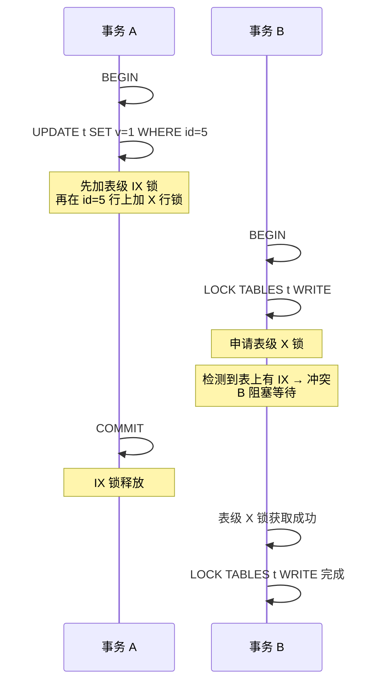

## 意义

```
事务A：对某几行加了行级独占锁（X锁）
事务B：想加 lock tables ... write（独占表锁）
```

事务B 加独占表锁之前，需要判断：**表里有没有行已经被加了锁？**

- **没有意向锁**：只能遍历所有行，逐行检查
- **有意向锁**：事务A 加行锁时已经顺手在表上打了 IX 标记，事务B 直接看表上有没有 IX，有就阻塞，O(1) 搞定

---


## 意向锁和表锁的冲突关系


### **简单回答**

意向锁（IS/IX）与表锁（S/X）的冲突关系是：**意向锁之间互不冲突**（IS 与 IS、IS 与 IX、IX 与 IX 均兼容），**独占意向锁与共享表锁（S）冲突**（IS 与 S 兼容），**意向锁与排他表锁（X）始终冲突**（IS 和 IX 都与 X 冲突）。设计意图是让表锁请求能快速判断表中是否存在不兼容的行锁，而无需逐行扫描。

>一句话总结，意向锁之间不冲突，其他的都是读写冲突，读读不冲突

---


### **完整冲突矩阵**

InnoDB 中四类表级锁的兼容关系如下：

| 请求锁 \ 已持有锁 | IS | IX | S | X |
|:---:|:---:|:---:|:---:|:---:|
| **IS** | 兼容 | 兼容 | 兼容 | 冲突 |
| **IX** | 兼容 | 兼容 | 冲突 | 冲突 |
| **S** | 兼容 | 冲突 | 兼容 | 冲突 |
| **X** | 冲突 | 冲突 | 冲突 | 冲突 |

行列读法：**行**是"新请求的锁"，**列**是"已持有的锁"，交叉处表示两者能否共存。

---

### **逐条拆解冲突关系**

**意向锁之间：全部兼容**

IS 与 IS、IS 与 IX、IX 与 IX 三种组合都不冲突。原因在于意向锁只是"声明"——事务打算在表中某些行上加行锁，它并不真正锁住任何行或表。两个事务完全可以同时打算在同一张表上加行锁，只要它们锁的是不同的行（行级锁之间互不干扰），意向锁层面就不需要互相阻塞。这保证了细粒度锁不会因为表级的意向声明而互相牵制。

**意向锁 vs 共享表锁（S）：IS 兼容，IX 冲突**

当事务想加 S 表锁时（如 `LOCK TABLES ... READ`），它与已持有的 IS 兼容——因为 IS 说明另一个事务只是在行级别加了共享锁，行级 S 锁与表级 S 锁并不矛盾（都是"读"意图）。但 S 与 IX 冲突——IX 表示另一个事务打算在某些行上加排他锁（写操作），而表级 S 锁要求整个表可读，两者语义对立，必须等待 IX 对应事务释放。

**意向锁 vs 排他表锁（X）：全部冲突**

无论 IS 还是 IX，只要表上已有意向锁，新的 X 表锁请求就会被阻塞，反之亦然。因为 X 表锁意味着独占整张表（读写全包），而意向锁代表有事务正在操作表内行数据，两者的排他性天然对立。

---

### **冲突关系的底层逻辑**

意向锁的核心价值在于**快速冲突检测**，而非真正锁定数据。

**没有意向锁时的困境**：假设事务 A 对表 T 中某行加了行级 X 锁，事务 B 想对整张表加 X 表锁。InnoDB 要判断能否授予表锁，就必须扫描表 T 的所有行锁——逐行检查是否有冲突。这在百万行级别的表上代价极高。

**有意向锁后的解法**：事务 A 在加行级 X 锁之前，先在表级加一个 IX 锁（轻量的"意向声明"，不阻塞行操作）。事务 B 申请表级 X 锁时，只需检查表上是否存在 IX 锁——一步判断即可发现冲突，立即阻塞。意向锁充当了行锁的"哨兵"，用 O(1) 的表级检查替代了 O(n) 的逐行扫描。

这个设计也解释了冲突矩阵的形状：**意向锁与意向锁之间不冲突**（都是哨兵，不影响彼此），**意向锁与表锁的冲突取决于"写意图"是否对立**——IX（排他意图）与 S（共享表锁）冲突，而 IS（共享意图）与 S 兼容；对 X 表锁而言，任何行操作意图都与之对立，因此一律冲突。

---

### **一个具体示例**



事务 A 对 `id=5` 加行锁前先放了 IX 哨兵；事务 B 的 `LOCK TABLES t WRITE` 申请 X 表锁，发现 IX 存在即被阻塞，无需扫描表中数百万行去寻找那个唯一的行锁。事务 A 提交释放 IX 后，B 才获锁继续。这正是意向锁机制高效运作的缩影。