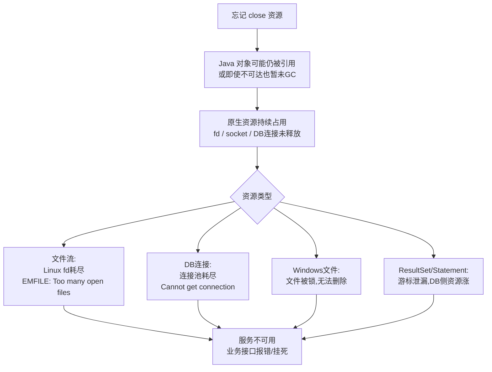
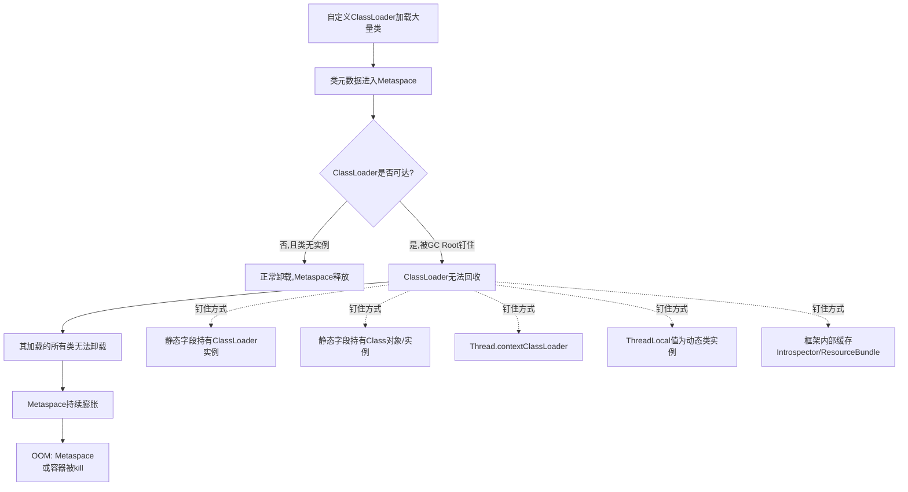

---
tags:
  - jvm
  - java
  - 内存泄漏
  - 元空间
  - 类加载
created: 2026-08-21
updated: 2026-10-16
---

# 未关闭资源泄漏与元空间泄漏详解

**核心本质：** 资源泄漏的根本在于 Java 对象只是原生资源（文件描述符、套接字、数据库连接）的"包装层"，而 GC 只管堆内存、不管原生资源，finalize/Cleaner 作为兜底既不可靠又有显著时延；自定义 ClassLoader 导致元空间泄漏的核心则是：类元数据只有在其 ClassLoader 被 GC 回收时才会释放，而 ClassLoader 一旦被 GC Root 或长生命周期引用"钉住"就无法回收，元空间持续膨胀直至 OOM。

---

## 一、未关闭资源泄漏的机制

### 1. 资源对象的本质：Java 层只是"代理"

像 `Connection`、`InputStream`/`OutputStream`、`FileInputStream`、`Socket`、`ResultSet`、`ZipFile`、`JarFile` 这类对象，在 JVM 堆里只是一个轻量级的 Java 对象壳子，真正持有的是操作系统层的**原生资源**：文件描述符（fd）、socket 句柄、数据库会话、服务器游标等。这些原生资源并不在 GC 的管理范围之内，GC 无法直接回收它们，只能通过 Java 对象的 `finalize()`（或 Java 9+ 的 `Cleaner`）在对象被回收时去"间接关闭"。

### 2. GC 为什么救不了你

很多人误以为"Java 有 GC，不关闭也没事"，这是最常见的认知误区，原因有三：

- **GC 只管理堆内存，不管理原生资源**：堆里的 Java 对象被回收，并不等于它持有的 fd/socket/连接被关闭。两者是解耦的。
- **GC 时机不可控**：堆还有大量剩余空间时，GC 根本不会触发，原生资源就一直挂着。往往内存压力来了 GC 才跑，此时 fd 表早已耗尽。
- **finalize/Cleaner 兜底既慢又不可靠**：finalize 跑在低优先级 finalizer 线程上，可能堆积、可能延迟、甚至可能因为异常被吞掉而不执行；Java 9 之后 `finalize()` 已被废弃，改用 `Cleaner`，但本质问题——依赖 GC 触发才能关闭——没有变。

### 3. 泄漏演化路径

资源泄漏的演化是一个"量变到质变"的过程：



关键阈值在 Linux 上是 `ulimit -n`（默认 1024），数据库连接池容量通常也就几十到几百。一个高频接口每次泄漏一个 fd，几分钟到几小时就会触顶。

### 4. 典型泄漏代码

最常见的两种错误写法：

```java
// 错误1: 正常路径关闭,异常路径泄漏
InputStream in = new FileInputStream("a.txt");
process(in);          // 这里抛异常,in.close() 永远执行不到
in.close();

// 错误2: 以为 try-catch 就够了
try {
    Connection conn = dataSource.getConnection();
    // ... 异常或正常return
    conn.close();    // 中途 return/throw 就漏
} catch (SQLException e) { ... }
```

### 5. 正确解法：try-with-resources

Java 7+ 的 `try-with-resources` 是标准答案，它编译期自动展开为 `try-finally` 并保证每个声明了 `AutoCloseable` 的资源都会在正常/异常路径上各调用一次 `close()`：

```java
try (Connection conn = dataSource.getConnection();
     PreparedStatement ps = conn.prepareStatement(sql);
     ResultSet rs = ps.executeQuery()) {
    // 即使中途 return 或抛异常,close 都会按声明逆序执行
}
```

面试加分点：可提 `AutoCloseable`（Java 5+，可抛任何异常）与 `Closeable`（Java 5+，只抛 IOException）的区别，以及 try-with-resources 资源泄漏的兜底"双层保险"——即便显式 close 失败，Cleaner 仍会在对象被回收时做最后一次尝试（如 `FileInputStream` 内部就注册了 Cleaner）。

**手写 finally 时"先声明成 null 再判空"的两个原因**（面试常被追问）：

1. **编译期要求**：局部变量没有默认值，Java 规定使用前必须确定赋值。声明在 try 外面的变量如果不给初值，finally 里引用它直接编译报错「变量可能尚未初始化」。
2. **运行期要求**：资源对象是 `new` 出来的，而 `new FileInputStream(path)` 这一句自己就抛 `FileNotFoundException`——一旦抛出，赋值根本没发生，变量停在初始值。finally 无论如何都会执行，只有先给了 null，`if (in != null)` 才能正确跳过 close，而不是去关一个空引用、或一个没创建成功的对象。

```java
InputStream in = null;                 // ← 不写 = null，编译都过不了
try {
    in = new FileInputStream("a.txt"); // ← 这一句可能抛，抛了 in 还是 null
    process(in);
} finally {
    if (in != null) in.close();        // ← 靠 null 判断"到底创建成功没有"
}
```

---

## 二、自定义 ClassLoader 导致元空间泄漏

### 1. 背景：元空间存储与类卸载条件

Java 8 把类元数据从 PermGen（堆内）搬到 Metaspace（堆外本地内存），存储的是 Class 结构、方法字节码、常量池、方法区等。**类元数据的释放强依赖 ClassLoader 的回收**——只有当 ClassLoader 被 GC 回收时，它加载的所有类的元数据才会被释放。

一个 ClassLoader 及其加载的类能被卸载，必须同时满足三条：

1. 该 ClassLoader 自身不可达（堆里没有任何强引用指向它）；
2. 它加载的所有类都没有活着的实例；
3. 它加载的所有类，其对应的 `Class` 对象都没有被任何地方引用（否则 `Class` 对象会通过 `getClassLoader()` 反向引用钉住这个 ClassLoader）。

三者缺一不可，只要 ClassLoader 被任意 GC Root 钉住，整棵类树元数据就全部泄漏。

> [!tip] 三条件不是并列的——真正判据只有 ClassLoader 不可达
> `Class` 对象强引用自己的定义 ClassLoader（`Class.getClassLoader()` 字段），所以「有活实例」（经对象头类指针）和「Class 对象被引用」（经反向引用）都会把 ClassLoader 拖住。ClassLoader 一旦不可达，这两条自动成立。JVMS 的判据只有一条：**定义 ClassLoader 被 GC 回收**。三条件只是描述"ClassLoader 可达"的三种常见原因。

### 2. 核心泄漏链路



### 3. 典型泄漏场景

**场景一：ClassLoader 被静态/长生命周期引用钉住**

最经典的插件化/热部署泄漏。

**先理解：为什么热部署/插件化要不停新建 ClassLoader？**

JVM 里一个类**只能由同一个 ClassLoader 加载一次**（全限定名 + ClassLoader 唯一决定一个类）。想让"同一个类名的**新版本**"加载进来，不能复用旧 ClassLoader——只能 `new` 一个新的：

| 场景 | 举例 | 为什么需要新 ClassLoader |
|------|------|--------------------------|
| **热部署** | Tomcat reload webapp、Spring Boot DevTools | 不重启 JVM 就加载新版本代码 → 必须新 ClassLoader 装新版类 |
| **插件化** | OSGi、IDE 插件、游戏 mod | 运行时动态装/卸插件 → 每个插件独立 ClassLoader 隔离 |

于是每次 reload 或加载新插件都会 new 一个 ClassLoader。**如果旧的还被引用挂着**（比如存进静态缓存），就形成"僵尸" ClassLoader + 一整棵旧类树赖在元空间：

```java
static Map<String, ClassLoader> loaderCache = new HashMap<>();
// 每次加载新版本put进去,旧版本从不remove
loaderCache.put(version, new CustomClassLoader(...));
```

```
loader v1（被 static Map 引用 → 永远可达）
  └── 它加载的旧版所有类（跟着 v1 永远存活）
        └── 元空间里这些类的元数据永不释放
```

每热部署一次就多一个僵尸 ClassLoader → 元空间持续膨胀 → 最终 OOM。**ClassLoader 一直可达 → 元数据永不释放。**

**场景二：静态字段持有动态加载的 Class 对象或其实例**

`Class<?>` 对象内部有 `getClassLoader()` 反向引用其定义加载器；持有实例同样会通过其 class 间接钉住 ClassLoader：

```java
static List<Class<?>> loadedClasses = new ArrayList<>();  // 钉住ClassLoader
static Map<String, Object> singletons = new HashMap<>();   // 实例也钉住
```

实例钉住比直接持有 Class 更隐蔽，因为业务代码往往意识不到"实例 → class → classLoader"这条链。

**场景三：Thread 的 contextClassLoader**

线程本身是 GC Root。如果线程的 contextClassLoader 被设为自定义 ClassLoader，只要这个线程不死（线程池里的常驻线程），ClassLoader 就永远不可回收。线程池场景尤其严重，核心线程长期存活。

**场景四：ThreadLocal 持有动态类实例**

`ThreadLocal` 的值表存在 Thread 的 `ThreadLocalMap` 里，Thread 是 GC Root。如果 ThreadLocal 的 value 是动态加载类的实例，整个 ClassLoader 被钉死。这也是 Tomcat 重部署泄漏的头号元凶。

**场景五：框架内部缓存（隐蔽泄漏重灾区）**

这类泄漏最坑，因为业务代码看起来"什么都没做"，但框架偷偷缓存了你的 Class：

- `java.beans.Introspector`：缓存 `BeanInfo`，强引用 Class → 钉住 ClassLoader。需手动 `Introspector.flushCaches()`。
- `java.util.ResourceBundle`：按 ClassLoader 缓存 bundle，持有 ClassLoader 引用。
- `java.util.ServiceLoader`：实例持有 ClassLoader 引用。
- `javax.imageio.ImageIO`：内部缓存使用系统 ClassLoader，但跨边界引用 webapp ClassLoader 的类也会泄漏。
- 日志框架：Log4j2、Logback、Commons-logging 的 LoggerContext 通常强引用 webapp ClassLoader。
- JDBC：`DriverManager` 静态注册的 Driver 由 webapp 加载 → 钉住 webapp ClassLoader。Tomcat 有专门机制在 webapp 卸载时 deregister。

**场景六：WeakHashMap 误用导致的"假弱引用"**

常见误判：以为用了 `WeakHashMap<ClassLoader, X>` 就安全。其实 `WeakHashMap` 的 key 是弱引用，但 **value 是强引用**。如果 value 内部又指回 ClassLoader（比如 value 里有个 `Class` 字段），就形成 ClassLoader → value → Class → ClassLoader 的"自我引用"环，WeakHashMap 的清理条件是 key 不可达，而 key 恰好被 value 钉住了，永远清不掉。

### 4. Web 容器经典泄漏链（Tomcat 视角）

热部署/undeploy 后元空间不降，是 Tomcat 的经典痛点。Tomcat 内置了 `WebappClassLoader` 内存泄漏防护机制（`ThreadLocalLeakPreventionListener`、`JreMemoryLeakPreventionListener`），在 webapp 停止时主动清理：杀掉 webapp 创建的线程、清 Introspector 缓存、deregister JDBC Driver、关闭 webapp 的 ResourceBundle 等。面试提一句这个机制是加分项。

### 5. 检测与解决

检测手段：

- JConsole / VisualVM / Arthas 观察 Metaspace 使用曲线，是否单调上涨不回落；
- `-XX:+HeapDumpOnOutOfMemoryError` 配合 MAT，用 "Path to GC Roots" 查看 ClassLoader 被谁钉住；
- JFR（Java Flight Recorder）记录对象分配与类加载事件；
- Tomcat 启动时 `leakPrevention` 日志会直接打印检测到的泄漏。

解决原则：

1. **ClassLoader 用完必须释放其引用**——不要放进静态集合，需要缓存就改用 `WeakReference`/`WeakHashMap`（注意 value 反向引用问题）；
2. **不要让静态字段持有动态加载的 Class/实例**，必要时用弱引用包装；
3. **线程池线程的 contextClassLoader 在生命周期结束后要复位为父类加载器**，或干脆回收线程；
4. **ThreadLocal 用完 remove**，绝不能依赖线程复用自动清；
5. **框架缓存在卸载时主动清理**：`Introspector.flushCaches()`、关闭 LoggerContext、deregister JDBC Driver；
6. **生产兜底**：`-XX:MaxMetaspaceSize` 限制上限防 OOM 拖垮整个进程，配合监控告警。

---

## 三、两者的共性：本质都是"GC 管不到的资源的引用链没断开"

资源泄漏和元空间泄漏看似无关，其实根因同构——都是**GC 管辖范围之外的资源，依赖一条不该长存的引用链**。前者是原生资源靠 finalize/Cleaner 兜底但时机不可控；后者是元数据靠 ClassLoader 回收触发，但 ClassLoader 被钉住。面试时把这层共性点出来，比单独背两个机制更能体现系统理解：**所有"托管式释放"的资源，泄漏点都不在资源本身，而在那条本该断开却没断开的引用链上。**

---

## 关联知识点

- [[JVM 热门面试题#12. 常见的内存泄漏案例有哪些？ThreadLocal 为什么会内存泄漏？怎么避免？]] — 本页对应 Q12 追问（未关闭资源 + 自定义 ClassLoader 泄漏）
- [[静态集合内存泄漏与类卸载详解]] — 类卸载三条件、static 集合 GC Root 的姊妹篇
- [[jvm八股#类加载过程（七个阶段）]] — 类加载流程与 Class 对象生成
- [[ThreadLocal 深度解析与内存泄露笔记]] — ThreadLocal 泄漏机制（场景四：ThreadLocal 持有动态类实例）
- [[线程上下文类加载器（TCCL）]] — contextClassLoader 钉住 ClassLoader（场景三）
- [[DirectByteBuffer与堆外内存回收]] — 另一种"堆外资源"（直接内存）的回收机制
