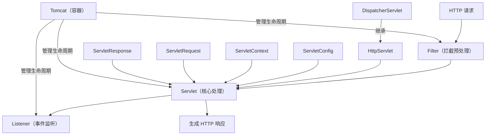

---
tags:
  - Servlet
  - JavaWeb
  - Tomcat
  - 面试
  - 生命周期
created: 2026-07-02
updated: 2026-10-09
source: raw/clippings/ （待补充原始资料）
---
	
# Servlet 详解

> [!abstract] Servlet — Java 服务器小程序（Server Applet）
> Java Web 开发的基石规范，定义了处理 HTTP 请求/响应的标准接口。所有 Java Web 框架（Spring MVC、Struts 等）本质上都是对 Servlet 的封装和增强。面试中 Servlet 是必考基础，不区分框架高低。

---

## 一、面试高频题

### Q1:什么是 Servlet？它和 Tomcat 是什么关系？

Servlet 是 **Java EE（现 Jakarta EE）规范中定义的一个接口**，规定了如何处理 HTTP 请求和响应。它本身只是一个接口，真正的实现由**容器**（Tomcat、Jetty、Undertow 等）提供。

```
┌─────────────────────────────────────────┐
│             浏览器 / 客户端                │
│          http://example.com/hello        │
└──────────────┬──────────────────────────┘
               │ 发送 HTTP 请求
               ▼
┌─────────────────────────────────────────┐
│              Tomcat (Servlet 容器)         │
│                                         │
│  ┌────────────┐    ┌─────────────────┐  │
│  │ Connector  │───▶│   Coyote (接受) │  │
│  │ (端口监听) │    │   Engine/Core   │  │
│  └────────────┘    └───────┬─────────┘  │
│                            │             │
│                    ┌───────▼─────────┐  │
│                    │  DispatcherServlet│ │
│                    │  (你的代码)       │  │
│                    └─────────────────┘  │
└─────────────────────────────────────────┘
               │ 返回 HTTP 响应
               ▼
┌─────────────────────────────────────────┐
│             浏览器 / 客户端                │
│              收到 HTML/JSON                │
└─────────────────────────────────────────┘
```

**核心关系：**
- **Servlet 规范**：定义了 `Servlet`、`Filter`、`Listener` 等接口（jar 包：`javax.servlet-api` / `jakarta.servlet-api`）
- **Servlet 容器**：Tomcat 实现了这套规范，负责加载、初始化、调度 Servlet
- **开发者**：编写 `HttpServlet` 的子类（或注解标记的类），由容器托管

**一句话回答：** Servlet 是 Java Web 的"国家规范"，Tomcat 是"国家队选手"——你写代码遵循规范，Tomcat 负责执行。

---

### Q2:Servlet 的生命周期？（必考，必背）

Servlet 的生命周期由**容器**（Tomcat）管理，分为四个阶段：

```
┌──────────────────────────────────────────────────────┐
│                    生命周期                           │
├──────────────────────────────────────────────────────┤
│                                                      │
│  ① 实例化 (instantiation)                             │
│     Tomcat 创建 Servlet 对象（调用无参构造）            │
│     → 默认是单例，一个 Servlet 类只创建一次              │
│                                                      │
│  ② 初始化 (initialization)                            │
│     调用 init(ServletConfig config)                   │
│     → 只执行一次，用于加载资源、初始化参数              │
│     → 容器提供 ServletConfig（获取配置参数）            │
│                                                      │
│  ③ 服务 (service)                                     │
│     调用 service(request, response)                   │
│     → 每次请求都调用                                   │
│     → 根据 HTTP 方法分发到 doGet/doPost/...           │
│                                                      │
│  ④ 销毁 (destruction)                                 │
│     调用 destroy()                                    │
│     → 容器关闭时执行，释放资源                         │
│     → 只执行一次                                      │
│                                                      │
└──────────────────────────────────────────────────────┘
```

**生命周期时序图：**

```mermaid
flowchart TD
    A[Tomcat 启动] --> B[加载 Servlet 类]
    B --> C[调用无参构造 → 实例化]
    C --> D[调用 init() → 初始化]
    D --> E[就绪，等待请求]
    E --> F{请求到达?}
    F -->|是| G[调用 service()]
    G --> H[分发到 doGet/doPost]
    H --> I[返回响应]
    I --> E
    E -->|Tomcat 关闭| J[调用 destroy() → 销毁]
```

**关键要点（面试必说）：**

| 方法 | 调用次数 | 调用时机 | 线程安全 |
|------|---------|---------|---------|
| `构造方法` | 1 次 | 实例化时 | 由容器保证 |
| `init()` | 1 次 | 初始化时 | 由容器保证 |
| `service()` | N 次 | 每次请求 | ⚠️ 多线程并发 |
| `destroy()` | 1 次 | 容器关闭时 | 由容器保证 |

> **面试坑点：** `service()` 方法是**多线程并发执行**的。Tomcat 默认只有一个 Servlet 实例，多个请求同时到达时会共用这个实例。所以**不要在 Servlet 中定义可变的实例字段**，除非做了同步处理。

---

### Q3:HttpServlet 的 doGet/doPost 是怎么调度的？

`HttpServlet` 是 `GenericServlet` 的子类，是开发者最常继承的基类。它重写了 `service()` 方法：

```java
// HttpServlet.service() 的核心逻辑（简化）
protected void service(HttpServletRequest req, HttpServletResponse resp)
        throws ServletException, IOException {
    String method = req.getMethod();  // 获取 HTTP 方法：GET/POST/PUT/DELETE...

    if (method.equals("GET")) {
        doGet(req, resp);
    } else if (method.equals("POST")) {
        doPost(req, resp);
    } else if (method.equals("PUT")) {
        doPut(req, resp);
    } else if (method.equals("DELETE")) {
        doDelete(req, resp);
    }
    // ... 其他 HTTP 方法
}
```

**所以开发者的职责就是：** 继承 `HttpServlet`，重写对应的 `doXxx()` 方法即可。

```java
// 最简示例：一个处理 GET 请求的 Servlet
@WebServlet("/hello")
public class HelloServlet extends HttpServlet {

    @Override
    protected void doGet(HttpServletRequest req, HttpServletResponse resp)
            throws ServletException, IOException {
        resp.setContentType("text/html;charset=UTF-8");
        resp.getWriter().write("<h1>你好，Servlet！</h1>");
    }
}
```

> **面试话术：** "Servlet 规范要求容器在 `service()` 方法中根据请求的 HTTP 方法分发到对应的 `doXxx()` 方法。开发者只需关注业务逻辑，不需要手动判断请求方法。"

> **追问：** 既然容器能自动匹配方法，为什么 Spring MVC 还要写 `@GetMapping`/`@PostMapping`？
> Servlet 层的分发解决的是**一个类内部的方法选择**（`doGet` vs `doPost`）；Spring MVC 的注解解决的是**整个应用中哪个 Controller 方法处理这个请求**，需要同时匹配 URL + HTTP 方法。粒度完全不同，不可互相替代。详见 [[@Controller与视图解析机制]]。

---

### Q3.5:GenericServlet 是什么？

`GenericServlet` 是 `HttpServlet` 的父类，Servlet API 中的**抽象骨架类**，用**模板方法模式**降低了实现成本。它实现了 `Servlet` 接口和 `ServletConfig` 接口，把通用逻辑封装好，子类只需关注业务。

```
Servlet（接口）
    │
    ├── GenericServlet（抽象类）
    │       │
    │       └── HttpServlet（抽象类）
    │               │
    │               └── 你写的 Servlet（如 HelloServlet）
```

**它做了什么：**

| 能力 | 说明 |
|------|------|
| 实现 `Servlet` 接口 | 提供 `init()`、`destroy()`、`getServletConfig()` 等默认实现 |
| 实现 `ServletConfig` 接口 | 直接委托给内部的 `config` 字段，子类可直接用 `getServletContext()` |
| 生命周期默认实现 | `init(ServletConfig)` 保存 config 后调用无参 `init()`，子类只需重写无参版本 |
| 协议无关 | 不关心 HTTP，只处理 IO——适用于非 HTTP 协议 |

**核心代码（简化）：**

```java
public abstract class GenericServlet implements Servlet, ServletConfig, Serializable {

    private transient ServletConfig config;

    // ① 带参 init —— 容器调用，保存 config 后回调无参版本
    public void init(ServletConfig config) throws ServletException {
        this.config = config;
        this.init();  // 模板方法：子类只需重写这个
    }

    // ② 无参 init —— 子类重写这个做初始化
    public void init() throws ServletException {
        // 空实现
    }

    // ③ 直接委托给 config
    public ServletContext getServletContext() {
        return config.getServletContext();
    }

    // ④ service() 依然是抽象的
    public abstract void service(ServletRequest req, ServletResponse res)
        throws ServletException, IOException;
}
```

**设计意图——模板方法模式：**

```
容器调用 init(config)
    → 保存 config
    → 调用无参 init()  ← 你只重写这个
```

你写 Servlet 时不需要关心 config 怎么存的，直接用 `getServletContext()` 就行。

**和 HttpServlet 的区别：**

| | GenericServlet | HttpServlet |
|--|---------------|-------------|
| 协议 | 协议无关 | HTTP 专用 |
| service() | 抽象，子类必须实现 | 已实现，分发到 doGet/doPost |
| 适用场景 | 自定义协议、Socket 通信 | 绝大多数 Web 开发 |

**总结：** `GenericServlet` 是"半成品骨架"，`HttpServlet` 是"HTTP 专用骨架"。平时写代码继承的都是 `HttpServlet`，很少直接碰 `GenericServlet`，但理解它能帮你搞懂 Servlet 的生命周期设计。

---

### Q4:ServletConfig 和 ServletContext 有什么区别？（必考）

这是面试中的**高频对比题**，核心区别就一句话：**Config 管一个 Servlet，Context 管整个 Web 应用。**

| 维度 | `ServletConfig` | `ServletContext` |
|------|----------------|-----------------|
| 作用范围 | **单个 Servlet** | **整个 Web 应用**（所有 Servlet 共享） |
| 获取方式 | `getServletConfig()` | `getServletContext()` 或 `request.getServletContext()` |
| 生命周期 | 随 Servlet 初始化时创建 | 随 Web 应用启动时创建，关闭时销毁 |
| 用途 | 获取当前 Servlet 的初始化参数 | 获取全局参数、共享数据、获取资源路径 |
| 配置方式 | `<init-param>` 写在 `<servlet>` 内 | `<context-param>` 写在 `<context-param>` 中 |

**XML 配置示例：**

```xml
<!-- web.xml -->
<context-param>                                    <!-- 全局参数 -->
    <param-name>appName</param-name>
    <param-value>我的应用</param-value>
</context-param>

<servlet>
    <servlet-name>HelloServlet</servlet-name>
    <servlet-class>com.example.HelloServlet</servlet-class>
    <!-- 当前 Servlet 的私有参数 -->
    <init-param>
        <param-name>greeting</param-name>
        <param-value>你好</param-value>
    </init-param>
</servlet>
```

**代码中使用：**

```java
// 在 Servlet 中
public class HelloServlet extends HttpServlet {

    @Override
    public void init() throws ServletException {
        // ① 获取当前 Servlet 的私有参数
        String greeting = getServletConfig().getInitParameter("greeting");
        // → "你好"

        // ② 获取全局参数
        String appName = getServletContext().getInitParameter("appName");
        // → "我的应用"

        // ③ 共享数据（整个应用可见）
        getServletContext().setAttribute("userCount", 100);
    }
}
```

**一句话回答：** `ServletConfig` 是 Servlet 的"个人配置文件"，`ServletContext` 是整个 Web 应用的"公共公告板"。

---

### Q5:转发（Forward）和重定向（Redirect）有什么区别？（必考）

这是 HTTP 层面最经典的区别，面试必问：

| 维度 | 转发（Forward） | 重定向（Redirect） |
|------|---------------|------------------|
| 本质 | **服务器内部**的资源流转 | 客户端发起**两次** HTTP 请求 |
| 请求次数 | 1 次 | 2 次 |
| 浏览器 URL | **不变**（还是原始 URL） | **改变**（变成目标 URL） |
| 共享数据 | ✅ 可以共享 request 域 | ❌ request 域丢失（新请求） |
| 性能 | 高（无额外网络开销） | 略低（多一次往返） |
| 适用场景 | 内部资源跳转（如 JSP 渲染） | POST-Redirect-GET、跨域跳转 |
| 状态码 | 无额外状态码 | 302（临时）或 301（永久） |

**代码对比：**

```java
// 转发 —— 服务器内部完成，request 域数据共享
RequestDispatcher dispatcher = request.getRequestDispatcher("/result.jsp");
dispatcher.forward(request, response);
// 浏览器地址栏仍显示 /hello

// 重定向 —— 客户端发起两次请求
response.sendRedirect(request.getContextPath() + "/result.jsp");
// 浏览器地址栏变成 /result.jsp
```

**流程图：**

```
转发（Forward）                    重定向（Redirect）
─────────────                    ──────────────

浏览器 → /hello                  浏览器 → /hello
     ↓                                ↓
  Tomcat 收到                          Tomcat 收到
     ↓                                ↓
  Servlet 处理                        Servlet 处理
     ↓                                ↓
  forward() → /result.jsp           302 + Location: /result.jsp
     ↓                                ↓
  内部跳转 ← ← ← ← ← ←              浏览器收到 302
     ↓                                ↓
  渲染 result.jsp                    浏览器自动发起新请求 → /result.jsp
     ↓                                ↓
  返回结果                            返回结果
浏览器地址: /hello                  浏览器地址: /result.jsp
```

> **面试坑点：** 表单提交后为什么用重定向（PRG 模式）？—— 防止用户刷新页面导致**重复提交**。如果用转发，刷新会重新执行 POST。

---

### Q6:Filter（过滤器）是什么？和 Servlet 有什么区别？

Filter 是 Servlet 规范中的另一个核心组件，用于**在请求到达 Servlet 之前（或响应离开之后）进行拦截处理**。

```
完整请求链路（含 Filter）：

浏览器 → [Filter 1] → [Filter 2] → ... → [Servlet] → 处理 → [Filter n] → 响应
         ↑ 预处理       ↑ 预处理               ↑ 业务逻辑          ↑ 后处理
```

**Filter vs Servlet 对比：**

| 维度 | Filter | Servlet |
|------|--------|---------|
| 职责 | 拦截/过滤请求，预处理或后处理 | 处理请求，生成响应 |
| 是否可以单独生成响应 | ✅ 可以（chain.doFilter 之前直接 return） | ✅ 可以 |
| 生命周期方法 | init() → doFilter() → destroy() | init() → service() → destroy() |
| 匹配方式 | URL 模式（`/*`、`/admin/*`） | URL 模式或注解 |
| 执行顺序 | 按 `<filter-mapping>` 顺序或 `@Order` | 由 DispatcherServlet 调度 |
| 能否访问 Spring Bean | ❌ 原生 Filter 不行（需特殊处理） | ✅ 天然是 Spring Bean |
| 典型用途 | 编码、跨域、鉴权、日志、参数校验 | 业务逻辑 |

**Filter 代码示例：**

```java
@WebFilter(urlPatterns = "/*", filterName = "logFilter")
public class LogFilter implements Filter {

    @Override
    public void doFilter(ServletRequest request, ServletResponse response,
                         FilterChain chain) throws IOException, ServletException {
        // ① 请求到达 Servlet 之前 —— 预处理
        long start = System.currentTimeMillis();
        System.out.println("请求路径: " + ((HttpServletRequest) request).getRequestURI());

        // ② 放行 —— 请求继续传递给下一个 Filter 或目标 Servlet
        chain.doFilter(request, response);

        // ③ 响应离开之后 —— 后处理
        long cost = System.currentTimeMillis() - start;
        System.out.println("处理耗时: " + cost + "ms");
    }
}
```

> **面试话术：** "Filter 是 Servlet 规范的配套组件，它在请求到达 Servlet 之前和响应离开之后进行拦截。它的核心价值是**横切关注点的统一处理**——比如鉴权、日志、编码这些和业务无关的逻辑，统一放在 Filter 里，避免在业务代码中重复。Spring MVC 的 Interceptor 是在 Filter 之后、DispatcherServlet 之内的更细粒度拦截，两者是互补关系。"

---

> [!info]- 补充：Filter 的优先级怎么设置（Spring Boot）
> **值越小、优先级越高、越先执行。** 三种方式：
> 1. **`@Order(1)` 或实现 `Ordered` 接口**——Filter 作为 Bean 被自动注册时生效。
> 2. **`FilterRegistrationBean.setOrder(1)`**（更推荐，还能同时配 URL 匹配规则）。
> 3. `@WebFilter` + `@ServletComponentScan`——这种方式下 `@Order` **通常不生效**，需要排序时建议改用 `FilterRegistrationBean`。
>
> 请求进来时按 order 从小到大依次经过各 Filter，响应返回时顺序相反（洋葱模型）。默认值是 `Ordered.LOWEST_PRECEDENCE`（`Integer.MAX_VALUE`）。⚠️ Filter 属 **Servlet 层**，在 Spring MVC 的 Interceptor **之前**执行，两者顺序不由同一套 order 控制。

---

### Q7:Servlet 的线程模型是怎样的？线程安全吗？

Servlet 默认是**单例多线程**模型：

```
┌─────────────────────────────────────────┐
│           Tomcat 线程池                    │
│                                         │
│  线程1 → 请求 A → ─┐                    │
│  线程2 → 请求 B → ─┤                    │
│  线程3 → 请求 C → ─┤→ 同一个 Servlet 实例 → 调用 service()    │
│  线程4 → 请求 D → ─┤                    │
│  线程5 → 请求 E → ─┘                    │
│                                         │
│  线程 N 并发访问同一个对象                    │
└─────────────────────────────────────────┘
```

**关键要点：**
- Tomcat 默认只创建一个 Servlet 实例
- 每个请求由一个独立的工作线程处理，**并发调用同一个实例的 `service()` 方法**
- 方法参数（`request`、`response`）是局部变量，每个线程独享，**天然线程安全**
- **实例字段**是所有线程共享的，**不是线程安全**

**线程安全写法：**

```java
// ❌ 错误：可变实例字段，并发时数据混乱
public class CounterServlet extends HttpServlet {
    private int count = 0;  // 多线程共享，竞态条件！

    protected void doGet(...) {
        count++;  // 非原子操作，并发时结果错误
    }
}

// ✅ 正确方案1：只用局部变量和方法参数
public class SafeServlet extends HttpServlet {
    protected void doGet(HttpServletRequest req, HttpServletResponse resp) {
        int localCount = 0;  // 局部变量，线程私有
        // 安全
    }
}

// ✅ 正确方案2：使用 synchronized
public class SafeServlet extends HttpServlet {
    private int count = 0;

    protected void doGet(HttpServletRequest req, HttpServletResponse resp) {
        synchronized (this) {
            count++;
        }
    }
}

// ✅ 正确方案3：使用 AtomicInteger
import java.util.concurrent.atomic.AtomicInteger;

public class SafeServlet extends HttpServlet {
    private AtomicInteger count = new AtomicInteger(0);

    protected void doGet(HttpServletRequest req, HttpServletResponse resp) {
        count.incrementAndGet();  // CAS 原子操作
    }
}
```

> **面试坑点：** Spring MVC 的 `@Controller` 默认也是单例，所以同样不要在 Controller 中定义可变实例字段。`ThreadLocal` 是安全的（每个线程一份副本）。

---

### Q8:会话管理 — Cookie、Session、Token 怎么选？

Web 是**无状态**的（HTTP 本身不记录用户身份），需要通过某种机制维持"会话"。主要有三种方式：

| 方式 | 原理 | 存储位置 | 适用场景 | 问题 |
|------|------|---------|---------|------|
| **Cookie** | 服务器 Set-Cookie → 浏览器自动存储 → 每次请求携带 | 浏览器端 | 记住登录状态、偏好设置 | 容量小（4KB）、可被禁用、安全性低 |
| **Session** | 服务端存储用户数据 → 浏览器只存 SessionID | 服务端内存 + 浏览器 Cookie | 传统 Web 应用登录 | 分布式环境下需要 Session 共享（Redis） |
| **Token（JWT）** | 服务端签发加密令牌 → 浏览器存储 → 每次请求携带 | 浏览器端 | 前后端分离、移动端、微服务 | 无法主动失效、体积大 |

**Session 工作原理：**

```
1. 用户登录（POST /login）
   → 服务端创建 Session 对象，存在内存/Redis 中
   → 生成唯一 SessionID（如 abc123）
   → 通过 Set-Cookie 响应头把 SessionID 发给浏览器
   → Set-Cookie: JSESSIONID=abc123; Path=/; HttpOnly

2. 后续请求（GET /profile）
   → 浏览器自动携带 Cookie: JSESSIONID=abc123
   → 服务端通过 SessionID 找到对应的 Session 数据
   → 判断用户是否已登录
```

> **面试话术：** "传统 Session 的问题在于分布式部署。多台服务器之间内存不共享，用户请求打到不同机器就会丢失 Session。解决方案有三种：Session 粘滞（Sticky Session）、Session 复制、集中存储（Redis）。现在微服务场景更多用 JWT Token，因为无状态，天然支持分布式。但 JWT 的缺陷是服务端无法主动让 Token 失效，需要配合 Redis 黑名单实现。"

---

### Q9:Servlet 3.0 有哪些新特性？

Servlet 3.0（Java EE 6，2009 年）是一次重大升级：

| 新特性 | 说明 | 示例 |
|--------|------|------|
| **注解配置** | 不再需要 web.xml | `@WebServlet`、`@WebFilter`、`@WebListener` |
| **异步处理** | 释放 Servlet 线程，支持长轮询/SSE | `request.startAsync()` |
| **文件上传** | 原生支持 multipart，无需第三方库 | `@MultipartConfig`、`request.getPart()` |
| **可插拔性** | 支持动态注册 Servlet/Filter | `ServletContext.addServlet()` |

**异步处理示例：**

```java
@WebServlet(urlPatterns = "/async", asyncSupported = true)
public class AsyncServlet extends HttpServlet {
    protected void doGet(HttpServletRequest req, HttpServletResponse resp)
            throws ServletException, IOException {
        // ① 开启异步 —— 立即释放 Servlet 线程
        AsyncContext asyncContext = req.startAsync();

        // ② 异步线程中处理耗时操作（如 DB 查询）
        asyncContext.start(() -> {
            try {
                // 模拟耗时操作
                Thread.sleep(3000);
                // ③ 完成响应
                asyncContext.getResponse().getWriter()
                    .write("异步处理完成");
                asyncContext.complete();
            } catch (Exception e) {
                e.printStackTrace();
            }
        });

        // ④ doGet 方法立即返回，Servlet 线程已释放
    }
}
```

**文件上传示例：**

```java
@WebServlet("/upload")
@MultipartConfig(               // 启用文件上传
    fileSizeThreshold = 1024 * 1024,  // 1MB 以上写入磁盘
    maxFileSize = 10 * 1024 * 1024,   // 单个文件最大 10MB
    maxRequestSize = 50 * 1024 * 1024 // 整个请求最大 50MB
)
public class UploadServlet extends HttpServlet {
    protected void doPost(HttpServletRequest req, HttpServletResponse resp)
            throws ServletException, IOException {
        Part filePart = req.getPart("file");        // 获取文件
        String fileName = filePart.getSubmittedFileName();
        filePart.write("/upload/" + fileName);       // 保存到磁盘
    }
}
```

---

### Q10:GET 和 POST 请求有什么区别？

这是最基础但最容易答不全的题：

| 维度 | GET | POST |
|------|-----|------|
| 数据位置 | URL 查询参数（`?name=tom`） | 请求体（Request Body） |
| 数据大小 | 受 URL 长度限制（浏览器/服务器各有不同，通常 2KB~8KB） | 无明确限制 |
| 安全性 | ⚠️ 参数暴露在 URL 中（浏览器历史、日志可见） | 参数在请求体中，相对安全 |
| 缓存 | ✅ 浏览器会缓存 GET 请求 | ❌ 默认不缓存 |
| 幂等性 | ✅ 安全且幂等（多次调用效果相同） | ❌ 不幂等（多次提交可能产生多次写入） |
| 编码 | `application/x-www-form-urlencoded` | `application/x-www-form-urlencoded` 或 `multipart/form-data` |
| 书签/历史 | ✅ 可以保存为书签 | ❌ 不可以 |
| 典型用途 | 查询、获取资源 | 提交表单、创建/更新资源 |

> **面试坑点：** GET 和 POST 的区别**不是**"GET 传参在 URL，POST 传参在 Body"这么简单。严格来说，GET 和 POST 的区别只在于语义（GET 用于获取资源，POST 用于提交数据），HTTP 协议本身并没有限制 GET 能不能有请求体——只是实践中 GET 带 body 会被某些中间件丢弃。

---

### Q11:HTTP 请求的 Request 和 Response 对象是怎么来的？

Servlet API 中的 `HttpServletRequest` 和 `HttpServletResponse` 是由**容器**（Tomcat）在每个请求到来时**创建并传入**的：

```java
// 你不需要 new —— 容器自动创建
protected void doGet(HttpServletRequest request,
                     HttpServletResponse response)
        throws ServletException, IOException {

    // request 对象包含：
    request.getMethod();          // HTTP 方法：GET/POST
    request.getRequestURI();      // 请求路径：/users/123
    request.getParameter("id");   // 查询参数：?id=123
    request.getHeader("Auth");    // 请求头
    request.getCookies();         // Cookie
    request.getSession();         // Session

    // response 对象包含：
    response.setStatus(200);                       // 状态码
    response.setContentType("application/json");    // 内容类型
    response.setCharacterEncoding("UTF-8");         // 字符编码
    response.getWriter().write("{}");               // 写入响应体
}
```

> **面试话术：** "Request 和 Response 是 Tomcat 在每个 HTTP 请求到达时根据底层 Socket 解析出来的对象。Request 封装了请求的所有信息（方法、头、参数、体），Response 封装了响应的写入接口。它们都是接口，Tomcat 提供具体实现（如 `org.apache.catalina.connector.RequestFacade`），开发者通过接口方法操作，不感知底层细节。"

---

### Q12:Servlet 中的四种域对象（Scope）是什么？

Servlet 规范定义了四个"域"，用于在不同范围**共享数据**：

| 域 | 接口 | 范围 | 生命周期 |
|----|------|------|---------|
| `PageContext` | `PageContext` | **当前 JSP 页面** | 页面渲染期间 |
| `HttpServletRequest` | `ServletRequest` | **当前请求** | 请求开始 → 响应结束 |
| `HttpSession` | `HttpSession` | **当前会话** | 会话创建 → 超时/销毁 |
| `ServletContext` | `ServletContext` | **整个 Web 应用** | 应用启动 → 关闭 |

**代码示例：**

```java
// ① Request 域 —— 一次请求内共享（转发时可用）
request.setAttribute("user", user);          // 存入
User u = (User) request.getAttribute("user"); // 取出

// ② Session 域 —— 同一会话内共享（多次请求间共享）
HttpSession session = request.getSession();
session.setAttribute("loginUser", user);
session.removeAttribute("loginUser");
session.invalidate();  // 销毁 Session

// ③ Context 域 —— 整个应用共享（所有用户可见）
ServletContext ctx = getServletContext();
ctx.setAttribute("appConfig", config);
Integer count = (Integer) ctx.getAttribute("userCount");
```

**面试话术：**
> "Servlet 四大域从窄到宽：PageContext（页面级）→ Request（请求级）→ Session（会话级）→ Context（应用级）。实际开发中，Request 域用于转发时传参，Session 域用于登录状态保存，Context 域用于全局配置和计数器。"

---

### Q13:Servlet 和 CGI 有什么区别？Servlet 为什么取代了 CGI？

**CGI（Common Gateway Interface，通用网关接口）** 是 20 世纪 90 年代早期 Web 时期制定的标准协议。当时的网页大多是静态 HTML，服务器只能把文件原样吐给浏览器；为了实现表单提交、留言板、搜索等**动态内容**，人们让 Web 服务器把请求"外包"给一个**独立的外部程序**处理，再把程序输出转发回浏览器——这就是 CGI。

**CGI 的请求流程：**

```
浏览器提交请求
     ↓
Web 服务器收到 → 为这个请求 fork 一个新进程（运行 CGI 程序）
     ↓
请求信息通过「环境变量 + 标准输入」传给程序
     ↓
程序把生成的内容（通常是 HTML）通过「标准输出」返回给服务器
     ↓
服务器转发给浏览器 → 进程随即退出、销毁
```

> **一句话本质：CGI 是「每个请求一个进程」，Servlet 是「常驻 JVM 里用线程处理请求」。** 所有差异都从这一条推导。

**核心对比：**

| 维度 | CGI | Servlet |
|------|-----|---------|
| **运行单元** | 每个请求 fork 一个**新进程**，处理完即销毁 | 常驻**服务器进程（JVM）**中，用**线程**跑 `service()` |
| **性能/开销** | 进程创建 + 解释器启动 + 销毁，开销大，高并发下资源紧张 | 线程复用（线程池），无进程创建开销，高并发表现好 |
| **状态/资源复用** | 请求间无法共享内存，连接、缓存都要重建 | 单例 Servlet，实例常驻，可复用连接池、缓存 |
| **易用性（API）** | 语言无关但**无统一接口**，参数解析、响应头、Cookie、会话都要自己写 | 容器提供 `HttpServletRequest`/`HttpServletResponse`/`HttpSession`，自动解析并解码表单、读写 HTTP 头、处理 Cookie、跟踪会话 |
| **可移植性** | ⚠️ **不如 Servlet**：程序常依赖具体操作系统和服务器环境，换环境往往要修改、重新编译 | "一次编写，到处运行"，只要服务器实现 Servlet 规范即可 |
| **语言** | 不限（Perl、C、Python、Shell…） | Java |

**逐条对应那道选择题：**

- ✅ **A 正确**：Servlet 处于服务器进程中，通过多线程方式运行 `service()`——每个请求由一个线程处理，比 CGI 高效。
- ✅ **B 正确**：CGI 对每个请求都产生新进程，服务完成后销毁，资源消耗大。
- ✅ **C 正确**：Servlet 提供大量实用工具例程——自动解析和解码 HTML 表单数据、读取和设置 HTTP 头、处理 Cookie、跟踪会话状态。
- ❌ **D 错误（即答案）**：说"CGI 可移植性高于 Servlet"是反的。**Servlet 基于 Java 的"一次编写，到处运行"，可移植性优于 CGI**；CGI 程序往往要针对不同操作系统和服务器环境修改、重编译。

**为什么 CGI 会慢？** 每次请求都要付出「创建进程 → 启动解释器 → 加载程序 → 销毁进程」的代价，而且请求之间**无法复用**任何内存状态。并发一高，进程数量爆炸，系统很快被拖垮。

**后来的演进：** CGI → **FastCGI / WSGI**（让程序**常驻**、反复处理请求，避免反复创建进程，如 PHP-FPM、uWSGI）→ **Servlet**（干脆常驻在 JVM 里，用线程池处理请求）。思路是一致的：**把"进程"换成"常驻 + 复用"**。

> **面试话术：** "CGI 是最早的动态网页方案，核心是**每个请求起一个新进程**、处理完就销毁，简单但开销大；Servlet 把处理逻辑**常驻在服务器进程（JVM）里**，用**多线程**处理请求，还通过容器封装了参数解析、HTTP 头、Cookie、会话管理这些工具例程。所以在**性能、易用性、可移植性**三个维度上 Servlet 都优于 CGI——尤其可移植性，Servlet 靠 Java 的『一次编写，到处运行』胜过需要按环境改写的 CGI。这三点正好就是那道题里 A、B、C 正确、D 错误的原因。"

---

## 二、Servlet 与 Spring MVC 的关系

### DispatcherServlet 的本质

Spring MVC 的 `DispatcherServlet` 继承自 `HttpServlet`，它是**你写的第一个 Servlet**：

```
HttpServlet（Java Servlet API 基类）
    │
    └── HttpServletBean
            │
            └── FrameworkServlet
                    │
                    └── DispatcherServlet（Spring MVC 前端控制器）
```

**这意味着：**
- `DispatcherServlet` 本身就是一个标准的 Servlet
- Spring Boot 自动注册它，映射路径为 `/`
- 你写的 `@Controller` 最终被 `HandlerAdapter` 调用——底层仍是 Servlet 规范在运行
- Spring MVC 的所有能力（参数解析、视图渲染、异常处理）都是在 `service()` 方法内部完成的

> **面试话术：** "Spring MVC 没有脱离 Servlet 规范。DispatcherServlet 是 HttpServlet 的子类，Spring MVC 的所有组件（HandlerMapping、HandlerAdapter、ViewResolver 等）都是在 DispatcherServlet 的 `service()` 方法中调度运行的。理解了 Servlet 生命周期，自然就能理解 Spring MVC 的初始化与请求处理流程。"

---

## 三、常见面试题速记表

| 面试问题 | 一句话答案 |
|---------|-----------|
| 什么是 Servlet？ | Java Web 规范定义的接口，处理 HTTP 请求/响应，由容器（Tomcat）管理 |
| 生命周期？ | 实例化 → init() → service()（每次请求） → destroy() |
| 默认是单例吗？ | 是，单例多线程，注意线程安全 |
| Config vs Context？ | Config 管一个 Servlet，Context 管整个 Web 应用 |
| 转发 vs 重定向？ | 转发是服务器内部跳转（1 次请求，URL 不变）；重定向是客户端 2 次请求（URL 变） |
| Filter 是什么？ | 在请求到达 Servlet 前后进行拦截的组件，处理横切关注点 |
| Cookie vs Session vs Token？ | Cookie 存客户端、Session 存服务端、Token 自包含无状态 |
| Servlet 3.0 新特性？ | 注解配置、异步处理、文件上传 |
| GET vs POST？ | 语义不同、参数位置不同、GET 幂等可缓存、POST 不幂等 |
| Spring MVC 和 Servlet 关系？ | DispatcherServlet 继承 HttpServlet，Spring MVC 是对 Servlet 的封装 |
| Servlet vs CGI？ | CGI 每请求一个进程、处理完销毁；Servlet 常驻 JVM 用多线程跑 service()。Servlet 在**性能 / 易用性 / 可移植性**上全面胜出 |

---

## 四、经典面试追问

### 追问1：Servlet 是线程安全的吗？

**默认不安全。** 只有一个实例，多线程并发调用 `service()`。如果实例字段是可变的，就会出问题。解决方案：
1. 不用实例字段，只用局部变量和方法参数
2. 用 `synchronized` 同步
3. 用 `ThreadLocal` 为每个线程保存副本
4. 用并发工具类（`AtomicInteger`、`ConcurrentHashMap`）

### 追问2：Servlet 的 load-on-startup 有什么用？

默认情况下，Servlet 在**第一次请求到达时才被实例化和初始化**（懒加载）。`<load-on-startup>` 可以让容器在**启动时就加载 Servlet**：

```xml
<servlet>
    <servlet-name>InitServlet</servlet-name>
    <servlet-class>com.example.InitServlet</servlet-class>
    <load-on-startup>1</load-on-startup>  <!-- 数字越小越先加载 -->
</servlet>
```

**用途：** 需要在启动时做初始化工作（如加载缓存、建立连接）的 Servlet。

### 追问3：Servlet 的 `@WebServlet` 注解怎么用？

Servlet 3.0 引入的注解，替代 web.xml 配置：

```java
@WebServlet(
    name = "HelloServlet",                          // Servlet 名称
    urlPatterns = {"/hello", "/hi"},                // 映射 URL
    loadOnStartup = 1,                              // 启动时加载
    initParams = {                                  // 初始化参数
        @WebInitParam(name = "greeting", value = "你好")
    }
)
public class HelloServlet extends HttpServlet {
    // ...
}
```

### 追问4：如何获取 Servlet 的绝对物理路径？

```java
// 获取 Web 应用根目录的物理路径
String realPath = getServletContext().getRealPath("/");

// 获取某个文件的物理路径
String filePath = getServletContext().getRealPath("/WEB-INF/config.properties");

// 获取资源输入流（不关心物理路径，推荐）
InputStream is = getServletContext().getResourceAsStream("/WEB-INF/config.properties");
```

> **注意：** 在 JAR 包部署或 Spring Boot 的 jar 运行模式下，`getRealPath()` 可能返回 `null`，建议用 `getResourceAsStream()`。

### 追问5：forward 和 include 的区别？

`RequestDispatcher` 有两个方法：
- **forward**：完全跳转到目标资源，当前 Servlet 不再处理响应
- **include**：把目标资源的输出**包含**进来，当前 Servlet 继续处理响应（常用于页面模块化）

---

## 五、Servlet 与相关技术的关系图



---

## 六、面试速记口诀

- **生命周期：** 实例 → 初始化 → 服务（每次请求） → 销毁
- **Config vs Context：** 个人配置 vs 全局公告板
- **转发 vs 重定向：** 内部跳 1 次 vs 客户端 2 次
- **Filter vs Servlet：** 过滤器在前做拦截，Servlet 在后做处理
- **四大域：** 页面 → 请求 → 会话 → 应用，范围由窄到宽

---

## 关联知识点

- [[SpringMVC]] — Spring MVC 整体架构与请求处理流程
- [[DispatcherServlet详解]] — Spring MVC 前端控制器的初始化与调度
- [[HandlerAdapter]] — 适配器模式 + 初始化来源 + 内置实现
- [[@Controller与视图解析机制]] — ViewResolver 与视图名解析机制
- [[WebMvcAutoConfiguration]] — Spring Boot MVC 自动配置原理
- [[uri和url]] — URI 与 URL 的区别与联系
- [[websocket]] — WebSocket 全双工通信协议详解
