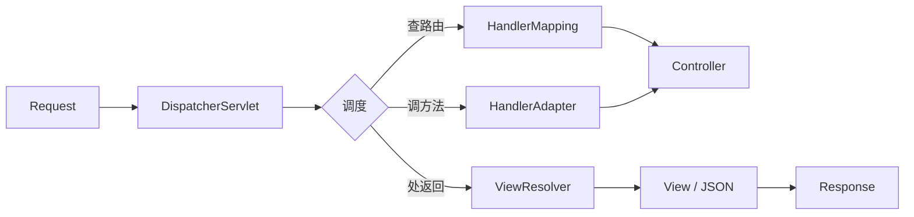

---
tags:
  - SpringMVC
  - DispatcherServlet
  - 前端控制器
  - 面试
created: 2026-07-02
updated: 2026-07-02
source: 03-Java/SpringMVC.md
---

# DispatcherServlet 详解

> [!abstract] DispatcherServlet — 前端控制器（Front Controller）
> Spring MVC 的核心调度中枢，所有 HTTP 请求的统一入口。它本身不处理业务逻辑，而是负责**查路由、调方法、处返回**的全流程调度。

---

## 一、面试高频题

### Q1:什么是 DispatcherServlet？它的作用是什么？

DispatcherServlet 是 Spring MVC 的**前端控制器（Front Controller）**，是请求处理的唯一入口。它的作用可以概括为：**一个请求进来，所有事情它来调度，具体工作分给专门的组件去做。**



**一句话回答：** DispatcherServlet 是 Spring MVC 的总指挥部，请求来了先过它，它再分发给对应的组件处理。

---

### Q2:DispatcherServlet 是如何初始化的？（必考）

DispatcherServlet 的初始化分为**两大步**：

#### 第一步：加载 WebApplicationContext

```
Servlet 容器启动（Tomcat 启动）
        │
        ▼
  DispatcherServlet 被创建
        │
        ▼
  创建自己的 WebApplicationContext
        │
        ├─ 父容器：根 ApplicationContext
        │   （存放 @Component、@Service、@Repository 等业务 Bean）
        │
        └─ 子容器：WebApplicationContext
            （存放 Web 层 Bean：Controller、ViewResolver、HandlerMapping 等）
```

关键点：
- **父子容器机制**：根容器管业务层，WebApplicationContext 管 Web 层
- `@Controller` 注册在 WebApplicationContext 中，DispatcherServlet 从这里找到它们
- 父容器看不见子容器，但子容器可以访问父容器中的 Bean

#### 第二步：初始化九大策略组件

WebApplicationContext 建好后，DispatcherServlet 从中取出策略 Bean，初始化九大组件：

| 组件                            | 职责                      | 面试重要性 |
| ----------------------------- | ----------------------- | ----- |
| `MultipartResolver`           | 处理文件上传                  | 低     |
| `LocaleResolver`              | 国际化/区域设置                | 低     |
| `ThemeResolver`               | 主题切换                    | 低     |
| **`HandlerMapping`**          | 根据 URL 查找 handler | ⭐⭐⭐ 高 |
| **`HandlerAdapter`**          | 适配并调用 handler     | ⭐⭐⭐ 高 |
| `HandlerExceptionResolver`    | 全局异常处理                  | 中     |
| **`ViewResolver`**            | 将视图名解析为真实视图路径           | ⭐⭐⭐ 高 |
| `RequestToViewNameTranslator` | 方法无返回值时自动推断视图名          | 中     |
| `FlashMapManager`             | 重定向时跨请求传参               | 低     |

> 面试重点记住三个：**HandlerMapping（查路由）、HandlerAdapter（执行方法）、ViewResolver（视图解析）**。

#### 第三步：加载默认实现

如果容器中没有自定义 Bean，从 `DispatcherServlet.properties` 加载默认实现类。所以**即使你不配置任何东西，Spring MVC 也能跑**——因为默认实现都给你准备好了。

**Spring Boot 中的自动注册：**

Spring Boot 中由 `DispatcherServletAutoConfiguration` 自动完成上述全部流程，开发者无需手动配置。

---

### Q3:DispatcherServlet 处理一次请求的完整流程？（必考，血流图必背）

```
1. 请求到达 DispatcherServlet
       │
2. DispatcherServlet 查询 HandlerMapping
   → 得到 HandlerExecutionChain（含目标方法 + 拦截器列表）
       │
3. 依次执行拦截器的 preHandle()
       │
4. 通过 HandlerAdapter 调用 handler
   → 参数由 HandlerMethodArgumentResolver 解析
   → 请求体由 HttpMessageConverter 反序列化
       │
5. Handler 执行完毕，返回 ModelAndView 或对象
       │
6. 返回值处理：
   ├─ 有 @ResponseBody → HttpMessageConverter 序列化为 JSON → 直接写响应
   └─ 无 @ResponseBody → 当作视图名，交给 ViewResolver
       │
7. 调用拦截器的 postHandle()
       │
8. 无 @ResponseBody 时：
   ├─ ViewResolver 解析视图名，找到视图路径
   └─ View 渲染页面
       │
9. 调用拦截器的 afterCompletion()
       │
10. 响应返回客户端
```

**记忆口诀：** 查 → 调 → 处 → 拦截器环绕 → 返回

**补充：** 步骤 2 中 `HandlerMapping` 返回的不是一个简单的 handler 对象，而是 `HandlerExecutionChain`。它内部封装了目标 handler 和对应的拦截器列表，让 DispatcherServlet 一次拿到"调谁 + 经过哪些关卡"。

---

### Q4:DispatcherServlet 的生命周期？

| 阶段 | 事件 | 说明 |
|------|------|------|
| **启动阶段** | Tomcat 启动 → Servlet 容器创建 DispatcherServlet 实例 | 执行初始化流程（加载 WebApplicationContext + 九大组件） |
| **就绪阶段** | 初始化完成，等待请求 | 所有策略组件已装配完毕，处于 idle 状态 |
| **处理阶段** | 请求到达 → 调度处理 → 返回响应 | 每次请求独立处理，互不干扰 |
| **销毁阶段** | Tomcat 关闭 → Servlet 容器销毁 DispatcherServlet | 调用 `destroy()` 方法，释放资源 |

**关键理解：** 初始化只做一次（启动时），每次请求只走"查-调-处"三步调度。初始化开销大但只执行一次，请求处理轻量但要扛高并发。

---

### Q5:DispatcherServlet 为什么不直接处理请求，而是 delegated 给其他组件？

**核心设计思想：开闭原则 + 策略模式。**

DispatcherServlet 只做**调度（Dispatch）**，具体工作交给可插拔的策略组件：

- 想换 URL 映射规则？换一个 `HandlerMapping` 实现
- 想换视图技术？换一个 `ViewResolver` 实现
- 想自定义参数解析？加一个 `HandlerMethodArgumentResolver`

**如果 DispatcherServlet 自己做所有事情：**
- 代码会膨胀成一个巨型类
- 改任何功能都要动核心代码，违反开闭原则
- 无法灵活组合不同策略

**面试话术：**
> "这是典型的设计模式应用。DispatcherServlet 持有一系列策略接口（HandlerMapping、HandlerAdapter 等），具体实现由开发者配置。框架提供默认实现，开发者可以按需替换或扩展。这样做的好处是核心调度逻辑稳定，而具体策略可以灵活变化。"

---

### Q6:DispatcherServlet 和 `HttpServlet` 是什么关系？

```
HttpServlet（Java Servlet API 基类）
    │
    └── DispatcherServlet（继承 HttpServlet）
            │
            └── 重写 doGet / doPost 等
                    → 内部统一走 doDispatch() 方法
```

DispatcherServlet **继承自** `HttpServlet`，重写了 `service()` 方法，将所有 HTTP 方法（GET、POST、PUT、DELETE）的请求都路由到同一个 `doDispatch()` 方法中处理。

**关键点：**
- 它仍然是 Servlet，遵守 Servlet 生命周期（init → service → destroy）
- 但它不直接生成响应内容，而是**委托给 View 或 HttpMessageConverter**
- web.xml 中注册的就是这个 Servlet（Spring Boot 中是自动注册）

---

### Q7:DispatcherServlet 中 WebApplicationContext 的父子关系是怎么回事？

```
┌──────────────────────────────────────────────────┐
│          根 ApplicationContext                      │
│  （ContextLoaderListener 创建）                      │
│  ┌────────────────────────────────────────┐        │
│  │ @Component、@Service、@Repository      │        │
│  │ 业务层的 Bean                           │        │
│  └────────────────────────────────────────┘        │
│                      ▲ 父容器                       │
└──────────────────────┼──────────────────────────────┘
                       │
          ┌────────────┴────────────┐
          │                         │
  ┌───────▼────────┐    ┌──────────▼─────────┐
  │ DispatcherServlet│    │ 其他 Servlet       │
  │ 的 WebAppContext  │    │ (如有)             │
  │ ┌──────────────┐│    │                    │
  │ │ @Controller  ││    │                    │
  │ │ ViewResolver ││    │                    │
  │ │ HandlerMap.. ││    │                    │
  │ └──────────────┘│    │                    │
  └─────────────────┘    └────────────────────┘
```

**面试话术：**
> "DispatcherServlet 有自己的 WebApplicationContext，作为根容器的子容器。根容器放业务 Bean，子容器放 Web 层 Bean（Controller、ViewResolver 等）。子容器可以访问父容器的 Bean，但父容器看不到子容器的 Bean。这样分层确保了 Web 层只依赖业务层，而业务层不依赖 Web 层，符合架构原则。"

**为什么单向查找？** Spring 父子容器是**子→父单向查找**，原因有三：① 防止循环依赖——从机制上杜绝 `@Service` 引用 `@Controller`；② 多子容器共享根容器——根容器不知道该找哪个子容器；③ 子容器可独立刷新销毁，父容器不持有子容器引用，避免 dangling reference。

---

### Q8:九大组件分别在请求的哪个阶段被用到？

```
初始化阶段（只执行一次）
  ├─ WebApplicationContext 加载
  └─ 九大组件初始化并存好

请求处理阶段（每次请求）
  ├─ HandlerMapping    → 第2步：查路由
  ├─ HandlerAdapter    → 第4步：调方法
  ├─ ViewResolver      → 第6步：视图解析
  ├─ HandlerExceptionResolver → 异常时：处理异常
  └─ RequestToViewNameTranslator → 无返回值时：兜底视图名
```

只有这五个组件在请求处理阶段真正参与工作，其余四个（MultipartResolver、LocaleResolver、ThemeResolver、FlashMapManager）在特定场景下才触发。

---

## 二、常见追问与易错点

### 九大组件一定是 DispatcherServlet 创建的吗？

不一定。Spring 遵循**依赖查找（Dependency Lookup）**模式：DispatcherServlet 先从自己的 WebApplicationContext 中查找，找不到再去父容器找。所以：
- 自定义组件可以放在任意一层
- 框架默认组件由 `DispatcherServlet.properties` 提供
- 开发者只需声明自己关心的 Bean，框架自动装配

### Spring MVC 只有一个 DispatcherServlet 吗？

默认只有一个，但可以注册**多个**，每个可以：
- 映射不同的 URL 路径（如 `/api/*` 和 `/admin/*`）
- 拥有独立的 WebApplicationContext
- 共享同一个根容器

典型场景：一个项目里 REST API 和后台管理页面用不同的 DispatcherServlet。

### DispatcherServlet 是单例的吗？

**是的。** 它是一个 Servlet，由 Servlet 容器管理生命周期，天然是单例。但它的九大组件（尤其是 HandlerMapping、HandlerAdapter）也是单例 Bean，所以：
- 初始化成本只有一次
- 请求处理无状态，线程安全
- Controller 默认也是单例（Spring Bean 默认 scope），不要在 Controller 中定义可变实例字段

---

## 三、核心速记表

| 面试问题 | 一句话答案 |
|---------|-----------|
| DispatcherServlet 是什么？ | Spring MVC 的前端控制器，所有请求的入口和调度中心 |
| 初始化分几步？ | ① 加载 WebApplicationContext ② 初始化九大策略组件 ③ 加载默认实现 |
| 九大组件核心三个是？ | HandlerMapping（查路由）、HandlerAdapter（调方法）、ViewResolver（视图解析） |
| 父子容器关系？ | WebAppContext 是根容器的子容器，Controller 在子容器，Service 在父容器 |
| 为什么用策略模式？ | 开闭原则——调度逻辑固定，具体策略可插拔替换 |
| 生命周期？ | init（初始化）→ service（每次请求处理）→ destroy（销毁） |
| 和 HttpServlet 关系？ | 继承 HttpServlet，重写 service 统一走 doDispatch |

---

## 关联知识点

- [[SpringMVC]] — 请求处理全流程与注解详解
- [[@Controller与视图解析机制]] — ViewResolver 与视图名解析机制
- [[SpringBoot 热门面试题]] — DispatcherServlet 的自动注册配置
