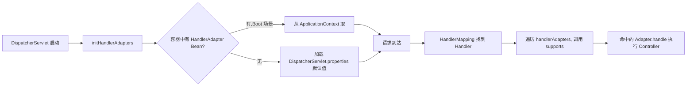

---
tags:
  - java
created: 2026-07-31
updated: 2026-07-31
---
### **`HandlerAdapter` 是 `DispatcherServlet` 在初始化时从 Spring 容器中查找并加载的策略组件,用来"适配"不同类型的 Handler,让 DispatcherServlet 不必关心 Handler 的具体形态**

  

下面从**为什么需要它、它从哪里来、它怎么被调用**三个维度讲清楚。

  

---

  

### **一、为什么需要 HandlerAdapter?(设计动机)**

  

Spring MVC 的 Handler 有多种形态:

  

- `@RequestMapping` 注解的方法(`HandlerMethod`)

- 实现 `Controller` 接口的类

- 实现 `HttpRequestHandler` 接口的类(处理静态资源)

- 函数式端点 `RouterFunction`(WebMvc.fn)

  

`DispatcherServlet` 不可能对每种 Handler 都写一套 `if-else`。于是引入了**适配器模式**:统一用 `HandlerAdapter#handle(request, response, handler)` 调用,由具体的 Adapter 去理解各自的 Handler 类型。

  

这就是典型的 **Adapter Pattern(适配器模式)**,也是 Spring MVC 可扩展性的关键设计之一。

  

---

  

### **二、HandlerAdapter 从哪里来?(初始化来源)**

  

`DispatcherServlet` 启动时会调用 `initHandlerAdapters(ApplicationContext context)`,加载顺序如下:

  

#### **1. 优先从 Spring 容器中按类型查找**

  

```java

Map<String, HandlerAdapter> matchingBeans =

BeanFactoryUtils.beansOfTypeIncludingAncestors(

context, HandlerAdapter.class, true, false);

```

  

只要容器里有 `HandlerAdapter` 类型的 Bean,就全部收集起来并按 `@Order` 排序。**Spring Boot 的 `WebMvcAutoConfiguration` 会自动注册几个默认的 HandlerAdapter Bean**,所以通常这一步就拿到了。

  

#### **2. 若容器中一个都没有,则加载默认策略**

  

==DispatcherServlet 会读取自己 jar 包内的 `DispatcherServlet.properties` 文件==(位于 `org/springframework/web/servlet/` 目录),里面预置了默认实现:

  

```properties

org.springframework.web.servlet.HandlerAdapter=\

org.springframework.web.servlet.mvc.HttpRequestHandlerAdapter,\

org.springframework.web.servlet.mvc.SimpleControllerHandlerAdapter,\

org.springframework.web.servlet.mvc.method.annotation.RequestMappingHandlerAdapter,\

org.springframework.web.servlet.function.support.HandlerFunctionAdapter

```

  

这就是所谓的**兜底默认策略**,保证即使用户没配置任何 Bean,Spring MVC 也能跑起来。

  

#### **3. Spring Boot 场景下的具体来源**

  

在 Spring Boot 中,`RequestMappingHandlerAdapter` 等 Bean 由以下配置链注册:

```
WebMvcAutoConfiguration → EnableWebMvcConfiguration → WebMvcConfigurationSupport
```

> **箭头 `→` 表示配置的委托链**:Spring Boot 自动配置通过一层层的 `@Import` 和继承,最终在 `WebMvcConfigurationSupport` 中定义并注册 HandlerAdapter 等核心 Bean。

具体拆解:

| 层级 | 类 | 职责 |
|------|-----|------|
| 1 | `WebMvcAutoConfiguration` | Spring Boot 自动配置入口,条件化导入 MVC 配置 |
| 2 | `EnableWebMvcConfiguration` | 由 `@Import` 引入,继承 `WebMvcConfigurationSupport` |
| 3 | `WebMvcConfigurationSupport` | 真正定义 `RequestMappingHandlerAdapter`、`RequestMappingHandlerMapping` 等 Bean |

**关键细节**:`WebMvcAutoConfiguration` 上有 `@ConditionalOnMissingBean(WebMvcConfigurationSupport.class)` —— **只要容器中已有该类型 Bean,自动配置就跳过**。所以:

- 不加 `@EnableWebMvc` → 走 `WebMvcAutoConfiguration` 自动配置,注册全套默认 Bean
- 加了 `@EnableWebMvc` → 引入 `EnableWebMvcConfiguration`(继承自 `WebMvcConfigurationSupport`),自动配置被禁用,所有 MVC Bean 需通过实现 `WebMvcConfigurer` 接口定制
- 若 `WebMvcConfigurer` 空实现(无方法覆写),Spring 用 `DelegatingWebMvcConfiguration` 代理到默认 `WebMvcConfigurationSupport`

  

```java

@Bean

public RequestMappingHandlerAdapter requestMappingHandlerAdapter(...) {

RequestMappingHandlerAdapter adapter = createRequestMappingHandlerAdapter();

// 注入 argumentResolvers、returnValueHandlers、messageConverters 等

return adapter;

}

```

  

所以在 Spring Boot 应用里,你打断点会发现 `HandlerAdapter` 是**从容器直接拿到的现成 Bean**,而不是走 properties 兜底那条路。

  

---

  

### **三、HandlerAdapter 有哪些内置实现?**

  

| 实现类                              | 适配的 Handler                      | 场景                                 |
| -------------------------------- | -------------------------------- | ---------------------------------- |
| `RequestMappingHandlerAdapter`   | `HandlerMethod`(@RequestMapping) | 最常用,99% 的接口                        |
| `HttpRequestHandlerAdapter`      | `HttpRequestHandler`             | 静态资源(`ResourceHttpRequestHandler`) |
| `SimpleControllerHandlerAdapter` | `Controller` 接口                  | 老式 Controller                      |
| `HandlerFunctionAdapter`         | `HandlerFunction`                | 函数式端点 WebMvc.fn                    |

  

---

  

### **四、DispatcherServlet 如何选择 HandlerAdapter?**

  

请求处理时的代码大致是:

  

```java

protected HandlerAdapter getHandlerAdapter(Object handler) {

    for (HandlerAdapter adapter : this.handlerAdapters) {

        if (adapter.supports(handler)) {

            return adapter;

        }

    }

    throw new ServletException("No adapter for handler ...");

}

```

  

每个 Adapter 实现 `supports(Object handler)` 声明自己能处理哪类 Handler,DispatcherServlet 遍历列表选出第一个匹配的。例如:

  

- `RequestMappingHandlerAdapter#supports` 判断 `handler instanceof HandlerMethod`

- `HttpRequestHandlerAdapter#supports` 判断 `handler instanceof HttpRequestHandler`

  

---

  

### **五、串起完整流程(结合前面讲的请求处理链路)**

  



  

---

  

**一句话总结**:`HandlerAdapter` 由 `DispatcherServlet` 在 `initHandlerAdapters` 阶段加载,**优先从 Spring 容器按类型注入(Spring Boot 由 `WebMvcAutoConfiguration` 自动注册),否则回退到 `DispatcherServlet.properties` 中声明的默认实现**;运行期通过 `supports()` 方法选择合适的 Adapter 来调用真正的 Handler,这是 Spring MVC 用适配器模式解耦 DispatcherServlet 与多种 Handler 形态的关键设计。

---

## 关联知识点

- [[SpringMVC]] — Spring MVC 整体架构与请求处理流程
- [[DispatcherServlet]] — 前端控制器的初始化与策略组件加载
- [[HandlerMapping]] — 与 HandlerAdapter 配对使用的 URL 映射组件
- [[WebMvcAutoConfiguration]] — Spring Boot MVC 自动配置原理
- [[WebMvcConfigurer]] — 用户自定义 MVC 配置的扩展点