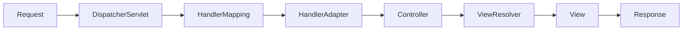

### **Spring MVC 是基于 Servlet API 的同步阻塞式 Web 框架,以 DispatcherServlet 为核心,采用一请求一线程模型处理 HTTP 请求**

  

下面按面试高频考点系统梳理,每个知识点都配上面试题与答题要点。

  

---

  

### **一、基础认知类**

  

#### **Q1:什么是 Spring MVC?它的核心组件有哪些?**

  

Spring MVC 是 Spring Framework 提供的 Web 层框架,基于 **Servlet API**,采用经典的 **MVC(Model-View-Controller)** 设计模式,通过一个前端控制器 `DispatcherServlet` 统一分发请求。

  

核心组件:

  

| 组件 | 作用 |
|------|------|
| `DispatcherServlet` | 前端控制器,所有请求的入口,详见 [[DispatcherServlet详解]] |
| `HandlerMapping` | 根据 URL 查找对应的 Handler(Controller 方法) |
| `HandlerAdapter` | 适配并调用 Handler |
| `Controller` | 业务处理器,处理请求 |
| `ModelAndView` | 封装模型数据和视图名 |
| `ViewResolver` | 将视图名解析为具体的 View |
| `View` | 渲染响应(JSP、Thymeleaf、JSON 等) |
| `HandlerInterceptor` | 拦截器,做前置/后置处理 |

  

---

  

#### **Q2:Spring MVC 的请求处理流程是怎样的?(必考)**

  

一次请求经过的完整链路(详见 [[DispatcherServlet详解]]):

  

1. 请求到达 `DispatcherServlet`

2. `DispatcherServlet` 查询 `HandlerMapping`,得到 `HandlerExecutionChain`(包含 Handler 与拦截器)

3. 依次调用拦截器的 `preHandle`

4. 通过 `HandlerAdapter` 调用真正的 Handler(Controller 方法),期间用 `HandlerMethodArgumentResolver` 解析参数,用 `HttpMessageConverter` 反序列化请求体

5. Controller 返回 `ModelAndView` 或对象

6. 用 `HandlerMethodReturnValueHandler` 处理返回值,`@ResponseBody` 时走 `HttpMessageConverter` 序列化

7. 调用拦截器的 `postHandle`

8. `ViewResolver` 解析视图,`View` 渲染

9. 调用拦截器的 `afterCompletion`

10. 响应返回客户端

  



  

---

  

### **二、注解与参数绑定类**

  

#### **Q3:`@Controller` 和 `@RestController` 有什么区别?**

  

- `@Controller`:传统控制器,返回值默认作为**视图名**（逻辑视图名）由 ViewResolver 解析,详见 [[@Controller与视图解析机制]];若要返回数据需在方法上加 `@ResponseBody`。

- `@RestController` = `@Controller` + `@ResponseBody`,类上所有方法默认返回**数据**(通常是 JSON),用于 RESTful 接口。

  

#### **Q4:`@RequestMapping`、`@GetMapping` 等映射注解有何区别?**

  

`@RequestMapping` 是通用注解,可指定 `method`、`params`、`headers`、`consumes`、`produces`;`@GetMapping / @PostMapping / @PutMapping / @DeleteMapping / @PatchMapping` 是它的**组合注解**,更语义化。

  

#### **Q5:`@RequestParam`、`@PathVariable`、`@RequestBody`、`@RequestHeader` 的区别?**

  

| 注解 | 来源 | 典型场景 |
|------|------|---------|
| `@RequestParam` | URL query 或表单字段 | `?name=tom` |
| `@PathVariable` | URL 路径变量 | `/users/{id}` |
| `@RequestBody` | 请求体(JSON/XML) | POST/PUT JSON |
| `@RequestHeader` | 请求头 | 读取 `Authorization` |
| `@ModelAttribute` | 表单绑定到对象 | 传统表单提交 |
| `@CookieValue` | Cookie | 读取指定 Cookie |

  

#### **Q6:`@RequestBody` 底层是如何工作的?**

  

由 `RequestResponseBodyMethodProcessor` 处理,根据请求 `Content-Type` 选择合适的 `HttpMessageConverter`(如 `MappingJackson2HttpMessageConverter`)将请求体反序列化为 Java 对象;返回值序列化同理,根据客户端 `Accept` 头协商。

  

---

  

### **三、核心组件深入类**

  

#### **Q7:DispatcherServlet 是如何初始化的?**

  

Spring Boot 中由 `DispatcherServletAutoConfiguration` 自动注册。启动时的完整初始化流程详见 [[DispatcherServlet详解]]:

  

1. 加载 `WebApplicationContext`

2. 初始化九大策略组件:`MultipartResolver`、`LocaleResolver`、`ThemeResolver`、`HandlerMapping`、`HandlerAdapter`、`HandlerExceptionResolver`、`RequestToViewNameTranslator`、`ViewResolver`、`FlashMapManager`

3. 若容器中无自定义 Bean,则从 `DispatcherServlet.properties` 加载默认实现

  

#### **Q8:HandlerMapping 有哪些实现?**

  

- `RequestMappingHandlerMapping`:处理 `@RequestMapping` 注解(最常用)

- `BeanNameUrlHandlerMapping`:按 Bean name 匹配 URL

- `SimpleUrlHandlerMapping`:显式配置 URL → Handler 映射

- `RouterFunctionMapping`:函数式端点(WebMvc.fn)

  

#### **Q9:拦截器(Interceptor)和过滤器(Filter)的区别?**

  

| 维度 | Filter | Interceptor |
|------|--------|-------------|
| 规范 | Servlet 规范 | Spring MVC 提供 |
| 生效范围 | 所有请求(含静态资源) | 进入 DispatcherServlet 之后 |
| 能否访问 Spring Bean | 需特殊处理 | 天然支持 |
| 执行时机 | 更早、更晚 | 包裹 Handler 前后 |
| 典型用途 | 编码、跨域、鉴权 | 权限、日志、参数校验 |

  

拦截器三个方法:`preHandle`(Controller 前)、`postHandle`(Controller 后、渲染前)、`afterCompletion`(渲染后,可拿到异常)。


**口述回答参考：**

开头先给结论："Filter 和 Interceptor 都能做拦截，但它们不在一个层面。Filter 是 Servlet 规范里的，Interceptor 是 Spring MVC 封装的，拦截的位置和能做的事情都不一样。"

**规范来源不同。** Filter 是 Java Servlet 规范定义的东西，不管你用什么框架，Tomcat 里都有 Filter。Interceptor 是 Spring MVC 自己提供的，属于框架层面的能力。

**拦截范围不一样。** Filter 管得更宽，所有请求都能拦，包括静态资源——比如你访问一张图片、一个 CSS 文件，Filter 都会经过。Interceptor 只在 DispatcherServlet 之后才生效，也就是说只有真正到了 Spring MVC 的请求才会被它拦到，静态资源它管不到。

**能不能拿到 Spring 容器里的东西。** Filter 是 Servlet 容器管理的，跟 Spring 容器是两回事，所以你在 Filter 里没法直接 `@Autowired` 注入 Service。要用的话得走一些额外的处理。Interceptor 就不一样了，它本身就是 Spring 管理的 Bean，依赖注入直接用，非常方便。

**执行时机。** Filter 执行得更早——请求进来先过 Filter，然后再到 DispatcherServlet。响应回去之后还会再过一次 Filter。Interceptor 呢，它是包在 Handler 前后执行的，有三个方法：`preHandle` 在 Controller 执行之前，`postHandle` 在 Controller 执行完但视图还没渲染的时候，`afterCompletion` 在整个请求结束、视图都渲染完了之后。所以 Interceptor 能看到 Controller 的执行结果，Filter 看不到。

**记忆点收尾：** "简单记就是——Filter 是更底层的、管所有请求的、拿不到 Spring Bean 的；Interceptor 是 Spring 层面的、只管 MVC 请求的、能注入 Bean、还能看到 Controller 执行过程的。面试里如果问我选哪个，一般业务上的权限校验、日志、参数校验这些，用 Interceptor 就够了；跨域、编码、敏感词过滤这种更底层的，用 Filter。"

  

---

  

### **四、异常处理类**

  

#### **Q10:Spring MVC 如何做全局异常处理?**

  

三种方式,推荐第三种:

  

1. Controller 内 `@ExceptionHandler` 方法(仅当前 Controller 生效)

2. 实现 `HandlerExceptionResolver` 接口

3. **`@ControllerAdvice` / `@RestControllerAdvice` + `@ExceptionHandler`**(全局生效)

  

```java

@RestControllerAdvice

public class GlobalExceptionHandler {

    @ExceptionHandler(BusinessException.class)

    public ResponseEntity<ErrorVO> handle(BusinessException e) {

        return ResponseEntity.status(400).body(new ErrorVO(e.getCode(), e.getMessage()));

    }

}

```

  

底层由 `ExceptionHandlerExceptionResolver` 承接,是 `HandlerExceptionResolver` 的默认实现之一。

  

---

  

### **五、数据校验与转换类**

  

#### **Q11:如何做参数校验?**

  

结合 **JSR-303 / Bean Validation**(Hibernate Validator):

  

```java

@PostMapping("/users")

public User create(@Valid @RequestBody UserDTO dto, BindingResult br) { ... }

```

  

- `@Valid` / `@Validated` 触发校验

- 常用注解:`@NotNull`、`@NotBlank`、`@Size`、`@Email`、`@Min`、`@Pattern`

- `@Validated` 支持**分组校验**(`@Validated(Create.class)`),`@Valid` 不支持

- 校验失败抛 `MethodArgumentNotValidException`,可在 `@ControllerAdvice` 统一处理

  

#### **Q12:自定义类型转换怎么做?**

  

- 实现 `Converter<S, T>` 并注册到 `WebMvcConfigurer#addFormatters`

- 或实现 `Formatter<T>` 支持格式化(如日期格式)

- 简单场景可用 `@InitBinder` + `PropertyEditor`

  

---

  

### **六、线程模型与性能类(高频)**

  

#### **Q13:Spring MVC 的线程模型是怎样的?**

  

基于 Servlet 容器(Tomcat)的**一请求一线程(Thread-per-Request)**模型:

  

- Tomcat 有一个连接器接受请求,交给工作线程池(默认 `max-threads=200`)

- 每个请求独占一个线程,直到响应完成

- 线程遇到 I/O(数据库、下游 HTTP)时**阻塞等待**

  

**优点**:模型直观、调试简单、`ThreadLocal` 天然可用(事务、SecurityContext、MDC)

**缺点**:高并发 I/O 场景下线程数量成瓶颈,吞吐受限

  

#### **Q14:Spring MVC 如何支持异步?**

**一句话核心：** 普通请求是"一个线程从头跑到尾"，异步是"请求进来拿个凭证就走，后台算完了再回来写响应"。

##### 为什么需要异步？

Spring MVC 默认基于 **Thread-per-Request** 模型——Tomcat 工作线程池里一个线程接一个请求，从进来到响应结束全程占用。问题是：如果 Controller 里调了慢操作（查数据库、调下游接口），这个线程就会**阻塞等待**，干等什么都不干。

高并发时线程池被占满，新请求只能排队——这就是异步要解决的问题：**把 I/O 等待期间的线程释放回池子里，让它去干别的请求。**

##### 六种异步方式

| 返回类型 | 原理 | 适用场景 |
|----------|------|----------|
| `Callable<T>` | Controller 返回 Callable，框架交给 TaskExecutor 线程池执行，释放 Tomcat 线程 | 最简单的异步，适合"调个 DB 查数据" |
| `DeferredResult<T>` | Controller 返回一个空的 DeferredResult，业务代码在任意线程（甚至定时器、消息监听）里调用 `setResult` | 适合事件驱动、异步回调（如等待消息队列结果） |
| `WebAsyncTask<T>` | 在 Callable 基础上加了超时控制和自定义线程池 | 需要超时回退或指定线程池时用 |
| `ResponseBodyEmitter` | 持续向客户端推送数据流，连接不关闭 | 服务端推送、进度通知 |
| `SseEmitter` | 基于 Server-Sent Events，浏览器用 EventSource 接收 | 实时通知、日志流、股票行情 |
| `CompletableFuture<T>` | 配合函数式编程，Spring MVC 自动检测并异步处理 | 已有 CompletableFuture 链式调用时 |

##### Callable 详细流程（最常考）

```java
@GetMapping("/users/{id}")
public Callable<User> getUser(@PathVariable Long id) {
    return () -> userService.findById(id);
}
```

执行时序图：

```
请求进来
   │
   ▼
① Tomcat 线程 A 进入 Controller
   │
   ▼
② Controller 返回 Callable 对象（注意：call() 还没执行！）
   │
   ▼
③ DispatcherServlet 检测到 Callable → 线程 A 立刻释放回线程池 ★
   │
   ▼
④ TaskExecutor 线程 B 执行 call() → 调 DB → 拿到 User
   │
   ▼
⑤ 框架派一个线程 C（可能复用线程 A）写响应 → 浏览器收到
```

关键理解：你 `return` 的不是最终结果，是 **Callable 对象本身**，返回给 DispatcherServlet 作为异步信号。框架看到 Callable 就知道释放当前线程，等 Callable 在别的线程里跑完再回来写响应。

##### 与 WebFlux 的本质区别

| 维度 | Spring MVC 异步 | Spring WebFlux |
|------|----------------|----------------|
| 线程模型 | Tomcat 线程池，I/O 时释放但连接仍占资源 | 事件循环（Event Loop），少量线程处理大量连接 |
| 底层 I/O | 仍然是阻塞式 NIO | 真正的非阻塞 I/O |
| 适用场景 | 少数慢接口的优化 | 高并发、大量 I/O 等待的场景 |

**结论：** Spring MVC 的异步是"有限度的异步"——它优化的是**单个连接释放线程的效率**，但底层仍然是 Servlet 阻塞模型。真正从架构层面改变的是 WebFlux。

##### 什么时候用，什么时候不用

- **用：** 单个接口 I/O 耗时明显（>500ms），且并发量较高
- **不用：** 接口本身很快（<100ms），加异步反而增加复杂度和上下文切换开销
- **不用：** 需要访问 `ThreadLocal` 的场景（异步线程拿不到原线程的 ThreadLocal 数据）

#### **Q15:Spring MVC 如何实现 RESTful 接口?**

  

- `@RestController` + `@GetMapping/@PostMapping/...` 构建资源风格 URL

- `@PathVariable` 表达资源标识

- 使用 `ResponseEntity<T>` 精细控制状态码、响应头

- `HttpMessageConverter` 自动完成 JSON/XML 序列化(默认 Jackson)

- 通过 `produces` / `consumes` 或 `ContentNegotiationConfigurer` 做**内容协商**

  

##### 什么是 RESTful？

**REST（Representational State Transfer）** 不是协议，也不是标准，而是一种**架构风格**，由 Roy Fielding 在 2000 年的论文中提出。它的核心思想是把服务器上的内容看作**资源（Resource）**，每个资源有唯一的标识符（通常是 URL），客户端通过 HTTP 方法对资源进行操作。

RESTful 风格的关键约束：

| 约束 | 含义 | 举例 |
|------|------|------|
| 资源导向 | 一切皆资源，用 URL 标识 | `/users/1` 表示 ID 为 1 的用户 |
| 统一接口 | 用标准 HTTP 方法操作资源 | GET 查、POST 增、PUT 改、DELETE 删 |
| 无状态 | 每个请求携带全部信息，服务器不保存会话状态 | 每次请求都要带 token |
| 表述性 | 资源可以有多种表述（JSON、XML），通过 Accept 头协商 | `Accept: application/json` |
| 超媒体驱动 | 响应中包含下一步操作的链接（HATEOAS） | 返回数据里带 `links` 指向相关操作 |

**面试高频对比：**

- RESTful 是风格，不是标准——没有"REST 认证机构"说你必须怎么做
- RESTful ≠ 必须用 JSON——XML、Protobuf 都可以，只是 JSON 最流行
- RESTful ≠ 必须用 HTTP 方法动词——很多团队用 POST + `_method` 参数模拟，本质一样
- 真正的 RESTful（含 HATEOAS）在实际项目中很少做到极致，但"资源 + 动词"这个核心思想几乎人人都在用

**简单记：** RESTful 就是把 URL 当作"资源地址"，用 HTTP 方法（GET/POST/PUT/DELETE）当作"操作动词"，用 JSON 当"表达格式"的一套接口设计风格。


#### **Q16:HttpMessageConverter 是什么?常见实现?**

  

用于**请求体反序列化**和**响应体序列化**的组件。常见:

  

- `MappingJackson2HttpMessageConverter`:JSON(默认)

- `MappingJackson2XmlHttpMessageConverter`:XML

- `StringHttpMessageConverter`:纯文本

- `ByteArrayHttpMessageConverter`:字节流

- `FormHttpMessageConverter`:表单

  

可通过 `WebMvcConfigurer#configureMessageConverters` 自定义。

  

---

  

### **八、跨域与文件上传类**

  

#### **Q17:Spring MVC 如何解决跨域问题?**


  

- 方法/类级注解:`@CrossOrigin(origins = "https://example.com")`

- 全局配置:`WebMvcConfigurer#addCorsMappings`

- 底层由 `CorsFilter` 或 `CorsInterceptor` 处理 CORS 预检请求(OPTIONS)

  

若使用 Spring Security,需额外在 Security 配置中启用 `cors()`,否则会被安全过滤器拦截。

  

##### 什么是跨域？

浏览器出于安全考虑，默认禁止**前端 JavaScript 向不同源（协议、域名、端口任一不同）的服务器发请求**，这就是**同源策略（Same-Origin Policy）**。

但日常开发中前端（如 `localhost:3000`）需要调用后端 API（如 `localhost:8080`），端口不同即构成"跨域"。浏览器不会直接拒绝请求，而是：**请求能发出去，但响应被浏览器拦截**，前端拿不到数据。

跨域资源共享（**CORS, Cross-Origin Resource Sharing**）是 W3C 提出的标准，让服务器通过响应头显式声明"我允许哪些来源访问我"，浏览器据此决定是否放行响应。

核心机制——**预检请求（Preflight）**：对于非简单请求（如带自定义请求头、非 GET/POST 方法），浏览器先自动发一个 `OPTIONS` 请求询问服务器"我这样请求你允许吗？"，服务器需返回正确的 CORS 响应头，浏览器才会发出真正的请求。

#### **Q18:文件上传怎么处理?**

  

Spring MVC 对文件上传做了完整封装，核心依赖 Servlet 3.0+ 的 `javax.servlet.http.Part` API，Spring 在此基础上提供了更友好的 `MultipartFile` 接口。

**第一步：引入 MultipartResolver**

Spring Boot 默认已注册 `StandardServletMultipartResolver`（基于 Servlet 3.0 原生 API），无需额外配置。传统 Spring MVC 需在 XML 中手动声明：

```xml

<bean id="multipartResolver" class="org.springframework.web.multipart.support.StandardServletMultipartResolver"/>
```

**第二步：Controller 接收文件**

```java

@PostMapping("/upload")
public String upload(@RequestParam("file") MultipartFile file) {
    // 判断是否为空
    if (file.isEmpty()) {
        return "文件为空";
    }
    
    // 获取文件名（注意：不要直接用原始文件名保存到服务器，有安全风险）
    String originalFilename = file.getOriginalFilename();
    
    // 读取文件内容
    byte[] bytes = file.getBytes();
    
    // 获取 Content-Type
    String contentType = file.getContentType();
    
    // 获取文件大小（字节）
    long size = file.getSize();
    
    // 保存到磁盘
    Path dest = Paths.get("D:/uploads/" + originalFilename);
    Files.copy(file.getInputStream(), dest);
    
    return "上传成功";
}
```

`MultipartFile` 常用方法：

| 方法 | 作用 |
|------|------|
| `getOriginalFilename()` | 客户端原始文件名 |
| `getContentType()` | 文件 MIME 类型 |
| `getSize()` | 文件大小（字节） |
| `getBytes()` | 文件内容转字节数组 |
| `getInputStream()` | 获取输入流（适合大文件） |
| `transferTo(File dest)` | 直接保存到目标文件（最方便） |
| `isEmpty()` | 判断文件是否为空 |

**多文件上传：**

```java

@PostMapping("/upload/multi")
public String uploadMulti(@RequestParam("files") MultipartFile[] files) {
    for (MultipartFile file : files) {
        file.transferTo(new File("D:/uploads/" + file.getOriginalFilename()));
    }
    return "上传成功";
}
```

或接收为 List：

```java

@PostMapping("/upload/multi")
public String uploadMulti(@RequestParam("files") List<MultipartFile> files) {
    // 同 List 操作
}
```

**第三步：配置上传大小限制**

Spring Boot 配置（`application.yml`）：

```yaml

spring:
  servlet:
    multipart:
      max-file-size: 10MB       # 单个文件大小上限
      max-request-size: 100MB   # 整个请求（含多个文件）大小上限
      location: D:/uploads       # 临时文件存储目录（可选）
```

传统 XML 配置：

```xml

<bean id="multipartResolver" class="org.springframework.web.multipart.commons.CommonsMultipartResolver">
    <property name="maxUploadSize" value="10485760"/>       <!-- 10MB -->
    <property name="maxUploadSizePerFile" value="5242880"/> <!-- 5MB -->
</bean>
```

**前端表单注意事项：**

文件上传的 HTML 表单必须满足两个条件：

```html

<form action="/upload" method="post" enctype="multipart/form-data">
    <input type="file" name="file"/>
    <button type="submit">上传</button>
</form>
```

- `method` 必须是 `post`（GET 不支持请求体）
- `enctype` 必须是 `multipart/form-data`（否则文件数据无法编码到请求体中）

Ajax 上传（Axios）：

```javascript

const formData = new FormData();
formData.append('file', fileInput.files[0]);

axios.post('/upload', formData, {
    headers: { 'Content-Type': 'multipart/form-data' }
    // 注意：Axios 会自动设置正确的 Content-Type（含 boundary），
    // 手动设置可能破坏格式
});
```

**常见坑：**

1. **文件名乱码**：中文文件名在 IE 浏览器下容易乱码，建议用 UUID 重命名后保存
2. **文件名注入攻击**：绝对不要用原始文件名保存到磁盘（`../../etc/passwd` 类型的路径穿越），应重命名或校验
3. **大文件内存溢出**：`getBytes()` 会把整个文件读入内存，大文件用 `transferTo()` 或 `InputStream` 流式处理
4. **临时文件清理**：超过大小阈值的文件会被写入临时目录，需确保操作系统能自动清理

**一句话总结：** Spring MVC 文件上传由 `MultipartResolver` 解析请求体为 `MultipartFile`，Controller 用 `@RequestParam` 接收，Spring Boot 默认已配置好，只需注意大小限制、前端 `enctype`、以及文件名安全。

---

  

### **九、进阶与踩坑类**

  

#### **Q19:`@ModelAttribute` 有几种用法?**

  

1. **方法参数上**:将请求参数绑定到对象,或从 Model 中取值

2. **方法上**:该方法在所有 `@RequestMapping` 之前执行,返回值放入 Model,常用于填充下拉框、公共数据

  

#### **Q20:`RedirectAttributes` 和 `FlashAttribute` 是什么?**

  

重定向时,普通 Model 数据会丢失。`RedirectAttributes.addFlashAttribute(...)` 把数据放入 **FlashMap**,通过 Session 短暂保存,重定向后的请求可读取一次,常用于 POST-Redirect-GET 模式的表单提交后提示。

  

#### **Q21:Spring MVC 如何做单元测试?**

  

用 `MockMvc`(不启动真实容器):

  

```java

@WebMvcTest(UserController.class)

class UserControllerTest {

@Autowired MockMvc mockMvc;

@MockBean UserService userService;

  

@Test

void getUser() throws Exception {

mockMvc.perform(get("/users/1"))

.andExpect(status().isOk())

.andExpect(jsonPath("$.name").value("tom"));

}

}

```

  

#### **Q22:Controller 是单例还是多例?线程安全吗?**

  

默认**单例**(Spring Bean 默认 scope)。因此**不要在 Controller 中定义可变实例字段**;方法参数、局部变量、`ThreadLocal` 是线程安全的。若要多例,可加 `@Scope("prototype")`,但一般不推荐。

  

---

  

### **十、对比与选型类**

  

#### **Q23:Spring MVC vs Spring WebFlux 怎么选?**

  

| 维度 | Spring MVC | Spring WebFlux |
|------|-----------|----------------|
| 编程模型 | 同步阻塞 | 异步非阻塞 |
| 线程模型 | Thread-per-Request | Event Loop |
| 学习成本 | 低 | 高 |
| 生态成熟度 | 极高(JDBC/JPA/一切老库) | 需响应式驱动 |
| 调试难度 | 简单 | 异步链路较难 |
| 适用场景 | 传统 CRUD、CPU 密集 | 高并发、I/O 密集、流式 |

  

**结论**:绝大多数业务系统 MVC 已经够用;只有当出现**大量下游 I/O 等待、长连接、流式推送**时,WebFlux 才具备明显优势。

  

---


  

**一句话收尾**:Spring MVC 的本质是 **DispatcherServlet 统一调度 + 一系列可插拔策略组件(HandlerMapping / HandlerAdapter / HttpMessageConverter / ViewResolver / HandlerExceptionResolver)** 完成请求分发与响应渲染;面试的落点几乎都在**处理流程、注解语义、九大组件、异常处理、异步支持**这几块,理解清楚这些,基本可以覆盖 90% 的问题。