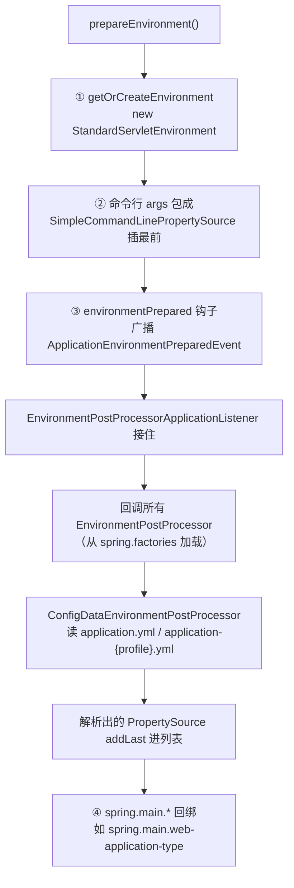

---
tags:
  - spring
created: 2026-10-13
updated: 2026-10-13
---
### **Environment 是 Spring 的「配置总管」：一张按优先级排好序的属性源列表，外加 profile 状态；prepareEnvironment 干的事就是创建这个对象，把命令行参数、系统变量、环境变量、application.yml 全部灌进去——之后整个应用里 @Value("${...}") 和 @ConfigurationProperties 读的值都是从它这来的**

先说句定位：这个不像上一轮的 RunListener 那么冷——Environment 是真高频核心，配置优先级、占位符解析、多环境 profile 这些经典面试题全都从它身上长出来，这个深度是值得花的。

#### **Environment 是啥：两个职责**

接口长这样，它继承的 `PropertyResolver` 是核心能力——按 key 取配置：

```java
public interface Environment extends PropertyResolver {
    String[] getActiveProfiles();      // 当前激活的 profile，如 dev、prod
    String[] getDefaultProfiles();     // 没激活任何 profile 时的兜底
}
```

所以它的两个职责一目了然。**职责一：配置的统一读取口。** 内部持有一个 `MutablePropertySources`——一个**有序的** PropertySource 列表，每个 PropertySource 就是一份「有名字的配置源」：系统属性是一份、环境变量是一份、application.yml 是一份、命令行参数是一份。取值的逻辑就是从头到尾遍历，第一个命中的赢：

```java
for (PropertySource<?> ps : this.propertySources) {
    Object value = ps.getProperty(name);
    if (value != null) return value;   // 排在前面的优先
}
```

**这就是「配置优先级」面试题的全部本质——优先级不是什么算法，就是列表里的顺序。** 谁插在前面谁能覆盖别人。一个 Servlet 应用启动完，列表大致是这个顺序：

| 顺序 | PropertySource | 里面是什么 | 谁放进去的 |
| --- | --- | --- | --- |
| 1 | commandLineArgs | `--server.port=8081` | prepareEnvironment 里 configureEnvironment |
| 2 | systemProperties | `System.getProperty()` | StandardEnvironment 构造器 |
| 3 | systemEnvironment | 操作系统环境变量 | StandardEnvironment 构造器 |
| 4 | Config data | application.yml、application-dev.yml | ConfigDataEnvironmentPostProcessor |
| 5 | random | `random.*` 随机数 | 内置 |

所以「命令行参数为什么能覆盖 yml」「为什么打了环境变量就生效」，答案都是同一句：它们被放在列表更前面，遍历时先命中。

**职责二：profile 管理。** `spring.profiles.active=dev` 决定加载哪个 `application-dev.yml`、决定哪些 `@Profile("dev")` 的 bean 会被注册。profile 本身也是从 Environment 里读出来的（yml 里配的或命令行传的），然后反过来影响「接下来再往 Environment 里灌哪份配置文件」——先有鸡还是先有蛋的问题 Boot 帮你处理好了。

顺带衔接前面聊过的应用类型推断：实现类有两个——普通应用用 `StandardEnvironment`，Servlet 应用用 `StandardServletEnvironment`（多挂了 servlet 上下文相关的源）。用哪个，又是看 `webApplicationType`。

#### **prepareEnvironment 具体在干嘛**

简化后的源码就四步：

```java
private ConfigurableEnvironment prepareEnvironment(...) {
    ConfigurableEnvironment environment = getOrCreateEnvironment();      // ① 按应用类型创建
    configureEnvironment(environment, args);                             // ② 命令行参数包成 PropertySource 插最前
    listeners.environmentPrepared(bootstrapContext, environment);       // ③ 发事件——application.yml 在这进来
    bindToSpringApplication(environment);                                // ④ spring.main.* 回绑到 SpringApplication
    return environment;
}
```

其中第③步就是前几轮聊的那条事件链的落地点：



两个值得记的点。**为什么 ConfigData 读的文件 addLast 而不是 addFirst**：yml 是「应用自己的默认配置」，天然应该被命令行、环境变量这些外部手段覆盖，所以放最后；这和上表的优先级顺序是自洽的。**第④步是干嘛的**：SpringApplication 自己也有配置项，比如 yml 里写 `spring.main.web-application-type: none`，就是在这时候把值绑回 SpringApplication 的字段上——这也解释了为什么它能覆盖 classpath 推断：推断发生在构造器，绑定发生在 prepareEnvironment，后者自然生效。

再往后衔接：prepareContext 阶段会把这个已就绪的 Environment `setEnvironment` 进容器，这样后面 CCPP 解析 `@Value("${server.port}")` 占位符时才有东西可查——Environment 就绪在先、bean 定义解析在后，顺序不能反。

#### **面试怎么用**

这题的标准一句话：**「prepareEnvironment 创建 Environment 并加载所有配置源——命令行、系统属性、环境变量由 Environment 自己带进来，application.yml 由 environmentPrepared 事件触发 EnvironmentPostProcessor 读进来，最终形成一份按优先级排序的属性列表，之后全应用的 @Value 和 @ConfigurationProperties 都从这里解析取值。」**

然后备好三个必然的追问：「配置优先级是什么」——答顺序即优先级，命令行 > 系统属性 > 环境变量 > yml；「@Value 和 @ConfigurationProperties 区别」——前者靠 PropertyResolver 精确取值，后者走 Binder 做宽松绑定（`SERVER_PORT` 环境变量能映射到 `server.port` 就是 Binder 的功劳）；「多环境怎么做」——`spring.profiles.active` 决定加载哪份 application-{profile}.yml 和哪些 @Profile bean。这三个问题的答案，全部站在 Environment 这一个概念上——把它吃透，等于一次性备了四道题。