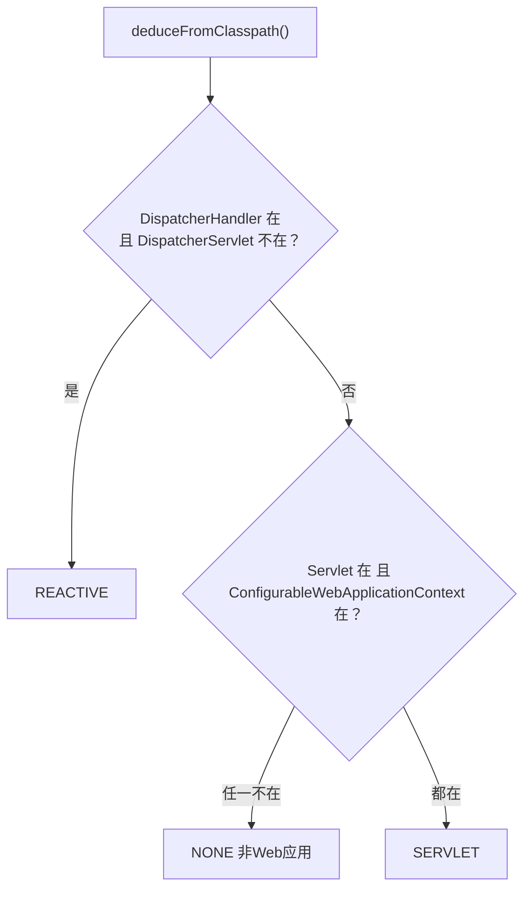

---
tags:
  - spring
created: 2026-10-13
updated: 2026-10-13
---

### **原理一句话：`WebApplicationType.deduceFromClasspath()` 挑了几个「标志类」，用 `ClassUtils.isPresent()` 逐个尝试加载——能加载成功就说明 classpath 上有对应框架，加载失败就是没有，纯粹靠 `Class.forName` 试探，没有任何魔法**

#### **入口在 SpringApplication 构造器**

`new SpringApplication(primarySources)` 里有一行：

```java
this.webApplicationType = WebApplicationType.deduceFromClasspath();
```

推断出的枚举有三种：`SERVLET`、`REACTIVE`、`NONE`。判断逻辑就是下面这段（Boot 3.x 源码，2.x 结构相同）：

```java
static WebApplicationType deduceFromClasspath() {
    if (ClassUtils.isPresent(WEBFLUX_INDICATOR_CLASS, null)
            && !ClassUtils.isPresent(WEBMVC_INDICATOR_CLASS, null)
            && !ClassUtils.isPresent(JERSEY_INDICATOR_CLASS, null)) {
        return WebApplicationType.REACTIVE;
    }
    for (String className : SERVLET_INDICATOR_CLASSES) {
        if (!ClassUtils.isPresent(className, null)) {
            return WebApplicationType.NONE;
        }
    }
    return WebApplicationType.SERVLET;
}
```

决策流程画出来就是这样：



三个标志类分别长这样：

| 标志类 | 属于谁 | 代表含义 |
| --- | --- | --- |
| `org.springframework.web.reactive.DispatcherHandler` | WebFlux | 引了 reactive 栈 |
| `org.springframework.web.servlet.DispatcherServlet` | Spring MVC | 引了 servlet 栈 |
| `jakarta.servlet.Servlet`（2.x 是 `javax.servlet.Servlet`） | Servlet 规范 | 有 Web 容器环境 |

#### **isPresent 的本质：加载一下试试，炸了就是没有**

`ClassUtils.isPresent(className, classLoader)` 的实现非常朴素：

```java
try {
    forName(className, classLoader);
    return true;
}
catch (Throwable ex) {
    return false;
}
```

拿类加载器去加载这个全限定类名，能加载 = classpath 上有这个类（也就是有引这个框架的依赖），`ClassNotFoundException` = 没有。因为 Maven/Gradle 的依赖是传递的，你引了 `spring-boot-starter-web`，`DispatcherServlet`、Servlet API 这些类就必然出现在 classpath 上——所以「引了什么 starter」和「推断出什么应用类型」是直接挂钩的，这也是它叫「约定优于配置」的底层原因之一。

顺带两个容易被追问的细节：**Reactive 的判定要求 DispatcherServlet 不在场**——如果 webflux 和 webmvc 两个 starter 同时引了，最终走 SERVLET，这是官方有意为之的兼容性优先（经典 MVC 优先）；Jersey 那个判断是后来版本加的，处理「只有 Jersey 没有 MVC」的边缘场景。

#### **推断结果怎么用上：createApplicationContext 时选容器**

这就是上一轮答案里「按应用类型选容器」的出处。2.x 是直接 switch：

```java
switch (this.webApplicationType) {
    case SERVLET:  contextClass = AnnotationConfigServletWebServerApplicationContext; break;
    case REACTIVE: contextClass = AnnotationConfigReactiveWebServerApplicationContext; break;
    default:       contextClass = AnnotationConfigApplicationContext;
}
return BeanUtils.instantiateClass(contextClass);
```

3.x 把这个 switch 委托给了 `ApplicationContextFactory`，但三者的映射关系没变。所以「classpath 有没有 DispatcherServlet」最终决定了 refresh 的载体是 `AnnotationConfigServletWebServerApplicationContext` 还是别的——推断和应用这两步就是这么接起来的。

#### **可以人为覆盖，这也是高频追问**

推断只是默认行为，三种覆盖方式：

- 代码：`springApplication.setWebApplicationType(WebApplicationType.NONE)`
- Builder：`new SpringApplicationBuilder(App.class).web(WebApplicationType.NONE).run(args)`
- 配置：`application.yml` 里 `spring.main.web-application-type: none`

典型场景：一个纯定时任务 / 消息消费者服务，依赖里间接带进了 web starter，但不想真的起 Tomcat——设成 NONE 就会走普通 `AnnotationConfigApplicationContext`，onRefresh 里也不会创建内嵌容器。

面试时如果被问到这一步，可以再补一个冷知识加分：同一个构造器里其实还有一个推断——主启动类 `deduceMainApplicationClass()` 是通过 `new RuntimeException().getStackTrace()` 拿调用栈，找到哪个栈帧的方法名叫 `main` 来定位主类的。一个构造器，两个推断，一个看 classpath、一个看调用栈，这话说出来基本能证明你读过源码了。