---
tags:
  - spring
created: 2026-10-13
updated: 2026-10-13
---
### **一个在容器 refresh 之前「改装」ApplicationContext，一个监听 run() 全生命周期的事件——Initializer 改的是容器本身，Listener 是启动过程的观察者**

#### **ApplicationContextInitializer：refresh 前对容器做最后定制**

接口定义在 spring-context 里，就一个方法：

```java
public interface ApplicationContextInitializer<C extends ConfigurableApplicationContext> {
    void initialize(C applicationContext);
}
```

执行时机是 `prepareContext` 阶段——容器已经 create 出来、但还没 refresh、一个业务 bean 都没实例化的时候，`SpringApplication.applyInitializers()` 会依次回调所有 Initializer。此时你能动的东西全是「容器级配置」：往 Environment 里插自定义 PropertySource、设置 active profile、改 beanFactory 的行为。Boot 自己注册了几个内置实现，每个都有明确用途：

| 内置实现 | 干什么 |
| --- | --- |
| ContextIdApplicationContextInitializer | 给容器设置 context id（日志名、spring.application.name 相关） |
| ServerPortInfoApplicationContextInitializer | 把实际监听端口回写进 Environment，`server.port=0` 随机端口时 `@Value("${local.server.port}")` 能拿到值就是它的功劳 |
| ConfigurationWarningsApplicationContextInitializer | 检测危险的 @ComponentScan 配置（比如扫到了根包）并打警告 |
| DelegatingApplicationContextInitializer | 读配置项 `context.initializer.classes`，让用户不用写代码也能注册 Initializer |

用户侧注册方式有三种：配置文件里写 `context.initializer.classes=com.example.MyInitializer`、代码里 `springApplication.addInitializers(...)`、或者自己的 jar 里写 spring.factories。多个 Initializer 的顺序靠实现 `Ordered` 或标 `@Order` 控制。

#### **ApplicationListener：贯穿 run() 生命周期的事件订阅者**

它是 Spring Framework 的原生接口（`onApplicationEvent(E event)`），Boot 做的事是：构造 SpringApplication 时把 spring.factories 里所有 Listener 收进来，在 run() 过程中把生命周期事件挨个广播给它们。完整事件时间轴：

```mermaid
flowchart LR
    A["ApplicationStartingEvent<br/>run() 第一行"] --> B["ApplicationEnvironmentPreparedEvent<br/>application.yml 已加载"]
    B --> C["ApplicationContextInitializedEvent"]
    C --> D["ApplicationPreparedEvent<br/>refresh 之前"]
    D --> E["ContextRefreshedEvent<br/>容器刷新完成"]
    E --> F["ApplicationStartedEvent"]
    F --> G["Runner 执行"]
    G --> H["ApplicationReadyEvent<br/>应用真正就绪"]
```



内置 Listener 里最值得记的三个，因为它直接串起前面聊过的启动流程：

- **EnvironmentPostProcessorApplicationListener**：收到 `ApplicationEnvironmentPreparedEvent` 后，从 spring.factories 加载所有 EnvironmentPostProcessor 并回调——其中 `ConfigDataEnvironmentPostProcessor` 就是真正读 application.yml 的那个。这是「prepareEnvironment 阶段加载配置文件」背后的完整链路：事件广播 → Listener 接力 → EnvironmentPostProcessor 干活。
- **LoggingApplicationListener**：在同一时机初始化日志系统（logback 等），所以你 refresh 之前就能看到日志输出。
- **BackgroundPreinitializer**：收到 `ApplicationStartingEvent` 就开后台线程预热重资源（消息转换器等），缩短主流程启动时间。

#### **关键设计点：为什么这俩必须走 spring.factories，不能注册成 bean**

这是最有面试价值的一问。**Listener 要收的事件（starting、environmentPrepared）发生在 refresh 之前，而 bean 要 refresh 之后才实例化——注册成 bean 的 Listener 根本来不及收到早期事件。** 所以 Boot 在 run() 里维护了一套不依赖容器的广播器 `initialMulticaster`（一个裸的 SimpleApplicationEventMulticaster），EventPublishingRunListener 把 spring.factories 里的 Listener 挂上去，早期事件直接方法调用同步送达；等容器 prepare 好之后（contextLoaded），这些 Listener 再被塞进容器的事件广播器，继续接收 refresh 之后的事件。Initializer 同理：它执行的时机比 bean 实例化早得多，也只能靠容器外的机制加载。

两者横向对比：

| | ApplicationContextInitializer | ApplicationListener |
| --- | --- | --- |
| 触发方式 | 一次性主动回调 initialize() | 事件广播，匹配几次收几次 |
| 时机 | prepareContext 内、refresh 前 | starting 到 ready 全程 |
| 操作对象 | 容器本身（Environment、beanFactory） | 事件载荷 |
| 典型用途 | 加属性源、设 profile、改容器配置 | 监听配置加载、就绪钩子、启动加速 |

#### **面试时的表达建议**

回答完定义后，主动抛一句串联全局的话：「上一轮说的 prepareEnvironment 能加载 application.yml，靠的就是 spring.factories 里的 EnvironmentPostProcessorApplicationListener 收到 environmentPrepared 事件后回调 EnvironmentPostProcessor」——直接证明你不只知道这两个接口的名字，还知道它们在启动流程里承担的具体一环。

再备好两个高频追问：**和 ApplicationRunner 什么区别**——Runner 在容器就绪后执行、能注入任意 bean、抛异常会中断启动，而 Listener 是事件广播、能力受限，适合「启动完成就做」的逻辑用 Runner、适合「观察启动过程」用 Listener；注意时间轴上 Runner 卡在 ApplicationStartedEvent 和 ApplicationReadyEvent 之间。**和 @EventListener 什么区别**——@EventListener 的方法挂在 bean 上，refresh 之后才生效，收不到任何早期事件；要监听 environmentPrepared 这种「容器还没好」的事件，只有 spring.factories 注册这条路。