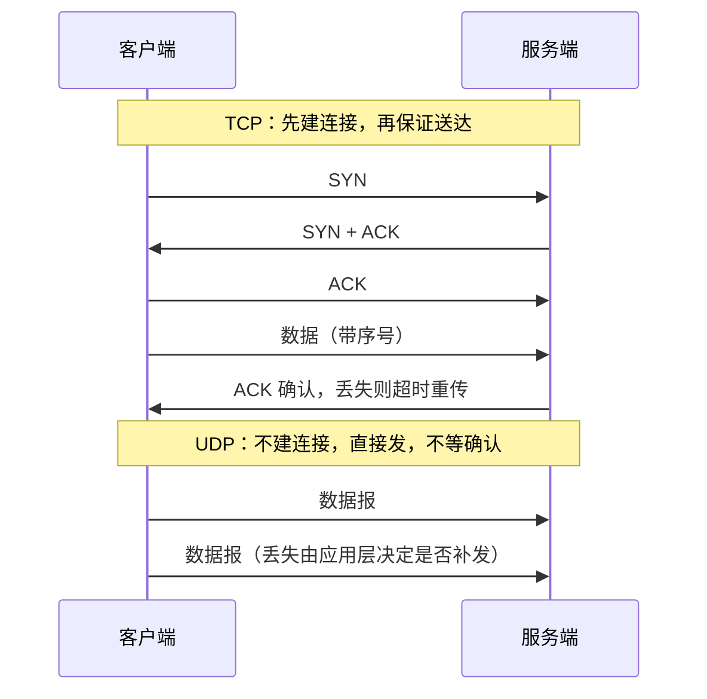

---
tags:
  - 计算机网络
  - TCP
  - UDP
  - 传输层
  - 粘包拆包
created: 2026-09-21
updated: 2026-09-21
source:
---

# TCP 与 UDP 的区别

## 一句话本质

**TCP 是面向连接、可靠、有序的字节流传输，UDP 是无连接、不可靠、保留报文边界的数据报传输；要求数据完整性和顺序的场景用 TCP，追求低延迟、容忍丢包或需要广播/组播的场景用 UDP。**

两者最本质的差异只有一句话：TCP 把"发出去的每一字节都送到、并且按顺序送到"当成自己的责任，而 UDP 只负责"尽力把每个数据报扔出去"，剩下的可靠性、顺序、重传全部交给应用层自己处理。其余所有区别（握手、头部开销、拥塞控制、广播支持）都是从这一点派生出来的。

## 分维度拆解差异

**连接状态**：TCP 通信前必须经过三次握手建立连接，通信结束要走四次挥手（或 RST）释放；连接由内核维护，占用源端口/目的端口、序号、窗口、定时器、发送接收缓冲区等状态。UDP 没有连接概念，应用随时把数据报交给内核发出，内核不记账、不留状态。

**可靠性机制**：TCP 通过序号 + 确认应答（ACK）+ 超时重传 + 快速重传 + 去重 + 校验和，保证数据不丢、不重、不错。UDP 只有 16 位校验和（IPv4 下还可选关闭），丢包不重传、乱序不重排、重复不剔除，全部由应用层自己兜底。

**数据组织方式**：TCP 是**字节流**，应用写入的多次数据在接收端可能被合并或切分，即所谓"粘包/拆包"，需要应用层自定义长度字段或分隔符来划分消息边界。UDP 是**数据报**，一次 send 对应一次 recv，报文边界天然保留，但单个报文受 MTU 限制（通常约 1472 字节以内不 IP 分片）。

**头部开销与效率**：TCP 首部固定 20 字节，带选项时最多 60 字节，且握手、ACK、窗口更新都是额外流量；UDP 首部固定 8 字节，只有源端口、目的端口、长度、校验和。

**流量与拥塞控制**：TCP 有滑动窗口做端到端流量控制，还有慢启动、拥塞避免、快重传快恢复（现代实现多为 CUBIC 或 BBR）来适配网络容量，因此对整条链路是"友好"的。UDP 完全不感知网络拥堵，会持续按应用节奏发包，因此延迟更稳定，但也可能加剧拥塞、伤害其他流。

**通信模式**：TCP 严格一对一（1:1 全双工）。UDP 支持一对一、一对多、多对多，天然适配广播和组播，这也是它在局域网发现、直播分发里不可替代的原因。

| 对比维度 | TCP | UDP |
| --- | --- | --- |
| 连接与状态 | 需三次握手建连，内核维护连接状态 | 无连接，无状态 |
| 可靠性 | 不丢、不重、不乱序（序号 + 重传 + ACK） | 尽力而为，丢包乱序不处理 |
| 数据形态与开销 | 字节流、无边界，首部 20~60 字节 | 数据报、有边界，首部 8 字节 |
| 控制机制 | 流量控制 + 拥塞控制 + 超时管理 | 无，靠应用自行限速 |
| 传输模式与代价 | 一对一，延迟受重传和队头阻塞影响 | 支持广播/组播，延迟低且稳定 |

## 典型适用场景

TCP 适合"不能错、可以等"的业务：HTTP/HTTPS 网页与 API 调用、FTP/TFTP 中的文件传输（TFTP 反而用 UDP）、SMTP/POP3/IMAP 邮件、SSH 与 Telnet 远程登录、数据库连接（MySQL、PostgreSQL）与缓存协议（Redis）、消息中间件（Kafka、RabbitMQ 的客户端连接）、gRPC（基于 HTTP/2 over TCP）、以及一切需要长连接、有序请求响应的 RPC 与配置下发。

UDP 适合"错了可以重来或干脆不在乎，但绝不能等"的业务：DNS 查询（53 端口，一次一问一答，超时自己重试）、DHCP 地址分配、SNMP 网管、NTP 时间同步、RIP 路由通告；实时音视频与互动直播（WebRTC 的 SRTP、VoIP、视频会议，丢几帧远比卡顿好）、在线游戏的状态同步与位置广播（FPS、MOBA 普遍自研可靠 UDP，只对关键事件重传）；HTTP/3 所依赖的 QUIC、VPN 隧道如 WireGuard；以及服务发现、心跳上报、监控打点这类高频小包、丢了下一轮就补上的场景。

## 面试加分点

回答完基本框架后，主动补充这几点通常能显著拉开分差。第一，不要说"TCP 一定比 UDP 慢"，更准确的说法是：无丢包的理想链路上两者吞吐差距有限，UDP 的优势在于**没有握手往返、没有重传等待、没有队头阻塞，因此尾延迟更可控**。第二，TCP 的队头阻塞和 HTTP/2 的应用层队头阻塞是 HTTP/3 改用 QUIC（UDP 之上实现可靠与多路复用 + TLS 1.3）的直接动因，这体现了"可靠性可以搬到用户态自己实现"的现代趋势。第三，UDP 想变可靠并不是重新发明 TCP，而是做取舍：KCP、QUIC、游戏自研 RUDP 都是选择性重传 + 快速恢复，用冗余换低延迟。第四，常见追问要能接住：为什么三次握手而不是两次（防止历史失效连接请求造成资源浪费，并确认双方收发能力）、TIME_WAIT 为何等待 2MSL、粘包本质是字节流无边界而非"TCP 把包粘起来"。

选型时可以用四个问题快速决策：**允许丢包吗？要求严格有序吗？是一对多吗？延迟敏感吗？** 前两个答案为"否/是"偏 TCP，后两个答案为"是"偏 UDP。真正的工程实践里，很多系统两者并存，甚至在同一产品中同时用 TCP 保证信令可靠、用 UDP 保证媒体实时。

面试时把这两句"本质差异 + 选型四问"先抛出来稳住主线，再按维度展开、用具体协议名举例，基本就答到位了。

## 深入：粘包拆包与消息边界

### 水管 vs 快递的类比

**TCP 是水管，UDP 是快递。水管里流出来的水是一整股，你没法从水里看出"我当初是分三次倒进去的"；快递包裹外面有纸箱，一个箱子就是一个箱子。**

这个类比就是本质差异的展开：TCP 一端写 3 次，接收端读几次、从哪切开都不确定；UDP 一端写 3 个包裹，就到达 3 个包裹，读 3 次正好拿到 3 个。

### "粘包/拆包"到底发生了什么

"粘包"这个名字其实有误导性——TCP 根本没有"包"这个概念，它只有**一串连续的字节**。所谓粘包，准确说法是"字节流没有消息边界"。三个环节共同造成了这个结果。

第一，应用层调用的 `send`/`write` 次数，和 TCP 实际发出的报文段（segment）数量**没有对应关系**。你在应用层写了三次，内核可能把它们攒进同一个发送缓冲区、合成一个 TCP 段发出去（Nagle 算法还会主动帮你攒），也可能因为缓冲区满了、或者单个消息太大，把一个 `send` 的数据切成两个段。

第二，接收端内核的接收缓冲区是一个**字节池**，不是消息队列。数据到达后按序堆在池子里，你的 `read` 只是"从池子里舀走当前可用的字节"。舀多少取决于你传给 `read` 的缓冲区多大、以及那一刻池子里有多少数据。

第三，也是最关键的一点：`read` 的返回值是**读到的字节数**，不是"一条消息"。所以下面这些情况都完全合法：

- 你 `send("MSG1")`、`send("MSG2")`，对端第一次 `read` 直接返回 `"MSG1MSG2"`——这就是"粘包"，两条消息被一次读完。
- 你 `send("MSG1MSG2")` 一条长消息，对端第一次 `read` 只返回 `"MSG"`，第二次返回 `"1MSG"`，第三次返回 `"2"`——这就是"拆包"。
- 甚至可能读回来 `"MSG1MSG"` 加 `"2MSG3"`，粘包和拆包同时发生。

换句话说，TCP 只承诺"字节的顺序和内容不会错"，但**绝不承诺"边界"**。而 UDP 恰恰相反：`sendto` 一次对应一个数据报，接收端 `recvfrom` 一次就返回**完整的一个**数据报，并且只返回这一个。它不会把两个数据报合并，也不会把一个数据报切开——因为每个数据报自带长度字段（UDP 首部里的 Length），边界是协议自己记账记下来的。

### TCP 上怎么把边界找回来

既然协议不给你边界，就得在应用层自己"画"出来。业界就四种做法：

| 定界方式 | 做法 | 典型协议 |
| --- | --- | --- |
| 长度前缀 | 消息头里放一个固定字节数的长度字段，先读头再按长度读体 | Kafka（4 字节长度）、gRPC/HTTP2 帧头、绝大多数 RPC 框架 |
| 特殊分隔符 | 用不会出现在正文里的字符序列切分 | HTTP 的 `\r\n\r\n`、Redis 的 RESP 协议、SMTP |
| 固定长度 | 每条消息长度恒定，按固定大小读 | 一些工业采集协议 |
| 自描述结构 | 靠格式本身配对，如 JSON 的括号嵌套 | 只适合短消息，长消息仍建议加长度前缀 |

工程上最稳的是**长度前缀**，因为它不依赖"正文里不会出现分隔符"这种脆弱假设。这也是为什么几乎所有自研 TCP 协议长这样：`[4 字节长度][消息体]`。

### UDP 保留边界的代价

UDP 因为保留边界，写起来确实省事——收到的一定是一条完整消息。但这个"省事"是拿别的东西换来的。

首先，单个数据报的大小被卡死了，超了就得由 IP 层分片，而**分片是非常危险的操作**：一个数据报被切成 5 片，只要丢了其中任意一片，接收端就无法重组，整个数据报会被直接丢弃；UDP 又没有重传机制，等于你辛辛苦苦发的一大条数据全白费。更糟的是，NAT 设备和某些防火墙会直接丢弃 IP 分片。

其次，如果接收缓冲区不够放这个数据报，内核会**直接丢弃**（部分实现会把超出的部分截断丢掉），你连"半条消息"都拿不到，和 TCP 可以慢慢读完全不一样。

最后，它不保证到达，也不保证顺序，所以真正需要可靠性的场景，还是得在 UDP 之上自己写确认、重传、排序——这就是 QUIC 和 KCP 在干的事。

### 1472 这个数字怎么来的

它不是什么神秘常量，就是一道减法。以太网一个帧最多承载 1500 字节（这就是 MTU，Maximum Transmission Unit）。IP 协议在 UDP 数据报前面要加 20 字节 IP 首部，UDP 自己还要加 8 字节首部（源端口、目的端口、长度、校验和），于是留给你的数据只有 $1500 - 20 - 8 = 1472$ 字节。超过这个数，IP 层就要分片。

需要澄清一个常见误解：**TCP 也有 MTU 限制**，但 TCP 会主动按 MSS（通常 1460 字节）把数据流切成合适大小的段，接收端重组后再交给你，切分和重组对应用层完全透明，丢了还会重传。而 UDP 不做这件事，它把分片这件事直接甩给了 IP 层，于是就有了上面那些风险。

所以实践中大家根本不会用满 1472，而是用更保守的值。原因是链路上还有额外开销：PPPoE 会吃掉 8 字节（所以家宽常见 MTU 是 1492），VPN、隧道、VXLAN 还要再扣几十字节。而且探测路径 MTU（PMTUD）依赖 ICMP 报文，很多中间设备会屏蔽 ICMP，导致探测失效、出现"大包发不出去、小包正常"的诡异故障。QUIC 干脆在协议里规定最小 1200 字节，就是为了绕开这些坑。

### 面试时怎么答粘包这一段

如果面试官追问这个点，可以用一句话收口：**TCP 是字节流，协议只保证有序到达、不保证边界，所以必须靠长度前缀或分隔符在应用层自己定界，这就是所谓粘包拆包；UDP 是数据报，协议用长度字段保留了边界，所以一次收一条，但代价是报文大小受 MTU 限制、超了要分片、丢一片就全废。**

再补一句反问式的加分点：正因为 TCP 的边界要靠应用层自己维护，才有了 HTTP 用 `Content-Length`、Redis 用 `\r\n` 加长度前缀、Kafka 用 4 字节长度头这些设计——它们本质上都是在同一件事上做的不同取舍。

## 关联知识点

- [[计网八股#为什么是三次握手？]] — TCP 建连的三次握手，本页"连接状态"维度的展开
- [[计网八股#三次握手没完成：半开连接与 SYN Flood 防护]] — 三次握手未完成的中间态与防护
- [[计网八股#HTTP/1.1的缺点有哪些？]] — TCP 传输层队头阻塞，HTTP/3 改用 UDP+QUIC 的动因
- [[计网八股]] — 计算机网络八股总览（TCP/IP、HTTP、HTTPS）
- [[计网热门面试题]] — 高频简答卷，含 TCP 可靠性、拥塞控制、HTTP/3 演进
