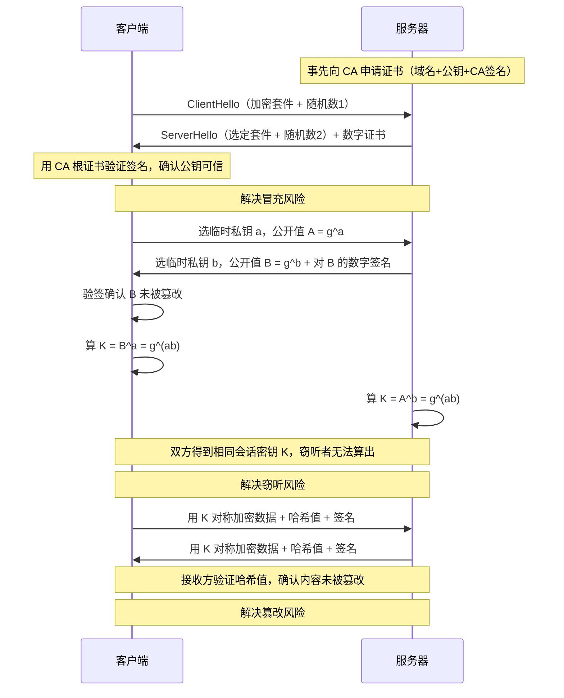
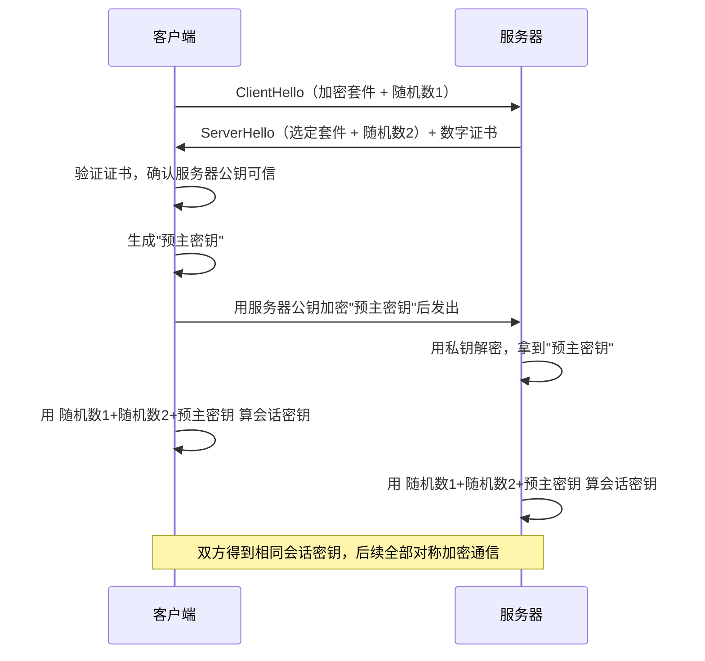
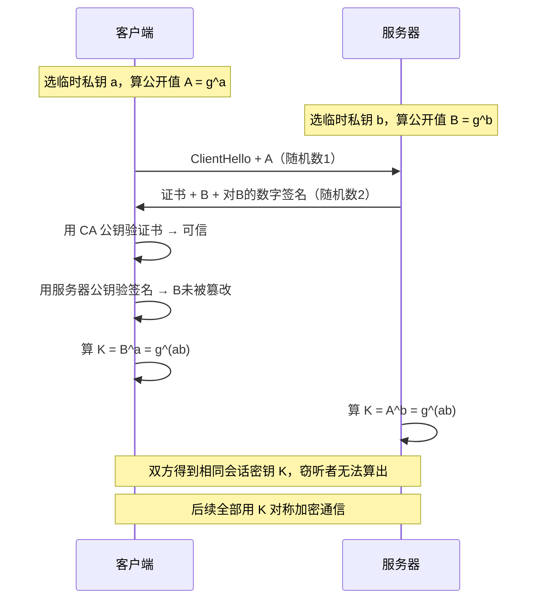
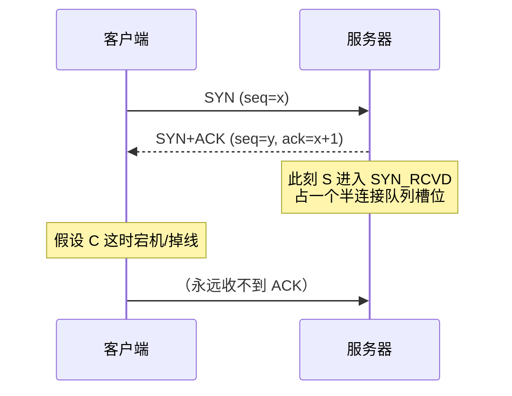
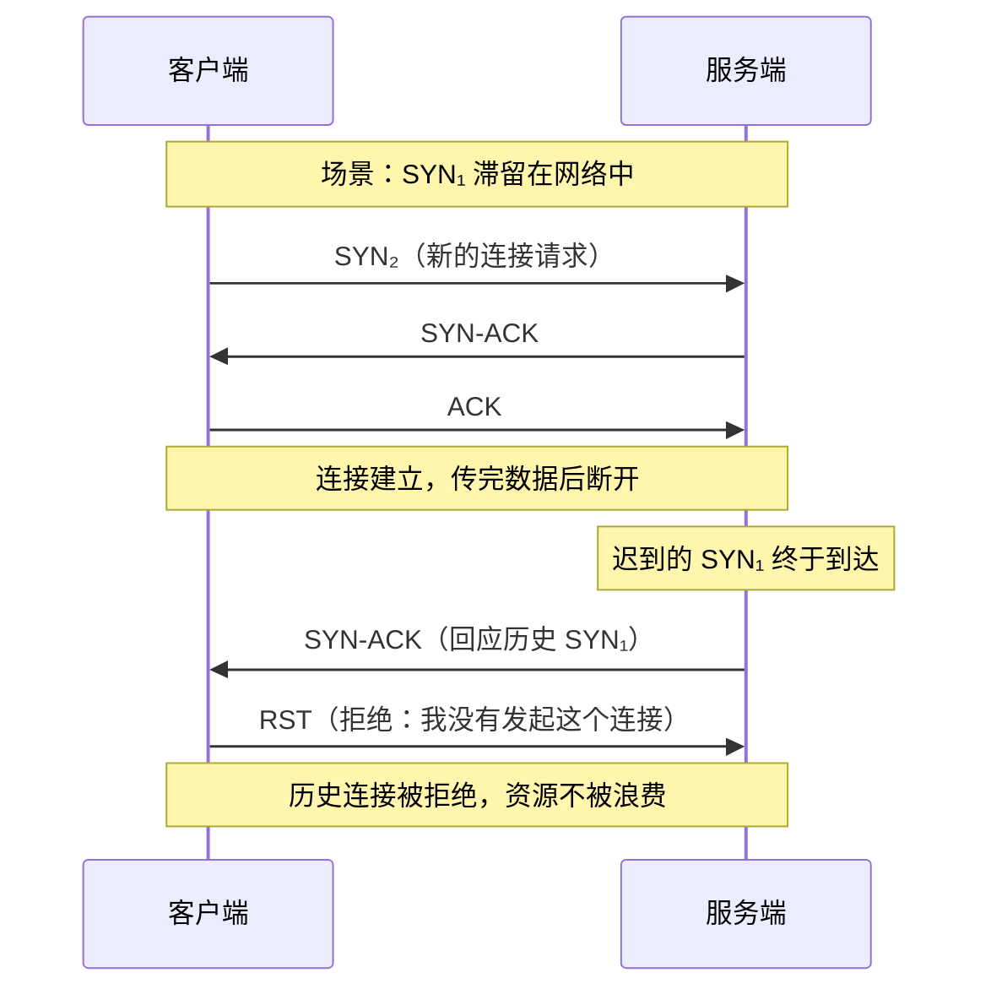
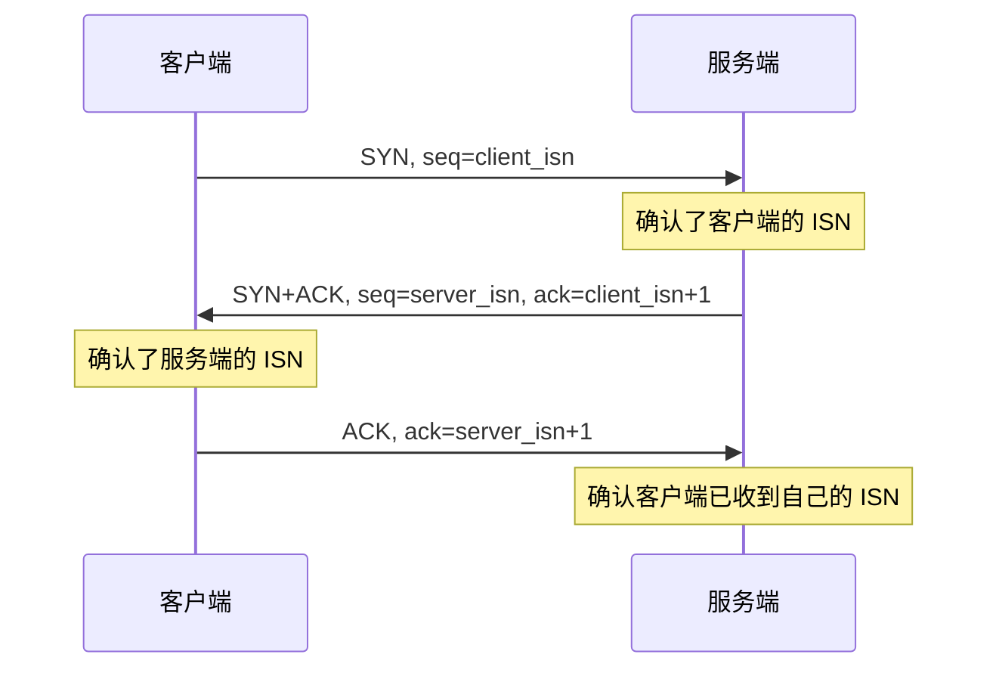

---
tags:
  - 计算机网络
created: 2026-06-28
updated: 2026-06-28
---
## HTTP


### 常见状态码

`1xx` 类状态码属于**提示信息**，是协议处理中的一种中间状态，实际用到的比较少。


`2xx` 类状态码表示服务器**成功**处理了客户端的请求

「**200 OK**」如果是非 `HEAD` 请求，服务器返回的响应有响应体和响应体

「**204 No Content**」也是常见的成功状态码，与 200 OK 基本相同，但响应没有 响应体数据。

「**206 Partial Content**」应用于断点续传或分块下载，表示该响应返回的数据是资源的一部分


3xx 类状态码表示客户端请求的资源发生了变动，需要客户端用新的 URL 重新发送请求获取资源，也就是重定向。

「**301 Moved Permanently**」表示永久重定向，说明请求的资源已经不存在了，需要改用新的URL再次访问

「**302  Found**」表示临时重定向，说明请求的资源还存在，只是临时需要用新的URL来请求

301 和 302 都会在响应头里使用字段 Location，指明后续要跳转的 URL，浏览器会自动重定向新的 URL。

「**304  Not Modified**」不具有跳转的含义，表示资源未修改，重定向已存在的缓存文件，也称作缓存重定向，也就是告知客户端可以继续使用缓存资源，用于缓存控制


`4xx` 类状态码表示**客户端错误**，即客户端发送的请求存在问题（如语法错误、权限不足、身份验证失败等），导致服务器无法正常处理。

「**400 Bad Request**」表示客户端请求的报文有错误

「**403 Forbidden**」服务器理解了请求，但因客户端权限不足或身份验证问题，拒绝提供资源。

「**404 Not Found**」表示请求的资源在服务器上不存在或未找到，所以无法提供给客户端


`5xx` 类状态码表示客户端请求报文正确，但是**服务器处理时内部发生了错误**

「**500 Internal Server Error**」与400类似，也是个笼统的错误码，并不知道服务器具体发生了什么错误

「**501 Not Implemented**」表示客户端请求的功能还不支持

「**502 Bad Gateway**」是网关或代理返回的错误码，表示网关或代理并没有出错，是其访问后端服务器出错

「**503 Service Unavailable**」表示服务器忙，暂时无法响应客户端


### GET和POST的区别


GET的语义是从服务器获取指定资源

POST的语义是根据请求负荷对指定资源做出处理


### GET和POST都是安全和幂等的吗？

先说明下安全和幂等的概念： 

在 HTTP 协议里，

所谓的「安全」是指请求方法不会「破坏」服务器上的资源。 

所谓的「幂等」，意思是多次执行相同的操作，结果都是「相同」的。


GET是安全和幂等的

POST不是


### 三种请求参数：路径参数 vs 查询参数 vs 请求体参数

很多人以为"请求参数"就是查询参数，其实一个 HTTP 请求把数据传给服务器有**三种载体**，位置和用途各不相同，在 Spring MVC 里正好对应三个注解。先记住这条主线：**路径参数定位"哪一个资源"，查询参数描述"怎么筛/怎么排"，请求体承载"要提交的数据本身"。**

**路径参数（Path Parameter）**：直接嵌在 URL 的路径段里，比如 `/users/123` 里的 `123`、`/users/123/orders/456` 里的两个 ID。它是 RESTful 风格的核心——路径本身就代表资源的层级定位，语义是"**我要操作哪一个（或哪一组）具体资源**"。它是 URL 的组成部分，必填、不可省略（省了就是另一个 URL、另一个资源），也会暴露在 URL、日志里，所以同样不放敏感信息。

**查询参数（Query Parameter）**：拼在 URL 问号之后，格式是 `?key1=value1&key2=value2`，多个用 `&` 分隔。特点是**暴露在 URL 里**——会被浏览器历史、服务器日志、代理缓存记录下来，所以不能放密码这类敏感信息；同时受 URL 长度限制（浏览器/服务器一般限制在几 KB）。只能传字符串键值对，结构扁平，需要 URL 编码（中文、空格、`&` 等特殊字符要转义）。语义上适合传"**过滤/排序/分页条件**"，比如分页 `?page=1&size=10`、筛选 `?status=active`、排序 `?sort=price`——它是"在一堆资源里怎么筛怎么排"，可有可无（不传就是默认全量），这正是它和路径参数最本质的区别：**路径参数定位资源、少了就不是同一个请求；查询参数修饰结果、少了只是没加过滤条件**。

**请求体参数（Body Parameter）**：放在 HTTP 报文的实体部分，不出现在 URL 里，因此**不会被 URL 日志记录**、也几乎没有长度限制（受服务器配置约束，如 Nginx 的 `client_max_body_size`）。它能承载复杂结构——JSON 嵌套对象、数组，还能传文件（multipart/form-data）。body 的解析方式由 `Content-Type` 决定：`application/json` 传 JSON、`application/x-www-form-urlencoded` 传表单键值对、`multipart/form-data` 传文件。语义上适合传"**要提交/处理的数据**"，比如新建订单的完整字段。GET 请求按语义不带 body，POST/PUT 这类才走 body。

| 维度 | 路径参数（Path） | 查询参数（Query） | 请求体参数（Body） |
| --- | --- | --- | --- |
| 位置 | URL 路径段 `/users/123` | URL 问号后 `?k=v&k2=v2` | 报文实体部分 |
| 可见性 | 暴露在 URL、日志里 | 暴露在 URL、日志、历史里 | 不出现在 URL |
| 是否必填 | 必填（少了就是另一个 URL） | 可选（不传即默认） | 看接口设计 |
| 长度限制 | 受 URL 长度约束 | 有（几 KB 量级） | 基本无（受服务器配置） |
| 数据结构 | 单个/少量标识值 | 扁平字符串键值对 | 支持 JSON 嵌套/数组/文件 |
| 典型语义 | 定位具体资源 | 过滤、排序、分页 | 提交、创建、处理数据 |

### 这三种参数在 Java（Spring MVC）里怎么接

Spring MVC 用三个不同注解分别绑定这三种载体，考点就在于"哪个注解接哪种参数、不要混用"。

**接路径参数：`@PathVariable`**。它取 URL 路径里 `{}` 占位段的值，属于 RESTful 风格，语义是资源定位。

```java
// GET /users/123
@GetMapping("/users/{id}")
public User get(@PathVariable Long id) { /* id=123 */ }
```

**接查询参数：`@RequestParam`**（注解名直译就是"请求参数"，最贴近日常说的"请求参数"）。它从 URL 的 query string（以及 `application/x-www-form-urlencoded` 表单体）里按名字取值。

```java
// GET /users?name=tom&age=18
@GetMapping("/users")
public User find(@RequestParam String name,
                 @RequestParam(defaultValue = "0") Integer age) {
    // name=tom, age=18
}
```

要点：`@RequestParam` 默认 `required=true`，参数缺失会抛异常，可用 `defaultValue` 兜底或设 `required=false`；参数多的时候可以直接用一个 POJO 承接（不加注解），Spring 会按字段名自动绑定。

**接请求体参数：`@RequestBody`**。它把整个请求体（通常是 JSON）通过 `HttpMessageConverter`（底层是 Jackson）反序列化成一个 Java 对象。**一个方法最多只能有一个 `@RequestBody`**，因为请求体是一个整体的流，读完就没了。

```java
// POST /users  body: {"name":"tom","age":18}
@PostMapping("/users")
public User create(@RequestBody UserDTO dto) {
    // dto.name=tom, dto.age=18
}
```

三者对照，面试时能一句话点清各自的载体（很常见的组合用法：`@PathVariable` 定位资源 + `@RequestBody` 传新数据，比如 `PUT /users/{id}` 更新用户）：

| 注解 | 取自 | 典型场景 |
| --- | --- | --- |
| `@PathVariable` | URL 路径占位段 | RESTful 资源定位 `/users/{id}` |
| `@RequestParam` | URL query string / 表单体 | 分页、筛选、简单参数 |
| `@RequestBody` | 请求体（JSON 反序列化） | 提交复杂对象、创建资源 |

一个高频坑：前端用 `Content-Type: application/json` 发 JSON，后端却用 `@RequestParam` 接，会取不到值（因为 `@RequestParam` 不解析 JSON 体），必须换成 `@RequestBody`；反过来，GET 请求没有请求体，用 `@RequestBody` 接也会失败。**注解要和参数的实际载体对上**，这是最容易在实操里踩的点。


## HTTP缓存有哪些实现方式？

- 强制缓存

  - 指的是只要浏览器判断缓存没有过期，就直接用浏览器的本地缓存，决定是否使用缓存的主动权在浏览器

  - 强缓存是利用Cache-control和Expires字段来实现的，它们都是表示资源在客户端缓存的有效期

  - **Expires 的作用**：Expires 是 HTTP/1.0 就有的老字段，它在响应头里给出一个**绝对的过期时刻**（GMT 格式的具体日期时间，如 `Expires: Wed, 21 Oct 2026 07:28:00 GMT`）。浏览器再次请求时，拿本地当前时间和这个时刻比较，没到就用缓存。它就是最早的强缓存实现手段。

  - **为什么 Cache-Control 优先级更高、能取代 Expires**：Expires 有个天生缺陷——它是**绝对时间**，依赖客户端本地时钟。如果用户把电脑时间改错了，或客户端与服务器时钟不同步，过期判断就会失效（提前失效或永不失效）。Cache-Control 是 HTTP/1.1 引入的字段，用 `max-age=秒数` 表示一个**相对时间**（从收到响应算起还能缓存多少秒），不受本地时钟影响，更可靠。所以规范规定：**两者同时存在时以 Cache-Control 的 max-age 为准，Expires 被忽略**。Expires 如今主要作为不支持 HTTP/1.1 的老客户端的兜底（向后兼容）。

  - Cache-control的优先级高于Expires

    - 具体流程：
    - 当浏览器第一次请求服务器资源时，服务器在返回这个资源的同时，会在响应头部加上Cache-control字段，该字段设置了过期时间大小
    - 当浏览器再次请求相同资源时，会将当前时间与Cache-control字段中设置的时间相计算比较大小，来判断该资源是否过期
    - 如果没有过期则使用缓存，否则重新请求服务器

    

- 协商缓存
  - 由服务器告知客户端是否使用缓存
  - 协商缓存是利用`If-Modified-Since`和`Last-Modified`字段实现的，或If-None-Match和ETag
  - **协商缓存需要配合强制缓存中的Cache-control字段来使用，只有在未命中强制缓存的时候，才能发起带有协商缓存的请求**
  - ETag优先级高于Last-Modified
    - 具体流程：
    - 当浏览器第一次请求服务器资源时，服务器在返回这个资源的同时，会在响应头部加上Last-Modified字段，值为该资源的最后修改时间
    - 当浏览器再次请求相同资源时，浏览器会在请求头带上If-Modified-Since字段，值为上次响应中的Last-Modified时间
    - 服务器收到请求时，会将该资源当前的最后修改时间与If-Modified-Since值相对比
      - 如果当前的最后修改时间大，则表示该资源被修改过，返回最新资源并在响应中更新Last-Modified值
      - 否则返回304，告知浏览器使用缓存


## HTTP/1.1的优点有哪些？

- 简单
  - HTTP基本报文格式就是header+body，头部信息是key-value的形式，易于理解，降低了学习门槛
- 灵活和易于扩展
  - HTTP协议的URL、请求方法、状态码、头字段等每个组成要求都没有被固定死，都允许开发人员进行自定义和扩充
- 应用广泛和跨平台


## HTTP/1.1的缺点有哪些？

- 无状态
  - 好处是服务器不用去记忆HTTP的状态，所以不需要额外的资源来记录状态信息，从而减轻服务器的负担，把更多的CPU和内存用于对外提供服务
  - 坏处是服务器在完成一些关联性操作时会非常麻烦

- 明文传输
  - 好处是给我们的调试工作带来了极大的便利
  - 坏处是非常不安全


## HTTP/1.1的性能如何？

​	HTTP/1.1 在性能上相比 HTTP/1.0 有了显著提升，主要通过以下两个核心机制来实现：

- 长连接
  - HTTP协议是基于TCP/IP的，早期1.0中，每发起一次请求都要新建一次TCP连接，而1.1允许多个 HTTP 请求复用同一个 TCP 连接，从而避免了频繁建立和断开连接的开销。
  - 长连接如果超过一定时间没有交互，服务器会主动断开这个连接

- 流水线
  - 在 HTTP/1.0 中，客户端必须等待上一个请求的响应完全返回后，才能发送下一个请求，这导致了严重的 “队头阻塞”
  - HTTP/1.1 引入了流水线技术，允许客户端在一个 TCP 连接上，连续发送多个请求，而无需等待前一个请求的响应。

- 队头阻塞（Head-of-Line Blocking）
  - HTTP/1.1 的队头阻塞是其最核心的性能瓶颈之一，下面从概念、成因和后续演进几个方面介绍：
  - **问题本质**：在 HTTP/1.1 中，一个 TCP 连接上，多个请求需要排队依次发送和处理。只要队首的请求没有完成，后续的请求就只能等待，无法越过它执行。
  - 具体来说，HTTP/1.1 的队头阻塞分为两层：
    - **应用层的队头阻塞**：HTTP/1.1 默认采用持久连接（`Connection: keep-alive`），请求和响应必须按照 FIFO（先进先出）的顺序进行匹配。即便同一个连接上可以”管道化”（pipelining）连续发送多个请求，服务器也必须严格按照请求的顺序返回响应。这就意味着，如果第一个请求处理特别慢（比如耗时大的动态接口、大文件传输），后面的请求即使已经在服务器端准备就绪，也必须排在它之后才能返回。
    - **传输层（TCP）的队头阻塞**：HTTP/1.1 运行在 TCP 之上，TCP 保证数据的顺序到达与可靠性。一旦某个数据包在传输中丢失，TCP 会要求重传，并且在此期间，后续即使已经到达的数据也会被缓存，不能交给上层应用，直到丢失的那个包补齐。这与 HTTP 本身无关，是 TCP 协议的固有特性。

>也就是说，我可以一次发多个HTTP请求过去，但如果排队第一的那个处理的很慢，后面的请求也不能越过他先响应


## HTTP/1.0 和 HTTP/2.0 的区别？

HTTP/1.0 和 HTTP/2.0 之间的演进，本质上是为了解决**“如何在延迟较高的互联网环境下，更高效地传输更多资源”**。

以下是它们之间最核心的区别：

------

### 1. 多路复用 (Multiplexing) —— 最本质的区别

- **HTTP/1.0：** 是**串行**的。每个 TCP 连接每次只能发送一个请求，服务器处理完后才能发下一个。虽然 1.1 引入了管道化（Pipelining），但因为“队头阻塞”问题，浏览器通常只能通过开启多个 TCP 连接（一般 6 个）来提高并行度。
- **HTTP/2.0：** 引入了**二进制分帧层**。它可以在**同一个 TCP 连接**上并行发送多个请求和响应。每个请求被拆分为带编号的“帧”，乱序发送，到达后再组装。
  - **结果：** 彻底解决了应用层的“队头阻塞”问题，极大提升了加载速度。

------

### 2. 报文格式：文本 vs 二进制

- **HTTP/1.0：** 基于**文本**协议。头部（Header）和数据体都是纯文本，虽然易读，但解析效率低，且冗余较多。
- **HTTP/2.0：** 全面采用**二进制格式**。头信息和数据体都被封装在二进制帧中。二进制协议解析更高效、更紧凑，且错误率更低。

------

### 3. 头部压缩 (Header Compression)

- **HTTP/1.0：** 每次请求都会重复携带完整的 Header（如 User-Agent, Cookie 等）。在微服务和 API 调用频繁的今天，这会导致巨大的带宽浪费。
- **HTTP/2.0：** 使用 **HPACK 算法**。客户端和服务器共同维护一张“首部表”，相同的头信息不再重复发送，只发索引号。
  - **结果：** 显著减少了带宽占用，尤其是在有大量小请求的页面中。

------

### 4. 服务器推送 (Server Push)

- **HTTP/1.0：** 典型的“请求-响应”模式。浏览器不请求，服务器绝不主动给。浏览器必须解析完 HTML，发现里面有 CSS，再去请求 CSS。
- **HTTP/2.0：** 支持服务器主动推送。服务器可以在发送 HTML 的同时，预测到浏览器后续需要 CSS 和 JS，直接提前推送到浏览器的缓存中。
  - **结果：** 减少了往返时延（RTT），页面渲染更快。

------

### 总结对比表

| **特性**     | **HTTP/1.0**         | **HTTP/2.0**             |
| ------------ | -------------------- | ------------------------ |
| **数据传输** | 纯文本格式           | 二进制分帧               |
| **连接方式** | 短连接（默认）       | 长连接多路复用           |
| **头部开销** | 巨大（重复发送文本） | 极小（HPACK 压缩）       |
| **资源获取** | 客户端主动拉取       | 支持服务器主动推送到缓存 |
| **并发性能** | 低（受限于连接数）   | 高（单连接并行）         |

------

### 补充说明

值得注意的是，虽然 HTTP/2 解决了 **HTTP 层面**的队头阻塞，但因为它底层依然使用 TCP 协议，如果发生丢包，整个 TCP 连接还是会阻塞等待重传。为了解决这个**传输层**的阻塞问题，后来才诞生了基于 UDP 的 **HTTP/3**。


## HTTP和HTTPS有哪些区别？

- HTTPS解决了HTTP不安全的缺陷，它在TCP和HTTP之间加入了SSL/TLS安全协议，使得报文能够加密传输
- HTTP的连接建立相对简单，TCP三次握手后即可进行HTTP的报文传输，而HTTPS在TCP三次握手后，还需要进行SSL/TLS的握手过程
- HTTP的端口号是80，HTTPS的是443
- HTTPS需要向CA申请数字证书，来保证服务器的身份是可信的


## HTTPS解决了HTTP哪些问题？

- 窃听风险：通信链路上可以获取到通信内容
- 篡改风险：强行植入垃圾广告
- 冒充风险：冒充淘宝网站


## HTTPS是如何解决上面三个风险的？

- 混合加密：解决**窃听风险**
  - 是一种对称加密和非对称加密结合的加密方式
  - 在通信建立前使用非对称加密的方式交换会话密钥，后续就不再使用非对称加密
  - 在通信过程中全部使用对称加密的会话密钥的方式加密明文数据
  - 使用混合加密的原因：
    - 对称加密只使用一个密钥，运算速度快，但密钥必须保密，无法做到安全交换密钥
    - 非对称加密使用两个密钥：公钥和私钥，公钥可以任意分发而私钥保密，解决了密钥交换问题但速度慢
  - 效果：即使数据被截获，没有密钥也无法解密，保证了数据的**机密性**

- 摘要算法 + 数字签名：解决**篡改风险**
  - 为了保证传输的内容不被篡改，我们需要对内容用摘要算法（哈希函数）计算出一个哈希值，然后一同传输给对方，对方收到后，也对内容计算出一个哈希值，将该值与发送来的哈希值相对比，如果相同则代表内容没有被篡改
  - 但这只能保证内容没有被篡改，没有办法保证内容+哈希值没有被篡改
  - 这种情况用非对称加密算法来解决
    - 公钥，可以公开给所有人
    - 私钥，必须自己保管不可泄露
  - 两个密钥可以双向加解密
    - 公钥加密，私钥解密：保证内容传输的安全性，因为被公钥加密的内容，只有持有私钥的人才能解密出内容
    - 私钥加密，公钥解密：保证消息不会被冒充，因为私钥是不可泄露的，如果公钥能正常解密出内容，说明该内容来自于持有私钥的人发送的
  - 我们一般不会使用非对称加密算法来传输内容，因为非对称加密的计算比较费时
    所以我们一般通过私钥加密，公钥解密来确认发送方的身份
    数字签名算法就是用的这种方式，不过私钥加密的内容不是内容本身，而是哈希值
  - 效果：如果两个哈希值一致，证明内容未被篡改，保证了数据的**完整性**

- 数字证书：解决**冒充风险**
  - 服务器把自己的公钥和身份信息提交给权威机构（CA），申请数字证书
  - 通信时，服务器出示证书，客户端用 CA 的公钥验证证书合法性，从而确认服务器身份
  - 这样，黑客无法伪造 CA 的数字签名，也就无法用假公钥欺骗客户端了
  - 效果：确保通信双方是真实可信的，防止了身份冒充，保证了通信的**真实性**

---

### 完整通信流程

把三大机制串起来，一次安全的 HTTPS 通信是这样运作的：



---

### 密钥交换方式：RSA vs ECDHE

TLS 握手的核心目标是安全地交换会话密钥。"用公钥加密会话密钥传过去"是最简化的 RSA 密钥交换描述。现代 HTTPS（TLS 1.2 推荐、TLS 1.3 唯一支持）实际改用 **ECDHE 密钥交换**，原因是 RSA 方式存在致命缺陷。下面把两种方式讲清楚。

---

#### 方式一：RSA 密钥交换

核心思路：**会话密钥由客户端单方面生成，用服务器公钥加密后传出去**。



**致命缺陷：没有前向安全性。** 整个加密的安全完全系于服务器私钥。一旦服务器私钥泄露（被攻破、被备份流出、被法院强制调取），攻击者只要保存了过去的通信流量，就能用私钥解出所有历史会话密钥，进而解密**过去所有的**通信内容。这种"一把钥匙开所有历史锁"的特性是 RSA 交换被淘汰的根本原因。

---

#### 方式二：ECDHE 密钥交换（现代标准）

为解决前向安全性，改用 **Diffie-Hellman 密钥交换**（椭圆曲线版本叫 ECDHE）。核心转变是：**会话密钥不再由一方生成后传输，而是双方各自生成一半，在公开信道上交换后各自"拼"出相同的密钥，且窃听者无法拼出来。**

先理解 DH 的数学魔法。双方先约定公开参数（大素数 p 和生成元 g，所有人都可见）：

- 客户端选一个**保密的私钥** a，计算公开值 A = g^a mod p，把 A 发出去。
- 服务器选一个**保密的私钥** b，计算公开值 B = g^b mod p，把 B 发出去。
- 客户端收到 B 后计算：K = B^a mod p = (g^b)^a mod p = g^(ab) mod p
- 服务器收到 A 后计算：K = A^b mod p = (g^a)^b mod p = g^(ab) mod p

双方算出的 K 完全相同，这就是会话密钥。**妙在**：窃听者能看到 p, g, A, B 这四样公开值，但要从中反推出 a 或 b，必须解"离散对数问题"，这在数学上是极其困难的（当参数足够大时，算到宇宙热寂也算不完）。ECDHE 把这套原理搬到椭圆曲线上，用更短的密钥达到同等强度，速度更快。

**关键：这里要和数字签名配合。** 纯 DH 交换本身有中间人风险——黑客可以中途替换 A 和 B。所以服务器在发送自己的 DH 公开值 B 时，**用私钥对 B（及相关参数）做数字签名**，客户端用证书验证后的服务器公钥来验签。这就是数字签名机制在握手阶段的具体应用。

完整流程：



---

#### 为什么 ECDHE 有前向安全性

RSA 方式里，私钥能解出"预主密钥"这个直接材料，私钥一漏全盘皆输。

ECDHE 方式里，a 和 b 是每次连接临时生成、用完即弃的，**从不传输也不存储**。会话密钥 K = g^(ab) 的安全性建立在离散对数难题上，而不是服务器私钥上。即便服务器长期私钥明天被泄露，攻击者保存的历史流量里也只有 A、B 这些公开值，仍然解不出当年的 a、b，也就解不出历史会话密钥。**过去通信依然安全**——这就是"前向安全"。

正因如此，TLS 1.3 干脆**只保留 ECDHE 这类前向安全算法，彻底移除了 RSA 密钥交换**。


## 为什么是三次握手？

三次握手的核心目的是防止已失效的历史连接请求被误当成新连接建立，这也是 RFC 793 的明确规定。具体来说，三次握手同时实现了两个目标：

---

### 三次握手完整过程（报文 → 状态 → 含义）

| 次数 | 发送方 → 接收方 | 报文 | 携带 | 状态变化 | 含义 |
|---|---|---|---|---|---|
| 第 1 次 | 客户端 → 服务端 | SYN | `seq = x` | 客户端 → **SYN_SENT** | 我想和你建立连接 |
| 第 2 次 | 服务端 → 客户端 | SYN + ACK | `ack = x + 1`、`seq = y` | 服务端 → **SYN_RCVD** | 我收到了，我也想和你建立连接 |
| 第 3 次 | 客户端 → 服务端 | ACK | `ack = y + 1` | 双方 → **ESTABLISHED** | 好的，连接正式建立 |

- **seq** 是发送方自己的初始序列号（第一次 `x`、第二次 `y`）；**ack = 对方的 seq + 1**，表示「确认收到对方的序列号」
- 客户端是**主动打开方**：发出 SYN 后进入 SYN_SENT；服务端是**被动打开方**：收到 SYN 后进入 SYN_RCVD；第三次握手完成，双方才一起进入 ESTABLISHED、开始传数据
- 第三次握手唯一的作用是「客户端确认收到服务端的 ISN」——所以第三次的 ACK 是只发数据不占资源的，丢了也能靠重连带出

> [!important] 第三次握手为什么不能省
> 第二次握手之后服务端就进入 SYN_RCVD 了，它**并不知道客户端有没有收到自己的 SYN+ACK**。如果客户端没收到（比如 SYN+ACK 丢了），服务端还傻等数据、占着资源，等到超时才发现。第三次 ACK 就是告诉服务端「你的 ISN 我收到了」，双方才敢正式进入 ESTABLISHED 干活——这正是「为什么不是两次」的核心。

---

### 三次握手没完成：半开连接与 SYN Flood 防护

**简单说**：服务器不会一直等，它会重试几次 SYN+ACK，超时就把这条半开连接扔掉；SYN Cookies 则让服务器在攻击下连队列都不占。

#### 半开连接：第三个 ACK 永远不来的中间态

TCP 三次握手的中间状态就是"半开"：



服务器收到 SYN 后会分配一个"请求控制块"（request_sock），塞进**半连接队列（SYN queue）**。如果客户端第三个 ACK 永远不来，这条槽位就一直被占着——如果很多连接都这样（无论故意攻击还是意外），半连接队列会被塞满，新连接进不来，这就是问题所在。

#### 服务器的自救：重传 SYN+ACK + 超时放弃

服务器发完 SYN+ACK 后会启动一个重传定时器，行为和普通数据包重传一样，**RTO 指数退避**：第一次等 1 秒，第二次 2 秒，然后 4 秒、8 秒、16 秒……指数翻倍。

- 由内核参数 `tcp_synack_retries` 控制最多重试几次，Linux 默认是 **5 次**
- 1+2+4+8+16 ≈ **63 秒**左右全部耗尽后，服务器判定对方死了，把这条半开连接条目**从队列里删掉，释放内存和端口资源**

所以服务器不会"死占"——单条连接最多赖 1 分钟左右就自动清掉。但如果 SYN Flood 攻击每秒打入几万个 SYN，清掉的速率远赶不上塞入的速率，队列照样被打爆，这就引出下面的防护手段。

#### 进一步防护：SYN Cookies 与 tcp_abort_on_overflow

**SYN Cookies**（`tcp_syncookies=1`，默认开启）：

核心思想是**队列满的时候，服务器干脆不保存任何状态**。它把这次握手的关键信息——源/目的 IP、端口、MSS、时间戳——全部"编码压缩"进 SYN+ACK 的**初始序列号（ISN）**里发出去，然后立刻忘掉这次连接。

如果客户端真的活着并回了 ACK，它的 `ack = ISN+1`，服务器只需**反向计算这个数字**，就能还原出当初所有握手参数，直接把连接建立起来。也就是说：

- 正常客户端：无感知，握手照常成功
- 伪造源地址的攻击者：收不到 SYN+ACK，也就不可能算出正确的 ACK，服务器永远不会为它分配资源

代价是牺牲了一些功能（比如部分 TCP 选项协商），所以平时不开，只在队列告急时自动启用。

**`tcp_abort_on_overflow=1`**：

这是针对**全连接队列（accept queue）**的参数。默认情况下，全连接队列溢出时服务器会**静默丢弃** ACK，假装没收到，指望客户端重传第三次握手（这样服务器还有机会等队列腾出空间）。但如果负载持续过载，这种"温柔策略"会让客户端傻等很久。设为 1 后，队列一溢出就直接发 **RST** 掐断连接，让客户端立刻失败、快速重试，避免连接"僵死"占着资源。

#### 客户端恢复上线后会不会出乱子？

不会，关键在于 **TCP 的序列号不会被持久保存**：

- 宕机前的握手用的是某个随机 ISN（假设是 x），服务器侧那条半开连接反正会在 ~63 秒后超时删除
- 客户端重启/恢复后重新发起连接，会生成一个**全新的随机 ISN**（可能是 y），和旧的 x 毫无关系，服务器把它当成一条全新的连接处理，两条连接互不干扰
- 旧的那条会在服务器侧自然超时作废；就算极端情况下时间上重叠，四元组（源 IP、源端口、目的 IP、目的端口）加新序列号的组合也能保证旧报文要么匹配不上，要么被当作过期数据丢弃（序列号回绕保护 + ISN 随机化就是干这个的）

#### 一句话串起来

客户端发完 SYN 就死 → 服务器在 SYN_RCVD 状态重发 SYN+ACK 约 63 秒（默认 5 次指数退避）→ 放弃并释放资源 → 如果是大规模攻击导致队列打爆，SYN Cookies 让服务器"零状态"应答、从 ACK 里反推信息 → `tcp_abort_on_overflow` 保证全连接队列溢出时快速失败 → 客户端复活后用新 ISN 重连，旧握手早已作废，一切干净如初。

---

### 追问：第三次 ACK 丢了会怎样？（客户端活着的半开连接）

上一小节讲的是"客户端宕机、ACK 永远不来"。这里换一个更刁钻的追问：客户端好好活着，但第三次 ACK 在网络里丢了，会怎样？

**客户端在发出第三次 ACK 的那一刻就已经进入 ESTABLISHED，会照常发数据；服务端还停在 SYN_RCVD，只能靠超时重传 SYN+ACK 死等。重传到上限后服务端放弃并删除半连接，而客户端毫不知情——于是留下一个客户端单向认为"已连接"的半开连接。**

关键在于第三次握手和第二次握手的性质完全不同：**服务端不会再确认这个 ACK**。所以这条 ACK 丢了，服务端根本不知道，只有客户端在唱独角戏。

#### 客户端：发完就自认为连上了

客户端 `connect` 返回成功、套接字进入 ESTABLISHED 的时机，是**把第三次 ACK 交给内核发出**，而不是等到对方确认。所以此刻在客户端看来，连接已经建好了。

接下来分两种情况。如果客户端手里正好有数据要发（很多场景就是这样，比如 HTTP 请求在 `connect` 返回后立刻写出去），那么这些数据报文里**本身就带着 ACK 号**。服务端收到这个合法数据报文，就会把连接推进到 ESTABLISHED——ACK 丢了也照样自愈，这是最常见的结局。

如果客户端没有数据要发，那就靠服务端重传的 SYN+ACK 来救。客户端此时已经是 ESTABLISHED，收到一个重复的 SYN+ACK，按协议要求会**再补发一个 ACK**。所以只要重传能到达，连接一样能建起来。

最坏的情况是双方长时间都没有数据、且服务端重传全部失败。此时客户端仍然停留在 ESTABLISHED，直到它第一次发数据，收到服务端回的 RST，才以 `ECONNRESET` 报错——**故障被推迟到了业务真正开始的时候**，这也是这类问题排查起来比较烦的原因。

#### 服务端：停在 SYN_RCVD，靠重传死等

服务端发出 SYN+ACK 后进入 SYN_RCVD，这个"半连接"会挂在**半连接队列（SYN queue）**里，同时启动一个重传定时器。收不到 ACK 就超时重传 SYN+ACK，间隔按指数退避：约 1s、2s、4s、8s、16s。

Linux 上由 `net.ipv4.tcp_synack_retries` 控制次数，默认 5 次，大约 31 秒后彻底放弃：**把这条半连接从队列里删掉，不通知客户端**。服务端此时认为连接从未存在过，而客户端还在 ESTABLISHED。

至于"为什么不干脆回个 RST 告诉它"——因为服务端无法区分"对方挂了"和"网络暂时丢包"，贸然发 RST 会打断可能只是慢的正常连接。所以默认选择沉默。

#### 三种结局一览

| 情况 | 结果 |
| --- | --- |
| 客户端有数据要发 | 数据自带 ACK，服务端立即建连，无感自愈 |
| 客户端暂无数据 | 服务端重传 SYN+ACK，客户端补 ACK，重传一次即可恢复 |
| 长期无数据且持续丢包 | 服务端放弃删连接，客户端保持 ESTABLISHED，形成半开连接 |

一个值得顺带记住的工程点：如果**服务端半连接队列被塞满**（典型场景是 SYN Flood），新的 SYN+ACK 会直接被丢弃，表现出的现象和"ACK 丢了"几乎一样——客户端认为连上了，服务端其实从没记过账。Linux 用 `tcp_syncookies` 来缓解这个问题（见上一小节 SYN Cookies）。

#### 面试收口

一句话：**第三次 ACK 丢失不会让连接直接失败，因为服务端会重传 SYN+ACK，客户端会补 ACK，通常一两次就自愈；只有当双方都长时间没有数据、重传全部耗尽时，才会出现服务端已放弃、客户端仍以为连着的半开连接，直到客户端发数据收到 RST 才暴露。**

顺带点出这背后的设计思想：TCP 的"可靠"只覆盖到"确认自己发出的东西"，而第三次 ACK 之所以不需要被确认，是因为它本身只是为了让对方确认——这种"最后一次不确认"的非对称设计，正是半开连接存在的根源。

---

### 1. 防止历史/重复连接（最根本的原因）

客户端发了第一个连接请求报文（SYN₁），因为网络拥塞在网络中滞留了。客户端等不到响应，超时后重发一个新的 SYN₂。SYN₂ 正常完成握手、建立连接、传完数据、断开连接。但之后那个迟到的 SYN₁ 终于到达了服务端。

如果只有两次握手，服务端收到 SYN₁ 就直接建立连接、分配资源、傻等数据——可客户端根本没打算建立这个连接，服务端的资源就这么被一个"僵尸连接"白白占用。

而三次握手下，服务端收到迟到的 SYN₁ 后回一个 SYN-ACK，客户端收到后发现自己并没有发起这个连接（或者序列号对不上），于是回一个 RST 报文把它拒绝掉，连接根本建立不起来。

> "防止历史连接"和"减少资源消耗"其实是因果关系，不是并列的两条理由。



---

### 2. 同步双方的初始序列号（ISN）

TCP 是可靠传输，靠序列号保证有序和不重复，所以通信双方都必须确认对方的初始序列号。三次握手刚好是完成这件事的最小次数：



第一次握手，客户端把自己的 ISN 告诉服务端；第二次握手，服务端既确认了客户端的 ISN（靠 ACK），又把自己的 ISN 告诉客户端；第三次握手，客户端确认收到了服务端的 ISN。三次之后，双方的 ISN 互相确认完毕，可以放心开始可靠传输。

**关键点**：第二次握手把"确认客户端 ISN"和"发送自己 ISN"合并成了一个 SYN+ACK 报文，所以三次就够，不需要四次。拆开讲的话逻辑上是四步（客户端 SYN → 服务端 ACK → 服务端 SYN → 客户端 ACK），中间那两步合并后就变成三次。

---

### 3. 常见追问：为什么不是两次？为什么不是四次？

**为什么不是两次**：两次握手下，服务端发出 SYN-ACK 后就直接进入 ESTABLISHED 状态了，它既无法确认客户端是否真的收到了自己的 ISN，也无法应对迟到的历史 SYN，等于把防历史连接的能力丢了。

**为什么不是四次**：因为第二次握手中的 ACK（确认客户端 ISN）和 SYN（发送自己 ISN）可以合并成一个报文，再拆出第四次纯属浪费往返时间，没有任何额外收益。三次是同步双方序列号的最小次数，设计上已经最优。

---

### 面试回答框架（30 秒版）

三次握手的核心目的是防止已失效的历史连接被误建立，这也是 RFC 793 的明确规定；其次是为了让双方可靠地同步初始序列号，保证后续数据的有序与不重复；三次刚好是同时达成这两个目标的最小次数——第二次握手把确认与同步合并成一个报文，所以不需要四次，而两次又不足以防历史连接，于是定在三次。

---

---
# 🎯 面试题 · 2026-07-31 19:27（基于《计网八股》）

> [!question]- 面试题 1：请结合 HTTP 缓存机制，说明浏览器是如何判断是否使用缓存的？强制缓存和协商缓存的具体流程及优先级是怎样的？
> HTTP 缓存主要分为强制缓存和协商缓存两种方式，浏览器会优先判断强制缓存，如果未命中再发起协商缓存请求。强制缓存是指浏览器只要判断缓存未过期，就直接使用本地缓存，主动权在浏览器端。它通过响应头中的 Cache-control 和 Expires 字段来控制有效期，其中 Cache-control 的优先级高于 Expires。具体流程是服务器第一次返回资源时带上 Cache-control 设置过期时间，浏览器再次请求时会计算当前时间与该时间的大小，若未过期则直接读取缓存，否则重新请求。
> 当强制缓存失效后，才会进入协商缓存阶段，这一过程由服务器告知客户端是否可以使用缓存。协商缓存主要通过 If-Modified-Since 配合 Last-Modified，或者 If-None-Match 配合 ETag 来实现，其中 ETag 的优先级更高。流程上，浏览器首次请求后记录资源的最后修改时间或 ETag 值，下次请求时在请求头带上这些标识。服务器收到后会对比资源当前的状态，如果资源被修改过，就返回最新资源并更新头部信息；如果未修改，则返回 304 Not Modified 状态码，告知浏览器继续使用本地缓存。需要注意的是，协商缓存必须配合强制缓存中的 Cache-control 字段使用，只有在未命中强制缓存时，才能发起带有协商缓存的请求。

> [!question]- 面试题 2：HTTP/1.1 存在哪些性能瓶颈？HTTP/2.0 是如何解决这些问题以提升传输效率的？
> HTTP/1.1 虽然引入了长连接和流水线技术，解决了部分频繁建立连接的开销，但其核心性能瓶颈在于队头阻塞问题。这分为两层：应用层上，即使允许连续发送多个请求，服务器也必须按顺序返回响应，只要队首请求处理慢，后续请求就得等待；传输层上，由于基于 TCP 协议，一旦某个数据包丢失，后续到达的数据也会被缓存等待重传补齐。此外，HTTP/1.1 基于文本格式，头部解析效率低且冗余大，每次请求都重复携带完整 Header，浪费带宽。
> HTTP/2.0 针对这些问题进行了本质改进。最核心的区别是多路复用，它引入了二进制分帧层，允许在同一个 TCP 连接上并行发送多个请求和响应，彻底解决了应用层的队头阻塞。其次，报文格式从文本改为二进制，封装在帧中，解析更高效紧凑。同时，HTTP/2.0 采用了 HPACK 算法进行头部压缩，客户端和服务器维护一张首部表，相同头信息只发索引号，显著减少了带宽占用。最后，它还支持服务器推送，服务器可以在发送 HTML 的同时预测并提前推送 CSS 或 JS 到浏览器缓存，减少往返时延，从而大幅提升页面加载速度。

> [!question]- 面试题 3：HTTPS 如何解决 HTTP 面临的安全风险？在密钥交换过程中，为什么现代标准更倾向于使用 ECDHE 而不是 RSA？
> HTTPS 通过在 TCP 和 HTTP 之间加入 SSL/TLS 协议，利用三种机制解决安全风险。首先是混合加密解决窃听风险，通信建立前用非对称加密交换会话密钥，之后全程用对称加密传输数据，保证机密性。其次是摘要算法加数字签名解决篡改风险，通过对内容计算哈希值并用私钥加密哈希值，接收方验签确认内容未被篡改，保证完整性。最后是数字证书解决冒充风险，服务器向 CA 申请证书，客户端验证证书合法性来确认服务器身份，保证真实性。
> 关于密钥交换，早期 RSA 方式是由客户端生成预主密钥并用服务器公钥加密传输，其致命缺陷是没有前向安全性。一旦服务器私钥泄露，攻击者能解密所有历史通信流量。而现代标准的 ECDHE 密钥交换采用 Diffie-Hellman 原理，双方各自生成临时私钥并在公开信道交换参数，最终独立计算出相同的会话密钥。由于临时私钥用完即弃且不传输，即便服务器长期私钥泄露，攻击者也无法从历史流量中推算出会话密钥，从而保证了前向安全性。因此 TLS 1.3 已移除 RSA 交换，仅保留 ECDHE 这类前向安全算法。

> [!question]- 面试题 4：TCP 为什么要采用三次握手建立连接？两次或四次握手会有什么影响？
> 三次握手的核心目的有两个：一是防止已失效的历史连接请求被误当成新连接建立，二是同步双方的初始序列号 ISN。如果只有两次握手，服务端收到迟到的历史 SYN 报文后会直接分配资源傻等，造成“僵尸连接”浪费资源；而三次握手下，客户端收到服务端的 SYN-ACK 后发现并非自己发起的连接，会回送 RST 拒绝，从而避免资源浪费。同时，三次握手刚好是同步双方 ISN 的最小次数：第一次客户端告诉服务端自己的 ISN，第二次服务端既确认客户端 ISN 又告诉客户端自己的 ISN，第三次客户端确认收到服务端的 ISN。
> 至于为什么不是四次，是因为第二次握手可以将”确认客户端 ISN”和”发送自己 ISN”合并成一个 SYN-ACK 报文，逻辑上虽有四步但物理上只需三次。如果强行拆成四次会增加不必要的往返时间，没有任何额外收益。所以三次握手是在保证防历史连接和同步序列号的前提下，设计上最优的次数。

---

## 传输层协议对比

TCP 与 UDP 的完整对比（六维度差异、选型四问、粘包拆包与消息边界、MTU/1472 由来）见 [[TCP与UDP的区别]]。

---

## IP 地址分类与私有地址（网络层）

### 五类地址（按首个字节划分）

| 类别 | 首字节十进制 | 二进制前缀 | 默认掩码 | 用途 |
|------|------------|-----------|---------|------|
| A 类 | 1 ~ 126 | `0` | /8（255.0.0.0） | 超大型网络 |
| B 类 | 128 ~ 191 | `10` | /16（255.255.0.0） | 中型网络 |
| C 类 | 192 ~ 223 | `110` | /24（255.255.255.0） | 小型网络 |
| D 类 | 224 ~ 239 | `1110` | — | 组播（Multicast） |
| E 类 | 240 ~ 255 | `1111` | — | 保留（实验/研究） |

注意：**0 和 127 不参与分类**——`0.x.x.x` 表示"本网络 / 默认路由"，`127.0.0.0/8` 整段是**回环地址**（`127.0.0.1` 就是常说的 localhost，见 [[OS 名词解释速查#lo（Loopback Interface，回环接口）]]）。

### 私有地址（RFC 1918）—— 面试最爱考的坑

这三段**只能在局域网内部使用，不能直接上公网**（要上公网必须经过 NAT 转换）：

| 类别    | 私有网段             | 可用范围                                | 记法                     |
| ----- | ---------------- | ----------------------------------- | ---------------------- |
| A 类私有 | `10.0.0.0/8`     | 10.0.0.0 ~ 10.255.255.255           | **10 整段**              |
| B 类私有 | `172.16.0.0/12`  | 172.**16**.0.0 ~ 172.**31**.255.255 | **只有 172.16 ~ 172.31** |
| C 类私有 | `192.168.0.0/16` | 192.168.0.0 ~ 192.168.255.255       | **192.168 整段**         |

⚠ **最经典的陷阱是 B 类私有段**：它是 `172.16.0.0/12`（掩码 `255.240.0.0`），第二段只到 **31**，所以 `172.16.x.x` ~ `172.31.x.x` 是私有，而 **`172.32.x.x` 已经不是私有地址**（是公网）。

> **口诀**：`10` 全段、`172.16 ~ 172.31`、`192.168`。

### 典型选择题解法

> 哪个属于 B 类的私有 IP 地址？
> A. `10.16.220.100`　B. `172.16.220.100`　C. `172.32.220.100`　D. `192.168.220.100`

| 选项 | 判断 | 结论 |
|------|------|------|
| A | `10.x` → A 类私有段 | 私有，但是 **A 类**，不符 |
| **B** | `172.16` 落在 `172.16 ~ 172.31` 内 | ✅ **B 类私有** |
| C | `172.32` **超出** `172.31` 上界 | ❌ 是公网地址 |
| D | `192.168.x` → C 类私有段 | 私有，但是 **C 类**，不符 |

答案：**B**。

### 其它特殊地址（顺带记）

| 地址段 | 含义 |
|--------|------|
| `127.0.0.0/8` | 回环地址，本机自己（`127.0.0.1` = localhost） |
| `169.254.0.0/16` | 链路本地地址（APIPA）：DHCP 拿不到 IP 时自动配，只能同链路段内通信 |
| `0.0.0.0` | "本机所有网卡" / 未指定地址（服务监听 `0.0.0.0` = 所有网卡都能连） |
| `255.255.255.255` | 受限广播地址（只在本网段内广播） |
| `224.0.0.0/4` | D 类组播地址 |
| `100.64.0.0/10` | 运营商级 NAT（CGNAT）共享地址段 |

### 和容器 / 虚拟机的联系

[[Linux 网络模式详解]] 里那些地址正好落在这几段里：Docker 默认 `docker0` 用 **`172.17.0.0/16`**，正好在 **B 类私有段**（`172.16~172.31`）内；家用路由器常见的 `192.168.1.0/24` 是 **C 类私有**；`10.x` 多见于公司内网和云上 VPC。**这正是它们"上不了公网"、必须靠宿主机 / NAT 网关做地址转换的原因。**

## 关联知识点

- [[TCP与UDP的区别]] — 传输层；MTU / IP 分片与网络层直接相关
- [[计网热门面试题]] — 计网高频问答 18 道（TCP / HTTP / HTTPS）
- [[OS 名词解释速查#lo（Loopback Interface，回环接口）]] — `127.0.0.0/8` 回环地址的落地
- [[Linux 网络模式详解]] — 私有地址在容器 / 虚拟机里的实际用法与 NAT 转换
