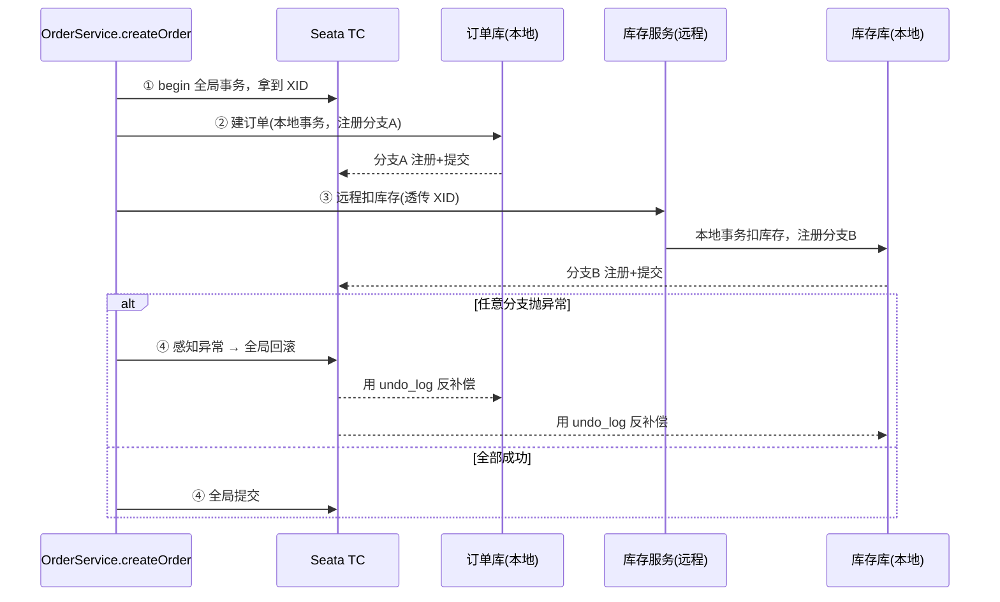
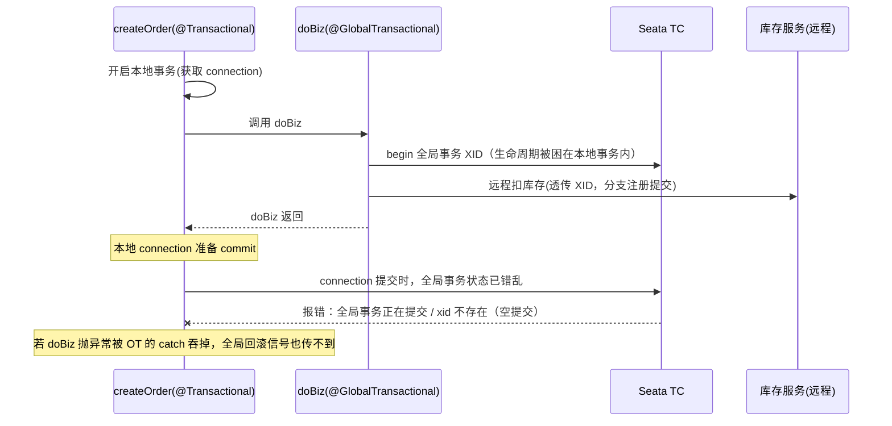

---
tags:
  - seata
  - 分布式事务
  - 最佳实践
created: 2026-08-12
updated: 2026-08-12
---

# @GlobalTransactional 使用规范

> 用一个经典的"下单"场景来举例：创建订单 + 远程扣库存 + 远程扣余额。这个场景天然跨三个数据源，是 Seata 最典型的用武之地。

---

## 正确写法：全局事务在外，本地事务在内

```java
// ===== 订单服务（全局事务发起方）=====
@Service
public class OrderService {

    @Autowired private OrderMapper orderMapper;
    @Autowired private StorageFeignClient storageFeignClient; // 远程：库存服务
    @Autowired private AccountFeignClient accountFeignClient; // 远程：账户服务

    // ✅ 全局事务加在最外层入口方法上
    @GlobalTransactional(rollbackFor = Exception.class)
    public void createOrder(OrderDTO dto) {
        orderMapper.insert(dto);                                        // 本地：建订单
        storageFeignClient.deduct(dto.getCommodityCode(), dto.getCount()); // 远程：扣库存
        accountFeignClient.debit(dto.getUserId(), dto.getMoney());         // 远程：扣余额
    }
}

// ===== 库存服务（分支事务参与方）=====
@Service
public class StorageService {
    @Autowired private StorageMapper storageMapper;

    // ✅ 参与方用本地 @Transactional 就够了，不用再标 @GlobalTransactional
    @Transactional(rollbackFor = Exception.class)
    public void deduct(String commodityCode, int count) {
        storageMapper.updateCount(commodityCode, -count);
    }
}
```

这种写法下，全局事务的 `begin/commit/rollback` 边界由最外层的 `@GlobalTransactional` 掌控，XID 的生命周期完整覆盖整条调用链；各分支用本地 `@Transactional` 管好各自的本地事务，异常能一路冒泡到 `createOrder` 被全局事务感知到，回滚正常。

---

## 错误写法：本地事务包住了全局事务

```java
// ❌ 外层是本地事务，全局事务被藏在内层 —— 顺序反了
@Service
public class OrderService {

    @Autowired private OrderMapper orderMapper;
    @Autowired private OrderBizService orderBizService;

    @Transactional(rollbackFor = Exception.class)          // 外层：本地事务
    public void createOrder(OrderDTO dto) {
        orderMapper.insert(dto);
        orderBizService.doBiz(dto);                         // 内层：全局事务
    }
}

@Service
public class OrderBizService {
    @GlobalTransactional(rollbackFor = Exception.class)    // 内层：全局事务
    public void doBiz(OrderDTO dto) {
        storageFeignClient.deduct(dto.getCommodityCode(), dto.getCount());
        accountFeignClient.debit(dto.getUserId(), dto.getMoney());
    }
}
```

问题出在全局事务的 `begin` 发生在 `doBiz` 方法里，而它的生命周期被外层 `createOrder` 的本地事务（一个 connection）整个包裹住了。当 `doBiz` 返回、外层本地事务准备 `commit` 时，全局事务的状态已经错乱。

---

## 两种写法的事务生命周期对比

### 正确写法



XID 从头到尾完整覆盖，异常能被最外层感知。

### 错误写法



---

## 后果：不是"异常截断"那么简单，根因是事务边界错乱

这里要修正之前话术里"异常会被截断，回滚就失效"的说法——那只是次生问题之一，真正的根因是**事务边界/XID 生命周期错乱导致"分布式事务空提交"**。Seata 官方 FAQ 第 22 条讲得很明确：

> 当与本地事务结合时，@Transactional 和 @GlobalTransactional 连用，@Transactional **只能位于**标注在 @GlobalTransactional 的同一方法层次或者位于 @GlobalTransactional 标注方法的**内层**。这里分布式事务的概念要大于本地事务，若将 @Transactional 标注在外层会导致**分布式事务空提交**，当 @Transactional 对应的 connection 提交时会报**全局事务正在提交或者全局事务的 xid 不存在**。

也就是说，官方把规则总结成一句话："分布式事务大于本地事务，`@Transactional` 只能在外层全局事务的同一层或更内层"。照这条规则记忆就不会反。

具体到上面的错误写法，会同时踩两个雷：

**第一是空提交/状态报错**。`@GlobalTransactional` 在 `doBiz` 上开启的全局事务，生命周期被外层 `@Transactional` 的 connection 包住。当外层 connection 走到 `commit` 时，全局事务要么已经进入提交阶段、要么 XID 已失效，于是抛出"全局事务正在提交"或"xid 不存在"。这是结构性的，哪怕你一点异常都不抛也会炸。

**第二是异常截断/回滚失效**。如果 `doBiz` 内部某个远程调用失败抛了异常，而外层 `createOrder` 里恰好 `try-catch` 把它吞了（或者外层 `@Transactional` 的 `rollbackFor` 没覆盖到该异常），那这个异常就冒泡不到 `@GlobalTransactional`，全局事务感知不到失败，自然不会发起全局回滚，各分支的 `undo_log` 补偿也就不会触发——数据就脏了。这是叠加在错误结构之上的次生风险。

所以把这两层后果都记牢，面试时无论被追"为什么反过来不行"还是被追"具体会报什么错"，都能接得住：**结构性根因是事务边界错乱导致的空提交（官方 FAQ 22 条明文），次生风险才是异常被外层本地事务截断使回滚信号传不到全局事务。**

---

## 一句话总结

**`@GlobalTransactional` 管全局（先拿 XID、最后提交全局），`@Transactional` 管本地（只管自己服务的提交回滚）。全局在外，本地在内。**
