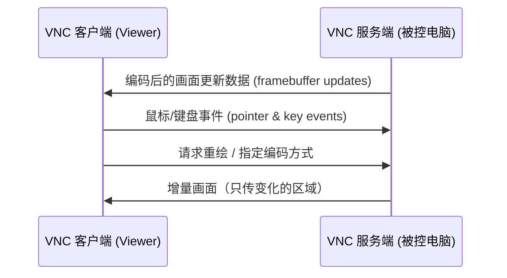

---
tags:
  - 计算机网络
  - 远程桌面
  - VNC
  - RFB协议
created: 2026-09-24
updated: 2026-09-24
source: 用户整理的 VNC 概念材料
---

# VNC（RFB协议）详解

> [!info] VNC — Virtual Network Computing（虚拟网络计算）
> 一套基于 RFB 协议的**远程桌面技术**：把一台电脑的屏幕画面实时传到另一台设备上，并把对方的键盘、鼠标操作回传，从而让你像坐在那台机器前一样操作它。名字强调「计算在远端、显示在本地」，并不指某一款具体软件。

## 一、它是什么

VNC 最早由 AT&T 剑桥实验室（Olivetti & AT&T）在 1998 年由 Tristan Richardson 等人开发，最初的参考实现以 GPL 开源，之后演化出 RealVNC、TightVNC、UltraVNC、TigerVNC 等众多分支，是目前最「通用」的远程控制方案之一。

它的定位关键词是**通用、开放、跨平台**——协议只关心像素，代价是要自己在安全和带宽上多花心思。

## 二、工作原理：一切围绕帧缓冲（framebuffer）

VNC 的设计非常「薄」，核心只有一个概念：**帧缓冲（framebuffer）**。

- **服务端**并不理解你在运行什么程序，它只是不断把**屏幕像素的变化**编码后发给客户端；
- **客户端**把本地的鼠标位置、点击、键盘事件打包发回服务端，由服务端「伪造」成真实输入。

客户端和服务端之间说的是 **RFB 协议（Remote Framebuffer，远程帧缓冲）**，跑在 TCP 上（RFB 是应用层协议，见 [[TCP与UDP的区别]]），默认端口是 **5900 + 显示号**：`:1` 对应 5901、`:2` 对应 5902，以此类推。

RFB 本身是**无状态**的——真正的会话状态都保存在服务端，所以客户端断线重连后画面依然是原样。

> [!tip] 通俗理解
> 把 VNC 想成「屏幕直播 + 弹幕遥控」：服务端像主播，不停把屏幕画面（只推变化的那块，省流量）直播给你；你的鼠标、键盘就像发弹幕，回传过去让主播那台机器照着做。主播不关心你在看什么，它只负责推画面、收指令。

## 三、关键特征

### 1. 平台无关（最大卖点）

因为协议只关心像素，Windows、Linux、macOS、树莓派、手机、甚至浏览器（Java / HTML5 客户端）都能互通，一台电脑可以同时被多种设备控制。

### 2. 画面编码可协商

为了在有限带宽下传输，VNC 支持多种编码，由客户端和服务端协商选用：

| 编码 | 说明 |
| --- | --- |
| Raw | 不压缩，直接传原始像素，带宽最高 |
| RRE / Hextile | 早期矩形 / 分块编码 |
| CopyRect | 复制已有区域（窗口移动时只发「从哪搬到哪」） |
| ZRLE | zlib + 游程编码，通用压缩 |
| Tight / JPEG / H.264 | 后期高压缩编码，适合富色彩、高动态画面 |

富色彩、高动态画面下，VNC 的带宽占用明显高于 RDP 这类「语义级」协议，这是它体验上的主要短板。

### 3. 默认安全性较弱（必须知道的坑）

早期 VNC 的认证机制用 **DES 做挑战-响应**，密码被截断成最多 **8 位**，且**流量本身不加密**。所以实践中一般要求：

- 放进 **SSH 隧道**或 **VPN** 里；
- 或使用支持 TLS 的 **VeNCrypt / RealVNC 加密模式**；
- **绝不建议**直接把 5900 端口暴露在公网上。

### 4. 没有内建 NAT 穿透

VNC 假定双方 IP 可达，跨网络往往需要端口映射、VPN 或反向连接。而 TeamViewer、AnyDesk 这类商业工具靠**云端中转服务器**解决穿墙问题——这是它们与 VNC 的主要定位差异。

## 四、常见实现与典型用途

| 名称 | 特点 / 适用场景 |
| --- | --- |
| RealVNC | 商业版功能最全，树莓派官方系统早期默认集成 |
| TightVNC | 轻量、开源，编码压缩做得较早 |
| UltraVNC | Windows 平台功能丰富，插件多，支持文件传输 |
| TigerVNC | 高性能开源实现，常见于 Linux 服务器 |
| x11vnc | 直接共享当前真实 X11 桌面，而非新建虚拟会话 |

**典型用途**：远程管理没有显示器的 Linux 服务器、运维排障、给家人做「远程协助」、树莓派等小主机的图形化操作、虚拟机与云主机的桌面访问，以及课堂 / 会议里的屏幕共享演示。

## 五、和相近技术的区别

| 技术 | 定位与差异 |
| --- | --- |
| RDP（Windows 远程桌面） | 协议级远程会话，能重定向剪贴板、音频、打印机，局域网体验更顺滑，但不跨平台 |
| SPICE | 面向虚拟机场景，性能与多媒体支持更好 |
| SSH X11 转发 | 只转发单个图形程序窗口，不传整个桌面 |
| NoMachine / AnyDesk / TeamViewer | 在 VNC / RDP 思路上做大量优化的商业/免费产品，主打易用性和 NAT 穿透 |

**一句话概括**：VNC 是远程桌面的「通用语」——简单、开放、跨平台，代价是要自己在安全和带宽上多花点心思。

## 六、面试 / 实用角度（诚实提示）

VNC 在 Java 后端面试里**几乎不会被直接问**。真正可能被追问的场景：

- 简历 / 项目里有**远程运维、树莓派、多机联调、云主机桌面**这类经历时，可能被顺着问「你怎么远程操作那台机器」；
- 如果答，抓住三个采分点即可：① **RFB 协议 + framebuffer 传像素**（区别于 RDP 的语义级重定向）；② **默认不加密、要走 SSH 隧道 / VPN**（安全意识）；③ **无内建 NAT 穿透，跨网要端口映射或反向连接**（和 AnyDesk / TeamViewer 云中转的差异）。

## 关联知识点

- [[计网八股]] — RFB 是跑在 TCP 上的应用层协议，端口、无状态会话等概念的上位知识
- [[TCP与UDP的区别]] — RFB 选 TCP 是因为画面 / 输入事件必须可靠有序，不能丢帧错序
- [[websocket]] — 同为「跑在 TCP 上的应用层协议」，浏览器版 VNC（noVNC）正是用 WebSocket 承载 RFB
- [[uri和url]] — VNC 连接地址（如 `vnc://host:5901`）的 URI 表示

