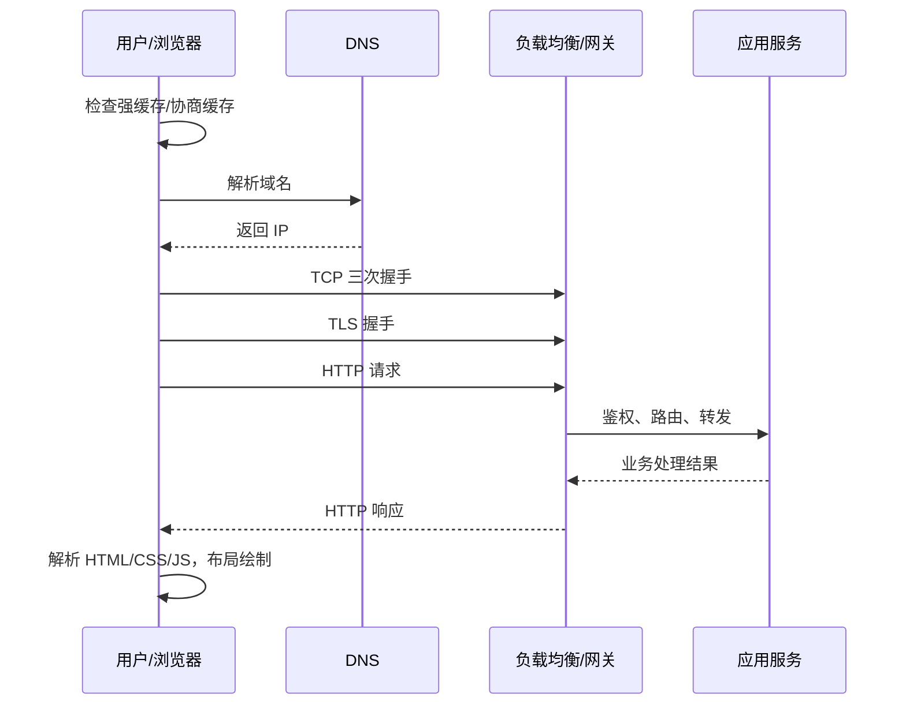

### **从输入 URL 到页面渲染，经历了 DNS 解析、TCP/TLS 建连、HTTP 请求与服务端处理、浏览器解析渲染等多个环节，每个环节都有缓存和优化点。**

面试官问这个问题，通常是想看你能否把网络、安全、服务端和浏览器渲染串成一条完整链路，并且能说出关键环节的细节和优化手段。

#### **一、URL 解析与缓存检查**

用户在地址栏输入内容后，浏览器首先判断它是搜索关键词还是 URL，然后解析出协议（如 `https`）、主机名、端口、路径和查询参数。如果没有显式写协议，浏览器会补全为 `https://` 或 `http://`。在真正发起请求之前，浏览器会检查强缓存：如果本地缓存中存在该资源，且 `Cache-Control: max-age` 或 `Expires` 未过期，就直接使用缓存，不会访问服务器。如果缓存已过期，则会带上 `If-None-Match` 或 `If-Modified-Since` 发起协商缓存请求，服务端确认资源未变化时返回 304，浏览器继续使用本地副本。

#### **二、DNS 解析**

浏览器需要把域名转换为 IP 地址。查找顺序通常是浏览器自身的 DNS 缓存，然后是操作系统的 DNS 缓存和 hosts 文件，再到本地路由器或运营商的递归 DNS 服务器。如果递归服务器也没有缓存，会依次向根域名服务器、顶级域名服务器（如 `.com`）和权威域名服务器查询，最终拿到目标 IP。很多网站接入了 CDN，权威 DNS 会返回一个 CNAME 记录指向 CDN 的调度域名，再由 CDN 的 DNS 根据用户的地理位置和运营商返回最近节点的 IP。DNS 结果都带有 TTL，在有效期内会被各级缓存复用。近年来还可以通过 DNS over HTTPS 加密查询过程，或通过 `<link rel="dns-prefetch">` 提前解析第三方域名。

#### **三、建立 TCP 连接**

拿到 IP 后，客户端与服务器之间需要建立 TCP 连接，这一步通过三次握手完成：客户端发送 SYN，服务端回复 SYN-ACK，客户端再回复 ACK。三次握手确保双方的收发能力都正常，并同步初始序列号。如果同一域名的连接已经存在且处于 keep-alive 状态，浏览器会直接复用已有连接，省去这一步。

#### **四、TLS 握手**

对于 HTTPS，TCP 连接建立后还要进行 TLS 握手。以 TLS 1.3 为例，客户端发送 ClientHello，携带支持的加密套件、随机数以及密钥共享参数（如 ECDHE 公钥）；服务端回复 ServerHello 和自己的证书与密钥参数，双方据此计算出会话密钥。客户端会校验证书的签名链、有效期和域名是否匹配，并检查是否被吊销。TLS 1.3 把握手压缩到一个往返，相比 TLS 1.2 的两个往返更快。恢复会话（Session Resumption）或 0-RTT 还能进一步减少握手延迟，但 0-RTT 数据存在重放风险，只能用于幂等请求。

#### **五、发送 HTTP 请求**

连接安全建立后，浏览器构造 HTTP 请求报文，包括请求方法（GET、POST 等）、路径、Host 头、User-Agent、Accept、Cookie 以及缓存相关的条件头。Cookie 会根据域名、路径和安全属性自动附带。在 HTTP/1.1 中，同一连接一次只能处理一个请求，浏览器对同一域名最多开 6 个左右的并发连接；HTTP/2 通过多路复用在一个连接上并行传输多个请求，HTTP/3 则基于 QUIC（UDP）解决了 TCP 队头阻塞问题，并把握手和加密进一步合并。

#### **六、服务端处理**

请求到达服务器后，通常先经过四层或七层负载均衡（如 LVS、F5、Nginx、SLB），由它们做流量分发、TLS 卸载、限流和健康检查。之后请求进入网关或反向代理，完成鉴权、路由匹配和限流熔断，再转发到具体的应用服务。应用服务执行业务逻辑，可能访问缓存（如 Redis）、数据库或其他微服务，最后把结果组装成 HTML、JSON 或静态文件，通过 HTTP 响应返回。如果页面是静态资源，往往直接由 CDN 边缘节点或 Nginx 返回，不会打到后端应用。响应头里的 `Cache-Control`、`ETag` 等字段决定了浏览器和 CDN 如何缓存它。

#### **七、浏览器解析与渲染**

浏览器收到 HTML 后开始边下载边解析。HTML 被解析为 DOM 树，遇到 `<link rel="stylesheet">` 会下载 CSS 并构建 CSSOM 树，两者合并生成渲染树（Render Tree），再经过布局（Layout）计算每个元素的几何位置，绘制（Paint）生成像素图层，最后由合成器（Compositor）借助 GPU 合成为屏幕画面。遇到普通的 `<script>` 时，解析会被阻塞，直到脚本下载并执行完毕，这也是 `defer` 和 `async` 属性存在的意义。CSS 会阻塞渲染，所以关键 CSS 应尽早加载。HTML 中的图片、字体、脚本等子资源会被预加载扫描器提前发现，并行下载。页面在关键资源加载后就会首次渲染（FCP），之后持续更新直到所有资源加载完成（onload）。

#### **八、整体时序**

下面用时序图概括整个流程，便于在面试中边画边讲：

回答时可以按"缓存 → DNS → 建连 → 请求 → 服务端 → 渲染"的顺序展开，每个环节点到一两个关键细节即可，面试官通常会根据你提到的点继续追问，比如 TLS 握手细节、HTTP/2 与 HTTP/3 的区别，或者重排重绘的触发条件。