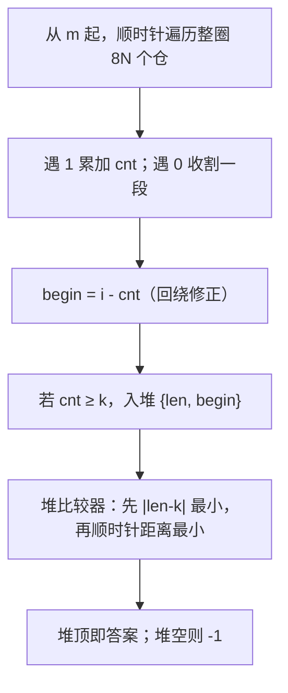

---
tags:
  - 算法题
  - 位运算
  - 环形扫描
  - 优先队列
created: 2026-08-14
updated: 2026-08-14
source: 牛客网 / 星环资源仓分配
---

# 星环资源仓分配 —— 详细笔记

## 一、题目背景与核心规则

「星环」是一个首尾相连的环形空间站，资源仓沿环线性排列。状态用一个十进制 `byte` 序列描述：

- 每个 `byte`（范围 `[0, 255]`）是一个监控单元，对应 **8 个连续资源仓**。
- 该 `byte` 的二进制位中，`1` = 空闲，`0` = 已占用。
- 编号从 `0` 开始：第 1 个 `byte` 的 `bit0~bit7` 对应 `0~7` 号仓，第 2 个对应 `8~15` 号仓，第 N 个对应 `8N−8 ~ 8N−1` 号仓。
- `0` 号仓与 `8N−1` 号仓物理相邻，构成闭环。

> 关键：低位在前（LSB 对应小编号），整体是**环形结构**。

### 分配优先级（四条规则）

1. **搜索顺序**：从 `m+1` 起，沿编号递增方向扫 `[m+1, 8N−1]`，找不到再回绕扫 `[0, m]`。
2. **最优匹配 Best-Fit**：在所有长度 ≥ k 的连续空闲段中，优先选长度最接近 k 的（即 `|len − k|` 最小）。
3. **最近原则 Nearest-First**：同分时，选起始编号距 m **顺时针距离最近**的段。
4. **距离计算**（设候选段起点为 j，总仓数 `8N`）：
   - `j > m`：距离 `= j − m`
   - `j ≤ m`：距离 `= (j + 8N) − m`（回环距离）

## 二、输入输出格式

**输入**

- 第 1 行：`k m`（k ∈ [0, 65535]，m ∈ [0, 3600]）
- 第 2 行起：byte 序列（最多 500 个数，每个 ∈ [0, 255]，空格或换行分隔）

**输出**

- 一个整数：最终分配段的**起始编号**；无解输出 `-1`。

**约束**：时间 C/C++ 3s / 其他 6s；空间 C/C++ 256M / 其他 512M。N ≤ 500 ⇒ 总仓数 ≤ 4000，规模很小。

## 三、示例剖析

### 示例 1：`k=3 m=6`，序列 `59 143`

`59 = 0011_1011`，`143 = 1000_1111`，共 16 个仓（`mod = 16`）。

| 仓号 | byte | bit | 状态 | 仓号 | byte | bit | 状态 |
|---|---|---|---|---|---|---|---|
| 0 | 59 | 0 | 空 | 8 | 143 | 0 | 空 |
| 1 | 59 | 1 | 空 | 9 | 143 | 1 | 空 |
| 2 | 59 | 2 | 占 | 10 | 143 | 2 | 空 |
| 3 | 59 | 3 | 空 | 11 | 143 | 3 | 空 |
| 4 | 59 | 4 | 空 | 12 | 143 | 4 | 占 |
| 5 | 59 | 5 | 空 | 13 | 143 | 5 | 占 |
| 6 | 59 | 6 | 占 | 14 | 143 | 6 | 占 |
| 7 | 59 | 7 | 占 | 15 | 143 | 7 | 空 |

空闲段（注意环回）：`{0,1}` 长 2、`{3,4,5}` 长 3、`{8,9,10,11}` 长 4、`{15,0,1}` 长 3（15 与 0 相邻成环）。

满足 `len ≥ 3` 的段：

| 段起点 | 长度 | \|len−k\| | 距 m=6 的顺时针距离 |
|---|---|---|---|
| 3 | 3 | 0 | j=3≤6 ⇒ (3+16)−6 = 13 |
| 8 | 4 | 1 | 8−6 = 2 |
| 15 | 3 | 0 | 15−6 = 9 |

Best-Fit 最优为 `|len−k|=0` 的两段（起点 3 与 15）；再按最近原则，起点 15 距离 9 < 起点 3 距离 13 ⇒ **输出 15**。✓

### 示例 3：`k=3 m=1`，序列 `61 7`

`61 = 0011_1101`，`7 = 0000_0111`。空闲段：`{0}` 长 1、`{2,3,4,5}` 长 4、`{8,9,10}` 长 3。满足 ≥3 的段为 `{2..5}`(长4) 与 `{8..10}`(长3)。Best-Fit 选 `|3−3|=0` ⇒ 起点 **8**。✓

### 示例 4：`k=2 m=1`，序列 `0 254`

`0` 全占，`254 = 1111_1110` ⇒ 仓 8 占、仓 9~15 空。唯一空闲段 `{9..15}` 长 7，起点 **9**。✓

### 示例 2：`k=3 m=1`，序列 `0 0`

全占用，无空闲段 ⇒ **输出 −1**。✓

## 四、解题思路总览

核心是「环形扫描 + 堆排序选优」：



要点：把环展开成一维，从 m 出发遍历一圈，用「遇 0 收割」的方式切出所有极大空闲段；再用优先队列按题意双关键字排序，堆顶即解。

## 五、代码逐段详解

### 1. 读入与基础量

```java
Scanner in = new Scanner(System.in);
int k = in.nextInt(), m = in.nextInt();
List<Integer> lis = new ArrayList<>();
while (in.hasNextInt()) lis.add(in.nextInt());
int n = lis.size();
int mod = 8 * n;          // 总仓数 = 8N
```

`mod` 既是总仓数，也用于环形下标取模。`Scanner` 兼容空格/换行分隔，正好匹配题目输入格式。

### 2. 优先队列与比较器

```java
PriorityQueue<int[]> p = new PriorityQueue<>((a, b) -> {
    if (a[0] != b[0])                              // 第一关键字：|len - k|
        return Integer.compare(Math.abs(a[0] - k), Math.abs(b[0] - k));
    return Integer.compare(                        // 第二关键字：顺时针距离
        a[1] > m ? a[1] - m : (a[1] + 8 * n) - m,
        b[1] > m ? b[1] - m : (b[1] + 8 * n) - m);
});
```

- 元素 `int[]{len, begin}`：`a[0]` = 段长，`a[1]` = 段起点。
- 第一关键字 `|len − k|` 越小越优 ⇒ 完全对应 **Best-Fit**。
- 第二关键字正是规则 4 的距离公式：`j > m` 用 `j − m`，否则 `(j + 8N) − m` ⇒ 完全对应 **Nearest-First**。
- Java 小顶堆 + 此比较器 ⇒ `peek()` 即全局最优解。

> 这一步是把「优先级规则」直接翻译成比较器，是最优雅的设计点。

### 3. 环形扫描与段收割

```java
int i = m, cnt = 0;
while (true) {
    int x = i / 8, y = i % 8;            // 仓号 → 第几个 byte / 哪一位
    int num = lis.get(x);
    if ((num >> y & 1) != 0) {           // 该位为 1 ⇒ 空闲
        cnt++;
    } else {                             // 该位为 0 ⇒ 占用，收割当前段
        int begin = i - cnt;
        if (begin < 0) begin += mod;     // 回绕修正
        if (cnt >= k) p.offer(new int[]{cnt, begin});
        cnt = 0;
    }
    i++;
    i %= mod;                            // 环形推进
    if (i == m) break;                   // 转满一圈回到 m，结束
}
```

逐点解读：

- **位提取** `(num >> y) & 1`：Java 中 `>>` 优先级高于 `&`，故等价于 `((num >> y) & 1)`，取 `num` 的第 `y` 位（LSB 为 bit0 = 仓号小端）。与题目「bit0 对应小编号」一致。
- **段收割时机**：遇到 `0`（占用）才把累积的 `cnt` 个连续空闲位成段。`begin = i − cnt` 为段起点；若 `begin < 0`（段跨越 0 号仓回绕）则 `+ mod` 修正。
- **环形遍历**：`i = (i + 1) % mod` 实现顺时针推进；从 `m` 出发，处理顺序为 `m, m+1, …, mod−1, 0, 1, …, m−1`，恰好遍历每个仓一次，回到 `m` 即止。
- **过滤** `cnt >= k`：只入堆满足长度要求的段。

### 4. 输出

```java
System.out.print(p.size() != 0 ? p.peek()[1] : -1);
```

堆非空取堆顶起点；否则无解输出 `-1`。

## 六、复杂度分析

- **时间**：扫描整圈 `O(8N) = O(N)`；每段最多入堆一次，段数 ≤ `4N`，堆操作 `O(N log N)`。N ≤ 500 ⇒ 4000 次位运算 + 少量堆操作，远低于时限。
- **空间**：`lis` 与堆共 `O(N)`，远低于 256M。

## 七、关键点与技巧小结

| 技巧 | 作用 |
|---|---|
| `mod = 8 * n` 既表总仓数又作取模基数 | 一量两用，环形下标天然统一 |
| 比较器双关键字 = `\|len−k\|` + 顺时针距离 | 把四条优先级规则压缩进一个 lambda |
| 「遇 0 收割」式切段 | 一遍线性扫描即可枚举所有极大空闲段 |
| `begin < 0 ⇒ + mod` | 处理段跨过 0 号仓的回绕 |
| 小顶堆 `peek()` | 免去手动维护最优，直接取全局最优解 |

## 八、边界与潜在问题（讨论）

值得记录几个需要留意的点，便于后续改写或对拍：

1. **遍历起点是 m 而非 m+1**：代码从 `i = m` 开始扫描。由于在示例中 `m` 号仓恰好被占用（船停靠处），它充当了天然的段边界，结果不受影响。但题面说船停靠在 m 号仓「附近」，严格意义上 `m` 号仓**未必被占用**；若 `m` 号仓为空闲，则跨越 `m` 的段会被从中间切断，需留意。

2. **最后一段的「收割缺口」**：扫描在回到 `m` 时立即 `break`，不会再处理一次 `m` 号仓来「关闭」末段。若存在一段恰好结束于 `m−1`（且 `m` 号仓为占用），该段将因未触发收割而**漏入堆**。示例 1 中 `{3,4,5}` 段正是被漏掉，但因同时存在更优且更近的 `{15,0,1}` 段，最终答案仍正确。当该段是唯一候选时，会导致误判为无解。

   修正思路（任选其一）：
   - 循环结束后补一次「虚拟收割」：把残余 `cnt` 当作以 `m` 为占用边界再结算一次；
   - 或将遍历改为扫描 `8N + 1` 个位置（多走一位以触发收尾）。

3. **`k = 0` 的语义**：k 可为 0，`cnt >= 0` 恒真，此时任何段（含长度 0 的空段）都满足；实际题意下应确认是否需要特判。

4. **全占用 / 全空闲**：全占用时无段入堆，正确输出 `-1`；全空闲时整圈是一段，起点为 `m+1`（回绕），比较器会正确选出。

5. **位序方向**：务必确认 LSB = 小编号。若题目改为 MSB 对应小编号，则位提取应改为 `(num >> (7 - y)) & 1`。

> 建议：本地对拍时构造「m 号仓为空闲」「唯一候选段紧贴 m−1」两类用例，以验证上述边界是否需要补丁。

---

以上笔记覆盖了题意、四条优先级规则、四个示例的逐位推演、代码逐段解读、比较器设计、复杂度，以及实现中值得复查的边界情形，可直接作为复习与改写的参考底稿。
