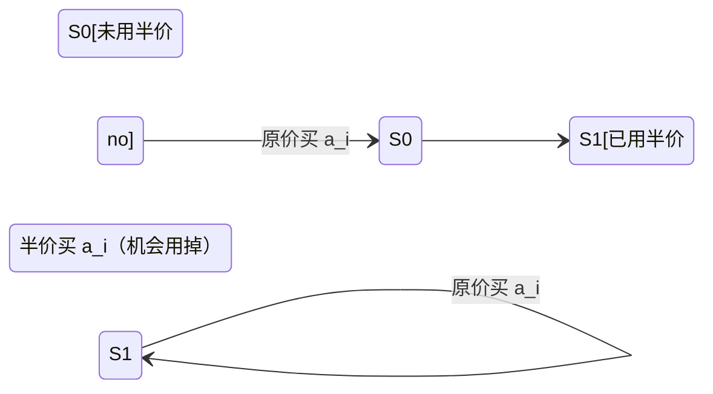

---
tags:
  - 算法
  - 动态规划
  - 01背包
  - 状态机DP
created: 2026-09-24
updated: 2026-09-24
source:
---

# 一次半价机会能否凑出目标金额（两状态 01 背包）

## 题意

给定 $n$ 件商品的价格和目标金额 $m$，可以**自由选择买哪些商品**，全程**只有一次半价（半折）机会**（把某一件商品价格按 $\lfloor a_i/2 \rfloor$ 计），问能否让实付总额**正好等于 $m$**。多组数据。

> [!note] 这里默认题意是"任选子集 + 至多一件半价"。若原题其实是"必须买下全部 $n$ 件、只是其中一件可半价"，那就不是背包，见文末「两个易错口径」。

## 错误解法与 bug 复盘

用户原始提交用 HashMap 压缩状态（`金额 → 是否已用掉半价机会`），样例能过但部分数据 WA：

```java
import java.io.BufferedReader;
import java.io.IOException;
import java.io.InputStreamReader;
import java.io.StreamTokenizer;
import java.util.Arrays;
import java.util.HashMap;
import java.util.Map;
import java.util.Scanner;

// 注意类名必须为 Main, 不要有任何 package xxx 信息
public class Main {
    public static void main(String[] args) throws IOException {
        StreamTokenizer in=new StreamTokenizer(new BufferedReader(new InputStreamReader(System.in)));
        in.nextToken();int t=(int)in.nval;
        Map<Integer,Boolean> map=new HashMap<>();
        map.put(0,false);
        while(t-->0){
            in.nextToken();int n=(int)in.nval;in.nextToken();int m=(int)in.nval;
//            System.out.println(n+" "+m);
            boolean f=false;
            int[] a=new int[n];
            for(int i=0;i<n;i++){
                in.nextToken();
                a[i]=(int)in.nval;
            }
            Arrays.sort(a);
            int i=0;
            while(i<n){
                int amount=a[i];
                i++;
                if(amount/2>m) break;
                Map<Integer,Boolean> tem=new HashMap<>(map);
                for(Map.Entry<Integer,Boolean> entry:tem.entrySet()){
//                    System.out.println(entry.getKey()+" "+entry.getValue());
                    int nAmount=amount+entry.getKey();
                    int n2Amount=amount/2+entry.getKey();
                    if(nAmount<=m) map.put(nAmount,entry.getValue());
                    if(!map.containsKey(n2Amount)&&n2Amount<=m&&!entry.getValue()){
                        map.put(n2Amount,true);
                    }
                    if(map.containsKey(m)){f=true;break;}
                }
                if(f) break;
            }
            System.out.println(f?"YES":"NO");
            map.clear();
            map.put(0,false);
        }
    }
}
```

### 错在哪：把"还没用券"的状态覆盖成了"已经用券"

核心问题在这一句**无条件覆盖**：

```java
if(nAmount<=m) map.put(nAmount,entry.getValue());   // ← 无条件 put，会降级已有状态
```

它会让一个"没用券就能凑出"的金额被写成"已用券"，从此再也不能用半价去买后面的商品，于是本该 YES 的用例输出 NO。

值得注意的是，下一行半价分支写了 `!map.containsKey(n2Amount)` 来判断会不会覆盖，说明用户已经意识到不能乱覆盖——**只是只保护了半价那一支，忘了原价那一支**。

## 状态语义：为什么只能"false 覆盖 true"

`map` 的值表示"这个金额是在什么条件下凑出来的"：

- `false`（机会还在）：后面既能原价买、也能挑一件半价买；
- `true`（机会用掉了）：后面只能原价买。

同一个金额上，`false` 的能力是 `true` 的**超集**。所以合并时只允许 **`false` 覆盖 `true`**（用能力强的状态替换弱的），绝不能反过来让 `true` 冲掉 `false`。原价分支无条件 `put`，只要某轮里有一个 `true` 的 entry 恰好推出这个金额，就把原本 `false` 的旧值降级了。

> [!tip] 这类覆盖只会造成漏解（假 NO），不会造出假 YES——因为写进去的 `true` 本身也是合法可达状态，现象就是"部分用例答案偏严"。

## 一组卡错数据

```
1
4 12
2 4 5 13
```

正确输出 `YES`（$2 + 4 + \lfloor 13/2 \rfloor = 2 + 4 + 6 = 12$，且是唯一方案），错误程序输出 `NO`。走一遍：

- 处理 `2` 后：`{0:未用, 2:未用, 1:已用}`
- 处理 `4` 后：`{0:未用, 1:已用, 2:未用, 4:未用, 5:已用, 6:未用}`，其中 **6 = 2+4 是原价凑出（未用券）**
- 处理 `5` 时：entry `(1, 已用)` 算出 `1+5=6`，把 `6` 写成"已用"，冲掉了原本的"未用"
- 处理 `13` 时：凑 12 的唯一路是 6（未用券）+ $\lfloor 13/2 \rfloor$ = 6+6，但 6 已被降级为"已用"，`!entry.getValue()` 把它挡住 → 12 永远进不了表 → 输出 NO

## 最小改动（两分支合并策略对齐）

把原价分支也改成"只在更优时覆盖"，与半价分支口径一致（都以"未用券优先"）：

```java
if (nAmount <= m) {
    Boolean cur = map.get(nAmount);
    // 只在“原来没这个金额”或“原来已用券、现在能不用券达到”时才写入
    if (cur == null || (cur && !entry.getValue())) {
        map.put(nAmount, entry.getValue());
    }
}
```

这样原来的 DP 逻辑就正确了。但 HashMap 版每件商品都要 `new HashMap<>(map)` 复制一次 + 装箱拆箱，常数极大，`n·m` 一大就容易 TLE。

## 推荐改写：两状态一维 0/1 背包

用两个布尔数组分别表示"半价机会还没用 / 已经用掉"两个状态，去掉 HashMap 的巨大常数：



```java
import java.io.BufferedReader;
import java.io.IOException;
import java.io.InputStreamReader;
import java.io.StreamTokenizer;
import java.util.Arrays;

public class Main {
    public static void main(String[] args) throws IOException {
        StreamTokenizer in = new StreamTokenizer(new BufferedReader(new InputStreamReader(System.in)));
        in.nextToken();
        int t = (int) in.nval;
        StringBuilder sb = new StringBuilder();

        while (t-- > 0) {
            in.nextToken(); int n = (int) in.nval;
            in.nextToken(); int m = (int) in.nval;
            int[] a = new int[n];
            for (int i = 0; i < n; i++) {
                in.nextToken();
                a[i] = (int) in.nval;
            }
            Arrays.sort(a);

            boolean[] no  = new boolean[m + 1]; // 半价机会还没用
            boolean[] yes = new boolean[m + 1]; // 半价机会已经用掉
            no[0] = true;

            for (int x : a) {
                int h = x / 2;
                if (h > m) break;                 // 半价都超 m，后面只会更贵
                for (int s = m; s >= 0; s--) {    // 倒序：保证每件商品最多用一次
                    if (no[s]) {
                        if (s + x <= m) no[s + x] = true;
                        if (s + h <= m) yes[s + h] = true;   // 用掉半价机会
                    }
                    if (yes[s] && s + x <= m) yes[s + x] = true; // 机会已用，只能原价
                }
            }
            sb.append((no[m] || yes[m]) ? "YES" : "NO").append('\n');
        }
        System.out.print(sb);
    }
}
```

## 倒序遍历为什么保证每件商品只用一次

倒序 `s = m → 0` 的关键：所有写入位置（`s+x`、`s+h`）都严格大于当前下标 `s`，而更大的下标在这一轮**已经处理过**，不会被当前商品再次读到——和一维 0/1 背包的倒序同理（正序会让同一件商品被重复选，退化成完全背包）。

剪枝 `if (h > m) break;` 在升序排序后成立：一旦某件商品**半价都超过 $m$**，后面更贵的商品原价、半价都不可能落进 $[0, m]$，整体跳过。

**复杂度**：$O(n \cdot m)$ 时间、$O(m)$ 空间，且常数干净（纯布尔数组，无装箱、无 HashMap 复制）。若 $m$ 到 $10^9$ 级别，可换 `BitSet` 位移：`no |= no<<x`、`yes |= (yes<<x) | (no<<h)`（先 `clone` 旧值再或），复杂度降到 $O(n \cdot m / 64)$。

## 两个易错口径

1. **半价取整方向**：本解用 $\lfloor a_i/2 \rfloor$（向下取整）。若题面是"半价向上取整"，`h` 要改成 `(x + 1) / 2`，否则奇数价格（如 13）整体错位。
2. **是不是必须全买**：上面 DP 对应"任选子集 + 至多一件半价"。若原题是"$n$ 件**必须全买**、其中一件可半价"，那就不是背包——直接判断 `sum == m`，或存在某件 $i$ 使 `sum - a[i] + a[i]/2 == m` 即可。

## 关联知识点

- [[knapsack_notes]] —— 01 背包一维倒序原理系统笔记，本题倒序遍历同源
- [[322.零钱兑换]] —— 背包可达性 / 完全背包对照（正序 vs 倒序的区别）
- [[123.买卖股票的最佳时机 III]] —— 状态机 DP：把"某次机会是否已用"作为额外状态维度，与本题两状态同构
- [[1293.网格中的最短路径（状态BFS + 消除障碍）]] —— "把有限资源并进状态"的同套路（消除次数 ↔ 半价机会）
- [[机试]] —— StreamTokenizer 快读与机试坑点速查
