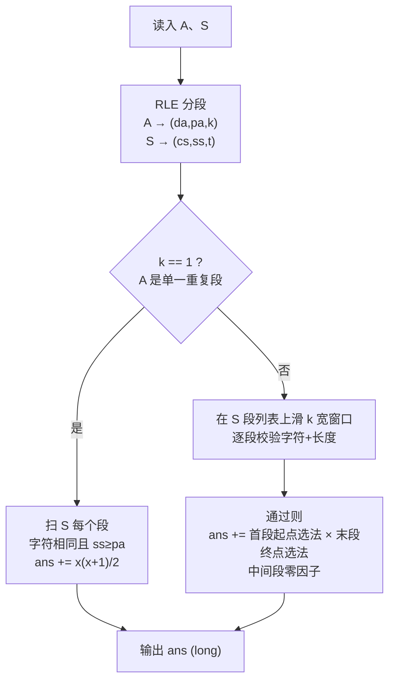

---
tags:
  - 算法
  - 字符串
  - 计数
  - 游程编码
created: 2026-08-30
updated: 2026-08-30
source:
---

# 小红的可压缩日志片段（RLE + 滑窗计数）

## 题目描述

小红为日志系统定义了一个目标模式串 $A$。对于任意字符串 $B$，一次压缩操作可以选择两个相邻且相同的字符，并删除其中一个。如果经过若干次压缩后能够得到 $A$，则称 $B$ 是符合目标模式的字符串。

现在给定一个字符串 $S$，请计算 $S$ 中有多少个子串符合目标模式。两个内容相同但起止位置不同的子串需要分别计数。

### 输入描述

- 第一行输入两个整数 $n, m$，分别表示字符串 $A$ 和 $S$ 的长度。
- 第二行输入长度为 $n$ 的字符串 $A$。
- 第三行输入长度为 $m$ 的字符串 $S$。
- 保证 $1 \le n, m \le 5000$，两个字符串均只包含英文小写字母。

### 输出描述

输出一个整数，表示符合目标模式的子串数量。

### 示例

**输入：**
```
2 4
ab
aabb
```

**输出：**
```
4
```

**说明：** 可以选择第一个连续字符段的任意非空后缀和第二个连续字符段的任意非空前缀，共得到 4 个符合要求的子串。

---

## 核心思路

**一句话：** 整份代码就干三件事——把 A 和 S 各自「压缩」成分段表示（字符 + 段长）、按 A 是否单段走两套计数公式、输出。

**通用心法：**「删除类操作」先想**不变量**。这题压缩删的是段内字符，所以「段的字符序列不变、每段长度只减不增到 ≥ 1」就是不变量，把「能不能压成」变成 O(1) 的结构比对，整道题就从中等题降级成了公式题。以后再遇到「折叠、消除、缩写」类题面，第一反应都该是先找不变量。

### 理论根基：压缩与分段

压缩操作只能在段内部删字符（`aa → a`），删不光一段、也绝不动段边界——所以「B 能压成 A」的判定完全不用真删，只看两件事：

1. **段的字符序列一模一样**（`da` 与 `cs` 逐段相等）
2. **B 每段长度 ≥ A 对应段**（`ss[i] >= pa[i]`）

这就是游程编码（RLE）后所有计数的根基。

### 两套计数公式

| 情况 | 公式 | 说明 |
|------|------|------|
| A 是单一重复段（k==1） | 对 S 每个字符相同的段：$x = ss[i] - pa[0] + 1$，$ans += \frac{x(x+1)}{2}$ | 合法子串必须整段落在段内部，长度可取 $pa[0]$ 到 $ss[i]$，等差数列求和 |
| A 多段（k≥2） | 滑 k 宽窗口逐段校验，通过则 $ans += (ss[l]-pa[0]+1) \times (ss[l+k-1]-pa[k-1]+1)$ | 起点首段内 $(s_1-p_1+1)$ 种、终点末段内 $(s_k-p_k+1)$ 种，中间段零因子 |

**为什么多段只有首末两个因子：** 子串由 (起点, 终点) 唯一决定，合法子串起点必须落在首段内、终点必须落在末段内；中间段的字符各取一段、没有自由度——不产生新起点也不产生新终点。

### 关键用例（模型排除）

| 输入 | 预期 | 说明 |
|------|------|------|
| A=ab, S=aabb（官方样例） | **4** | 首段 2 × 末段 2 |
| A=a, S=aaaa（判题机反馈） | **10** | 全部 10 个子串都能压成 a，等差数列 |
| A=abca, S=aabbccaa | **4** | 可压缩子串只有 aabbcca/aabbccaa/abbcca/abbccaa 四个 |

> [!warning] 复盘教训
> 判题机反馈（A=a、S=aaaa、预期 10）直接排除了「子序列选法」模型（LC115 在这组只会输出 4）。10 这个数字是决定性的：`aaaa` 的全部子串恰好 10 个且每个都能压成 `a`——判题机数的正是**子串**。子序列模型在一切单字符 A 用例上都会算成 $C(m,n)$，永远到不了 10。
>
> 同时注意「16 vs 4」：`abca/aabbccaa` 的**预期是 4**（不是 16）。原代码错误地对中间两组也各乘了 (2-1+1)=2，才得到 16。中间组不该乘 $(S-A+1)$，只有首末组有取起点/终点的自由。

---

## 完整代码

```java
import java.io.*;

public class Main {
    public static void main(String[] args) throws IOException {
        BufferedReader br = new BufferedReader(new InputStreamReader(System.in));
        String[] head = br.readLine().split(" ");
        int n = Integer.parseInt(head[0]);
        int m = Integer.parseInt(head[1]);
        String A = br.readLine().trim();
        String S = br.readLine().trim();

        char[] da = new char[n]; int[] pa = new int[n]; int k = 0;   // A 分组
        for (int i = 0; i < n; i++) {
            if (i > 0 && A.charAt(i) == A.charAt(i - 1)) pa[k - 1]++;
            else { da[k] = A.charAt(i); pa[k] = 1; k++; }
        }
        char[] cs = new char[m]; int[] ss = new int[m]; int t = 0;   // S 分组
        for (int i = 0; i < m; i++) {
            if (i > 0 && S.charAt(i) == S.charAt(i - 1)) ss[t - 1]++;
            else { cs[t] = S.charAt(i); ss[t] = 1; t++; }
        }

        long ans = 0;
        if (k == 1) {                                    // A 是单一重复段：数每段里长度≥p 的区间数
            for (int i = 0; i < t; i++) {
                if (cs[i] == da[0] && ss[i] >= pa[0]) {
                    long x = ss[i] - pa[0] + 1;
                    ans += x * (x + 1) / 2;
                }
            }
        } else {
            for (int l = 0; l + k <= t; l++) {           // 长度为 k 的连续 run 窗口
                boolean ok = true;
                for (int i = 0; i < k; i++) {
                    if (cs[l + i] != da[i] || ss[l + i] < pa[i]) { ok = false; break; }
                }
                if (ok) ans += (long) (ss[l] - pa[0] + 1) * (ss[l + k - 1] - pa[k - 1] + 1);
            }
        }
        System.out.println(ans);
    }
}
```

## 代码逐段拆解

### 第 1 段：读入

第一行是「n m」两个整数，用 `split(" ")` 拆开解析；第二、三行分别是 A 和 S 本体。`trim()` 是保险动作——OJ 的行尾常混着 `\r`（Windows 换行符），不切掉的话 `charAt` 会碰到脏字符，长度也可能对不上，这是笔试题读入的经典暗坑。

### 第 2 段：把 A 压成「段列表」

```
char[] da = new char[n]; int[] pa = new int[n]; int k = 0;   // A 的分组
for (int i = 0; i < n; i++) {
    if (i > 0 && A.charAt(i) == A.charAt(i - 1)) pa[k - 1]++;
    else { da[k] = A.charAt(i); pa[k] = 1; k++; }
}
```

这是游程编码（RLE）：把 `abca` 变成四条记录 `('a',1)('b',1)('c',1)('a',1)`，k=4；把 `aaab` 变成 `('a',3)('b',1)`，k=2。`da` 存每段的字符、`pa` 存每段的长度、`k` 是总段数。逻辑就是线性扫一遍：当前字符和前一个相同 → 还在同一段里 `pa[k-1]++`；不同（或 i=0）→ 开新段。

S 的那段代码结构和这个一模一样，产出 `cs / ss / t`，比如 `aabbccaa` → `('a',2)('b',2)('c',2)('a',2)`，t=4。

### 第 3 段：k == 1 的特判——A 是单一重复段

A 只有一段时（比如 A=a、S=aaaa），合法子串不需要跨多个 S 的段——S 的每一个字符段都可能是「案发现场」。对每个字符等于 `da[0]` 且长度够（`ss[i] >= pa[0]`）的段：子串必须整段落在这一段内部（一出去就碰到别的字符，段数就对不上了），长度可取 pa[0] 到 ss[i]，长为 L 的区间有 ss[i]−L+1 个，总数是等差数列求和：

$$
\sum_{L=p}^{s}(s-L+1) = (s-p+1) + (s-p) + \cdots + 1 = \frac{x(x+1)}{2}, \quad x = s-p+1
$$

验证 `A=a, S=aaaa`：x = 4−1+1 = 4，4×5/2 = **10** ✓。

> [!warning] 原代码的坑
> 判断条件写成了 `A==an && S==sn`（拿总长度当段长比），只有 A 和 S 都整个是同一种字符时才碰巧成立；这版条件 `cs[i]==da[0] && ss[i]>=pa[0]` 找的是 S 里**每一个**足够长的段，A=aa、S=aabaaaaa 也能正确算出 1 + 6×7/2 = 22。

### 第 4 段：k ≥ 2 的主计数——滑窗枚举 run 窗口

外层枚举 S 段列表上**长度恰为 k 的连续窗口**（起点 l）。内层做校验，逐段对比两件事：字符相等（`cs[l+i] == da[i]`）、长度够压缩（`ss[l+i] >= pa[i]`）。任何一段不合格整个窗口作废。

校验通过后计数，这是全题的核心一行：

$$
\underbrace{(ss[l] - pa[0] + 1)}_{\text{起点选法}} \times \underbrace{(ss[l+k-1] - pa[k-1] + 1)}_{\text{终点选法}}
$$

一个 Java 细节：`(long)` 强转在相乘**之前**做。n、m ≤ 5000 时答案最坏可到 O(m²) ≈ 千万级，int 理论上勉强够，但乘积中间值一旦溢出就悄悄变负数，OJ 上就是神秘的 WA——计数题一律用 long 是保命习惯。

### 第 5 段：复杂度与正确性

总复杂度：两次 RLE 是 O(n+m)；滑窗每窗口校验 O(k)、最多 t 个窗口，最坏 O(t·k) ≤ O(n·m/常数)——n=m=5000 时约 2500 万次字符比较，1 秒内轻松跑完。

三个关键用例回归：`ab/aabb` → 4（官方样例）、`a/aaaa` → 10（单段公式）、`abca/aabbccaa` → 4（乘法公式）。

## 结构图



## 复杂度分析

- **时间复杂度**：$O(n + m + t \cdot k)$，最坏 $O(n \cdot m)$（n=m=5000 时约 2500 万次，1 秒内）
- **空间复杂度**：$O(n + m)$

## 关联知识点

- [[KMP算法详解]] — 字符串匹配 / 模式串
- [[小红的虚拟机任务拼装]] — 同厂题（小红系列）