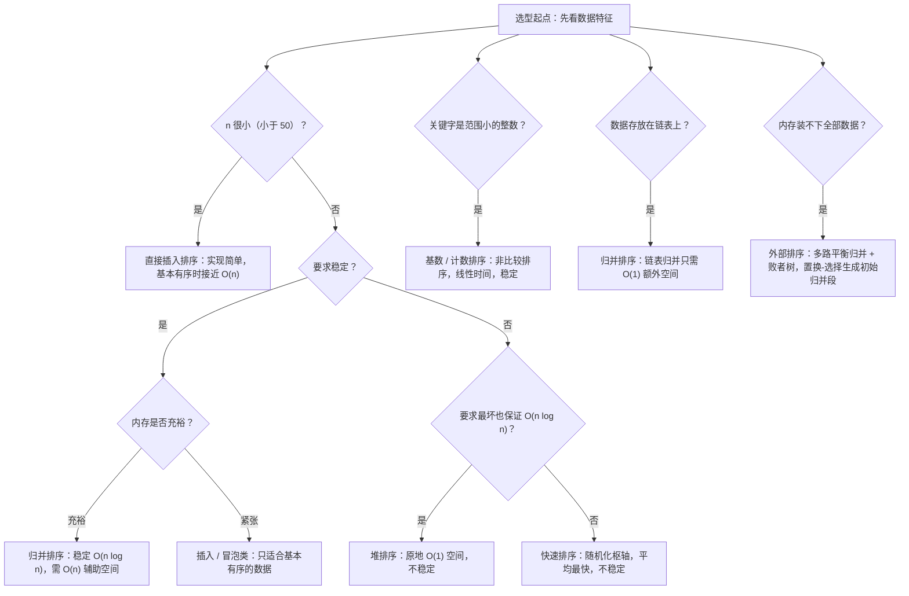

---
tags:
  - 算法
  - 排序
  - 笔试
  - 数据结构
created: 2026-09-22
updated: 2026-10-01
source:
---

# 排序算法笔试对照总表

**排序笔试的核心其实只有三件事：把复杂度与稳定性背准、会手推"某一趟之后的结果"、知道什么场景用哪个算法——其余都是这三点的变体。**

判断"以下哪个可能是某算法第 k 趟结果"这类题，判据来自三种"局部有序形态"：插入排序始终是"前缀有序"，冒泡是"后缀就位"，归并是"本趟合并区间成段"。下文逐一展开。

## 一、复杂度与稳定性总表（骨架）

这张表是整章的骨架，笔试几乎每年都会以"选一个具有某种性质（原地、稳定、最坏 O(n log n)）的算法"的形式考它。

| 排序算法 | 平均时间 | 最坏时间 | 空间 | 稳定性 |
|---|---|---|---|---|
| 直接插入排序 | O(n²) | O(n²) | O(1) | 稳定 |
| 折半插入排序 | O(n²) | O(n²) | O(1) | 稳定 |
| 希尔排序 | 约 O(n^1.3) | O(n²) | O(1) | 不稳定 |
| 冒泡排序 | O(n²) | O(n²) | O(1) | 稳定 |
| 快速排序 | O(n log n) | O(n²) | 平均 O(log n)、最坏 O(n) | 不稳定 |
| 简单选择排序 | O(n²) | O(n²) | O(1) | 不稳定 |
| 堆排序 | O(n log n) | O(n log n) | O(1) | 不稳定 |
| 归并排序 | O(n log n) | O(n log n) | O(n) | 稳定 |
| 基数排序 | O(d(n+r)) | O(d(n+r)) | O(r+n) | 稳定 |

两个不能漏的补充：**直接插入排序和带 flag 的冒泡排序，最好情况是 O(n)**（原序列已经有序，只需 n−1 次比较、0 次移动）；**快速排序最好情况是 O(n log n)**（每次划分均匀，递归深度约 ⌈log₂(n+1)⌉）。记忆口诀只有一句：**"快些选堆不稳定"**——快速、希尔、选择、堆不稳定，其余四个（插入、冒泡、归并、基数）稳定。

## 二、手推题的四条固定判据

这类题的问法是"下列序列中，哪个可能是用某算法进行第 k 趟排序后的结果"，也有反着问"哪个不可能是"。不需要把整个过程算一遍，只看局部有序形态：

如果一个序列的第 t 趟结果满足 **前 t+1 个元素有序，且第 t+2 个元素及以后与原序列完全一致**，它只能是**直接插入排序**——因为插入排序从不打乱尚未处理的后缀。

如果满足 **前 t 个元素是全局最小的 t 个数且升序排列**，它只能是**简单选择排序**——每趟都在剩余区里选最小。

如果满足 **后 t 个元素是全局最大的 t 个数且有序**（升序排时最大值沉底），它只能是**冒泡排序**。

如果满足 **每个有序段的长度为 2^t**（例如 2、2、2、2 → 4、4 → 8），它只能是**归并排序**。

**快速排序没有这类前缀/后缀性质**，它一趟划分只保证一件事：枢轴元素就位，且左半区所有元素 ≤ 枢轴、右半区所有元素 ≥ 枢轴，但左右两半内部完全不保证有序。反过来说，如果题目问"哪个是快排一趟划分的结果"，你就去找那个"左边都不大于它、右边都不小于它"的元素。**希尔排序**的特征是按增量 gap 分成 gap 个子序列、每个子序列内部有序，整体无序。

## 三、快排的一趟划分必须能手写

这是唯一一个几乎每年都要求手算过程的算法。以经典例子为例，对序列 (46, 79, 56, 38, 40, 84) 以首元素 46 为枢轴做一趟划分，采用"左右交替挖坑"：

从右往左找比 46 小的 40，填入左端；再从左往右找比 46 大的 79，填入右端刚才空出的位置；继续右→左遇到 38，填入左端；继续左→右遇到 56，填入右端；此时左右指针相遇，把 46 填入该位置。最终结果是 **(40, 38, 46, 56, 79, 84)**。

这里有两个易错点。第一，**46 之前和之后的两个子序列内部都不有序**（38 在 40 后面、79 在 56 后面），所以它绝不是"排好序的结果"。第二，枢轴的选取直接决定性能：取首元素时，遇到**基本有序或逆序**的原始序列，每次划分都极不均匀，递归深度退化为 O(n)、时间退化为 O(n²)，这也是"快排最坏情况"的标准答案；生产环境会采用随机枢轴或"三者取中"来规避。

## 四、建堆与堆相关的高频考法

堆排序的考点密度很高，因为它同时牵连完全二叉树的编号性质。**建堆**是把数组视为完全二叉树，从第 ⌊n/2⌋ 个结点开始，依次对 ⌊n/2⌋、⌊n/2⌋−1、…、1 号结点做"向下调整"（筛运算），让每个子树满足堆序。**建堆的总时间复杂度是 O(n)**，不是 O(n log n)，这是最常见的陷阱选项；真正花 O(n log n) 的是之后的排序阶段——反复执行"堆顶与当前堆尾交换、堆大小减一、对堆顶向下调整"共 n−1 次。

需要背下来的判据：大根堆要求完全二叉树中**每个非叶子结点都 ≥ 它的左右孩子**（只比较父子，不比较兄弟）。升序排序用**大根堆**，降序用小根堆——因为堆顶就是当前最值，取出来依次放到数组末尾。此外两个操作流程要清楚：**插入**元素时把它放到堆尾再"向上筛"（最多 O(log n) 次比较）；**删除**堆顶时，把堆尾元素放到根再"向下筛"。堆排序空间 O(1)、时间恒为 O(n log n)、不稳定，这三点组合出的选项（"原地、最坏 O(n log n) 但不稳定"）答案只能是堆排序。在"从海量数据中取前 k 大"这类题里，维护一个大小为 k 的小根堆也是标准解法。

## 五、那些"反常识"的对比结论

几个结论之所以要单独列出来，是因为它们常被出成判断题或选择题的干扰项。**简单选择排序的比较次数固定为 n(n−1)/2、与初始序列无关，但元素移动次数与初始序列有关**（已有序时为 0，最坏为 3(n−1) 次赋值）。对称地，**堆排序的时间复杂度同样与初始序列无关**（三种情况都是 O(n log n)），但具体比较和移动次数会随序列变化。而**直接插入、冒泡、快排、希尔这四种的趟数或耗时都与初始序列有关**，其中插入和冒泡在"基本有序"时表现最好，快排在"基本有序"时反而最差。归并排序与基数排序的时间完全由 n 决定，与初始顺序无关。

关于折半插入排序，要分清它优化了什么：它把"查找插入位置"的比较次数从 O(n) 降到 O(log n) 量级（总比较约 O(n log n)），但**元素移动次数与直接插入排序完全相同**，因为找到位置后仍然要整体后移。

比较次数的常用公式也顺手记下：冒泡与选择的最坏比较次数都是 n(n−1)/2；直接插入最坏比较次数也是 1+2+⋯+(n−1) = n(n−1)/2，移动次数同量级（约 n²/2，具体常数取决于是否把临时变量的赋值也计入"移动"，答题时写量级最稳妥）；冒泡每次交换算 3 次移动，最坏可达 3n(n−1)/2。**归并排序的趟数是 ⌈log₂n⌉，快排最好情况的递归深度是 ⌈log₂(n+1)⌉，堆的层数是 ⌊log₂n⌋+1**。还有一个理论性结论：任何基于关键字比较的排序，比较次数下界为 ⌈log₂(n!)⌉ ≈ n log₂n − 1.44n，所以 n = 1000 时量级是 10⁴ 而非 10⁶——这也解释了为什么 O(n log n) 被认为是比较排序的最优。

## 六、稳定性反例（记例子比背结论靠谱）

**简单选择排序**对 (2, 2′, 1) 排序，第一趟用最小值 1 与第一个 2 交换，得到 (1, 2′, 2)，两个 2 的相对次序被颠倒。**快速排序**对 (2, 2′, 1) 以末尾 1 为枢轴划分，结束后 2′ 排在了 2 前面。**希尔排序**不稳定是因为相等的元素可能被分到不同的增量组里，跨组移动会打乱原有相对次序。**堆排序**在"堆顶与堆尾交换"时也必然可能把相等元素换到后面。归并排序稳定，是因为合并时使用 `arr[i] <= arr[j]` 的判断（相等时优先取左边），这一点在写代码题时值得点出来。

## 七、选型决策



最后补一个容易被忽略的外排序考点：数据量超过内存时，先在内存中用**置换-选择排序**生成尽可能长的初始归并段，再做**多路平衡归并**，用**败者树**把在 k 个归并段中选出最小值的比较次数从 k−1 降到 ⌈log₂k⌉。这一段的常见问法是"归并趟数""败者树的作用"，与内存内排序属于同一章的不同题型。

## 八、比较次数会不会随初始序列变化？（高频判断题）

> 典型判断题：「希尔 / 快排 / 堆排三者的比较次数都会随初始序列变化」——**对**。但要说清"为什么"，得先分清两个概念。

**「时间复杂度的阶」≠「某个具体输入上的比较次数」。**

- **时间复杂度的阶**（O(n log n)、O(n²)）是在某种分析口径（最坏 / 平均 / 最好）下的**渐近增长率**；
- **某次具体比较次数**是在**一个确定输入**上真正执行了多少次关键字比较。

一个是"函数曲线"，一个是"曲线上某一点"。所以完全可能：堆排序的阶锁死在 O(n log n)，但不同输入的具体比较次数依然不同。

| 算法 | 具体比较次数随输入变？ | 时间复杂度的阶随输入变？ | 根因 |
|------|---------------------|-----------------------|------|
| 希尔排序 | **变** | **变**（平均约 n^1.3，最坏 n²） | 分组插入，`while` 会提前停；增量序列 + 初始排列都影响 |
| 快速排序 | **变（幅度最大）** | **变**（最好/平均 n log n，最坏 n²） | 划分是否均衡 → 递归树形状 |
| 堆排序 | **变** | **不变**（恒 O(n log n)） | 下沉几层受数据影响，但高度上限 O(log n) 把总数锁住 |

**① 希尔排序：每一趟都是"分组插入排序"**

- 取增量 h，把下标相差 h 的元素分成一组做插入排序；h 逐步缩小到 1（最后一趟就是普通插入排序）。
- 插入排序的 `while` 一旦遇到"前面的元素不大于当前"，就**提前停止**——所以有序程度直接决定它比较几次。
- 例（h=1，即普通插入排序，排升序）：`[1,2,3,4]` 只需 **3** 次比较（每个元素跟前一个比一次就停）；`[4,3,2,1]` 需要 1+2+3 = **6** 次。
- 增量序列还会改变"谁和谁在一组、能移动多远"，所以**同一输入换个增量序列，比较次数也会变**。

**② 快速排序：划分均不均，决定递归工作量**

- 每次划分把序列切成"小于枢轴 / 大于枢轴"两边，总比较次数取决于**每层切得多均衡**。
- 均衡时递归树高度 ≈ log₂n，总量 Θ(n log n)；每次都取到最值时会切出"0 个 + (n−1) 个"，逐层求和 `(n−1)+(n−2)+⋯+1 = n(n−1)/2` → Θ(n²)。
- ⚠ **关键澄清**：**"有序"本身不会让快排变慢**，是「**固定取首/尾元素作枢轴**」遇上「有序/逆序」这个**组合**才会退化。若每次取中位数或随机枢轴，有序数组一样能被均匀切开。
- 也正因如此，随机化 / 三数取中 的作用是**打散这个不利组合**，而不是"让有序数组变快"。

**③ 堆排序：下沉几层随数据变，但上界锁死**

- 每次"堆顶与堆尾交换 → 对新堆顶向下调整"要先比较左右孩子取大的、再拿它与该节点比较；**当前节点已经不小于孩子就停**，否则继续下沉。
- 元素大小关系不同 → 停止的层数不同 → 具体比较次数不同；建堆阶段同理。
- 但堆高是 O(log n)、排序阶段最多 n 次调整 → 总比较**恒 ≤ O(n log n)**。**它不会像快排那样因某种输入退化到 O(n²)。**

**一句话收口**：所谓"受初始排列影响"，不是说数据位置"神秘地"改变了算法，而是说——**初始排列改变了元素之间的相对大小关系 → 改变了比较结果 → 改变了算法的执行路径（提前停止 / 继续下沉 / 划分比例）→ 改变了后续子问题的规模**。

（本节是第五节"反常识对比"的展开：那里给结论，这里给"为什么"。）

## 九、希尔排序的代码实现与"交错插入"

```java
public static void shellSort(int[] arr) {
    if (arr == null || arr.length < 2) return;

    for (int gap = arr.length / 2; gap > 0; gap /= 2) {   // 增量逐步减半，最后为 1
        for (int i = gap; i < arr.length; i++) {          // 从 gap 开始，逐个向前插入
            int current = arr[i];                         // 暂存待插入值
            int j = i;
            while (j >= gap && arr[j - gap] > current) {  // 同组前一个更大就后移
                arr[j] = arr[j - gap];
                j -= gap;
            }
            arr[j] = current;                             // 落到腾出来的位置
        }
    }
}
```

**逐行拆解**：

- `gap = arr.length / 2; gap /= 2`：**增量序列**，最常用的"希尔增量"就是每次减半，最后必然收敛到 `gap = 1`（此时等价于对整个数组做一次普通插入排序，保证最终有序）。
- `for (int i = gap; ...)`：为什么从 `gap` 开始？因为前 `gap` 个位置分别是 `gap` 个组各自的**第一个元素**，没有"同组前一个元素"可插入。
- `int current = arr[i]; int j = i;`：把待插入值**暂存**——后面要移动数组元素，不先存会被覆盖。
- `while (j >= gap && arr[j - gap] > current)`：`j >= gap` 保证还存在同组的前一个元素（下标 `j-gap`）；`arr[j-gap] > current` 表示它比待插入值大，于是把它**向后挪一个组内位置**（从 `j-gap` 挪到 `j`），再继续往前查。
- `arr[j] = current;`：把暂存值放进腾出来的位置。**注意是"逐个后移 + 一次落位"，不是每次交换两个数**——这也是插入类排序移动次数更少的原因。

**为什么"交错执行"和教科书说的"逐组排序"是等价的？**

`gap = 3`、长度 10 时，分组是：

| 组 | 下标 |
|----|------|
| 第 0 组 | 0, 3, 6, 9 |
| 第 1 组 | 1, 4, 7 |
| 第 2 组 | 2, 5, 8 |

而代码从 `i = 3` 开始**按下标 1、2、3… 依次处理**，看起来像"0-3、1-4、2-5"跳着走，似乎不是逐组排。关键在：**`while` 里的 `j -= gap` 只让它沿同一组向前找，从不跨组**。实际处理顺序是：

| i | 实际处理的组内路径 |
|---|------------------|
| 3 | 第 0 组：0 → 3 |
| 4 | 第 1 组：1 → 4 |
| 5 | 第 2 组：2 → 5 |
| 6 | 第 0 组：0 → 3 → 6 |
| 7 | 第 1 组：1 → 4 → 7 |
| 8 | 第 2 组：2 → 5 → 8 |
| 9 | 第 0 组：0 → 3 → 6 → 9 |

教科书的描述是"分别对每个间隔子序列做插入排序"，这段实现是把**各组的插入步骤交错写在同一个循环里**——处理顺序不同，但**每组内部的插入结果完全一致**，所以等价。这是省掉一层"遍历各组"循环的实现技巧，不是另一种算法。

⚠ 注意 **`gap /= 2`（希尔增量）的最坏时间复杂度是 O(n²)**，笔试选复杂度和上机都可能被卡；工程里会换 **Hibbard（2^k−1）** 或 **Knuth（3h+1）** 这类更优的增量序列。

## 关联知识点

- [[912.排序数组]] — 手写归并 + 随机化三路快排的代码实现（本表选型决策的落地写法，第九节希尔排序是另一套模板）
- [[机试]] — 机试综合速查（含 Java 排序坑点与 `Arrays.sort` 最坏 O(n²) 雷区）
- [[笔试]] — 笔试常见题型整理
- [[机试]] — 机试综合速查（含 Java 排序坑点）
- [[跳表（Skip List）详解]] — 另一种 O(log n) 有序结构，与堆/树的对比
