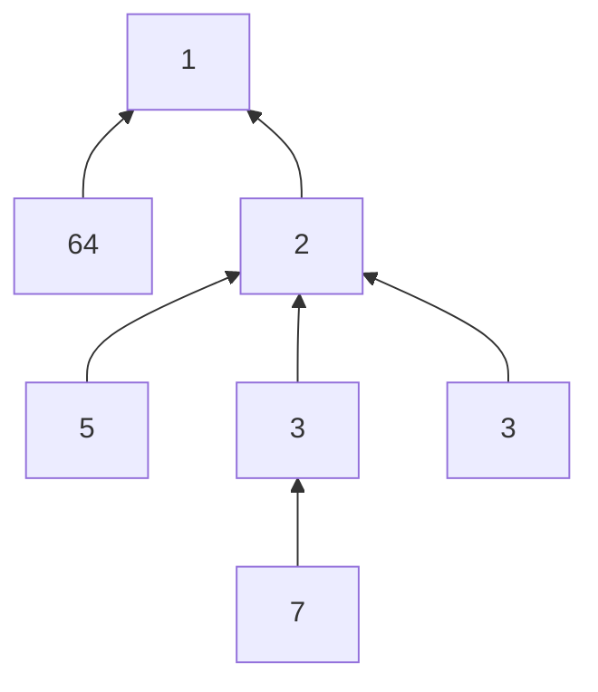

---
tags:
  - 算法
  - 数学
  - 树
  - 贪心
  - popcount
created: 2026-08-30
updated: 2026-08-30
source:
---

# 数组同构（popcount 链 → 树上的最小费用匹配）

## 题目描述

定义变换函数：将一个正整数 $x$ 用其二进制表示中 1 的个数替换，记作 $g(x)$（即 popcount）。

给定两个长度均为 $n$ 的正整数数组 $A$ 和 $B$。你可以对 $A$ 或 $B$ 中的任意元素反复执行以下操作，每次操作计数 1：将该元素 $x$ 替换为 $g(x)$。

当且仅当存在置换 $\pi$，使得对所有 $1 \le i \le n$ 都有 $A_i = B_{\pi(i)}$（即两个数组都排序后完全相同），我们称 $A$ 与 $B$ 同构。请计算使 $A$ 与 $B$ 同构所需的**最少操作次数**。题目保证一定有解。

### 输入描述

- 第一行输入一个整数 $t\ (1 \le t \le 10^4)$，表示测试用例数；
- 每个测试用例：第一行输入 $n\ (1 \le n \le 2 \times 10^5)$；第二行输入 $n$ 个整数 $A_i$；第三行输入 $n$ 个整数 $B_i\ (1 \le A_i, B_i \le 10^{18})$；
- 保证所有测试用例 $\sum n \le 2 \times 10^5$。

### 输出描述

对每个测试用例，输出一行整数——使 $A$ 与 $B$ 同构的最少操作次数。

### 示例

**输入：**
```
2
3
4 1 2
2 2 1
3
7 3 5
3 3 5
```

**输出：**
```
2
1
```

**说明：**
- 用例 1：对 A 中元素 4 执行一次变换 $g(4)=1$（A={1,1,2}）；对 B 中一个元素 2 执行一次变换 $g(2)=1$（B={1,2,1}）。共 2 次。
- 用例 2：仅需将 A 中的 7 变换为 $g(7)=3$，得到 A={3,3,5}。共 1 次。

---

## 核心思路

**把每个数 $x$ 看成树上的节点，$x$ 有一条指向 $g(x)$ 的边**，所有链最终汇到根 1。因为 $x \le 10^{18}$ 时 $\text{popcount}(x) \le 63$，之后 $63 \to 6 \to 2 \to 1$，链长最多 5~6 左右。

把 $A$ 中元素变成 $b$ 与 $B$ 中元素 $a$ 匹配的最小代价，**恰好等于两点在这棵树上的距离**（各自向上走直到相遇）。

于是做树上最小费用匹配，经典结论：

$$\text{answer} = \sum_{x \ne 1} \big| \text{cnt}_A[x] - \text{cnt}_B[x] \big|$$

其中 $\text{cnt}_A[x]$ 表示 $A$ 中有多少个元素的链经过节点 $x$（包括 $x$ 本身作为起点）。每个元素链长只有常数级（$\le 6$ 步），总复杂度 $O(\sum n)$，用 HashMap 统计即可。

### 一句话理解：把数字想成"楼"

每个数字是一座"楼"，操作一次就是"下楼一层"，最后都下到 1 楼。要花最少的"下楼梯"次数，让两个数组的成员名单变得一模一样。

变换 $g(x)$ 会让数**迅速变小**：$10^{18}$ 二进制最多 63 个 1，$g(63)=6$、$g(6)=2$、$g(2)=1$。所以不管开始的数多大，最多走 5~6 步就到 1。所有楼层最终汇到 1 层。

把 $x$ 变成 $g(x)$ 花费 1 次，等于**沿楼梯下一层**。两个数 $a$ 和 $b$ 想碰面，最少花费就是它们各自下楼、直到走到同一层——这正是树上两点的距离。



### 为什么按边差求和是对的

一个自然的思路是把 A 和 B 里的数两两配对，算每对的距离再求最小值——但配对方案太多会超时。

更聪明的看法：**一个数不管最终配给谁，它下楼必然要经过固定的那几条楼梯**。所以：

1. 对 A 里每个数，把它会经过的所有楼层（含起点、不含 1 层）记一个 "+1"；
2. 对 B 里每个数，同样记一个 "-1"；
3. 每条边 $x \to g(x)$ 上，两边人数差多少，就有 |差值| 人必须从这层往下走，每人花 1 次操作。

所有边差值绝对值之和就是答案。

- **下界性**：某条边（如 $4 \to 1$）上 A 有 1 人、B 没人在上面时，这个 A 队员迟早要独自走过这条楼梯，这一步省不掉；
- **可达性**：让多出来的人逐层下移去填补缺口，构造上总能恰好用这么多次操作完成。

所以每条边差值是躲不掉的下界，且可达到，故差值之和即最小值。

### 验证

**样例 1**：$A=\{4,1,2\}$：cnt_A[4]=1, cnt_A[2]=1；$B=\{2,2,1\}$：cnt_B[2]=2。边 $4\to1$ 差 1，边 $2\to1$ 差 1，答案 **2** ✓。
**样例 2**：$A=\{7,3,5\}$：cnt_A[7]=1；B 有两个 3：$7\to3$ 这条边差 1，其余边两侧都平衡，答案 **1** ✓。

> [!warning] 沿整条链计数
> 样例 2 中若误把 B 的 3 不算进节点 2 的子树就会得 4，务必沿整条链计数（addChain 一直走到 1 为止）。

---

## 完整代码

```java
import java.util.*;
import java.io.*;

public class Main {
    public static void main(String[] args) throws IOException {
        DataInputStream in = new DataInputStream(new BufferedInputStream(System.in, 1 << 16));
        int t = nextInt(in);
        StringBuilder sb = new StringBuilder();
        while (t-- > 0) {
            int n = nextInt(in);
            long[] A = new long[n], B = new long[n];
            for (int i = 0; i < n; i++) A[i] = nextLong(in);
            for (int i = 0; i < n; i++) B[i] = nextLong(in);

            HashMap<Long, Integer> cntA = new HashMap<>();
            HashMap<Long, Integer> cntB = new HashMap<>();
            for (long x : A) addChain(cntA, x);
            for (long x : B) addChain(cntB, x);

            long ans = 0;
            for (Map.Entry<Long, Integer> e : cntA.entrySet()) {
                if (e.getKey() == 1L) continue; // 根节点不计边
                ans += Math.abs(e.getValue() - cntB.getOrDefault(e.getKey(), 0));
            }
            // B 中独有、A 中没有的节点也要算
            for (Map.Entry<Long, Integer> e : cntB.entrySet()) {
                if (e.getKey() == 1L) continue;
                if (!cntA.containsKey(e.getKey())) ans += e.getValue();
            }
            sb.append(ans).append('\n');
        }
        System.out.print(sb);
    }

    // 把 x 及其整条链 g(x), g(g(x)), ... 都计数（不含根 1）
    static void addChain(HashMap<Long, Integer> cnt, long x) {
        while (x != 1L) {
            cnt.merge(x, 1, Integer::sum);
            x = Long.bitCount(x);
        }
    }

    static int nextInt(DataInputStream in) throws IOException {
        return (int) nextLong(in);
    }

    static long nextLong(DataInputStream in) throws IOException {
        int b;
        do { b = in.read(); } while (b < '0' || b > '9'); // 本题输入均为正整数
        long v = 0;
        while (b >= '0' && b <= '9') { v = v * 10 + (b - '0'); b = in.read(); }
        return v;
    }
}
```

## 代码关键点

- **链很短**：$x \le 10^{18}$ 时 popcount ≤ 63，$g(63)=6$、$g(6)=2$、$g(2)=1$，每个元素只需走常数步，整体 $O(\sum n)$，满足 3 秒限制。
- **读入优化**：数据量约 $4 \times 10^5$ 个最大 $10^{18}$ 的数，用手写 `DataInputStream` 快速读入（`StreamTokenizer` 也支持 long 但需手动解析）。`nextLong` 假设输入均为正整数，跳过非数字字符后逐位累加。

## 复杂度分析

- **时间复杂度**：$O(\sum n)$（每个元素链长常数 ≤ 6，HashMap 统计 + 遍历）
- **空间复杂度**：$O(\sum n)$（HashMap 存链上节点计数）

## 关联知识点

- [[星际跃迁的稳定信标]] — 数位 / 位运算相关
- [[172.阶乘后的零]] — 数论计数
