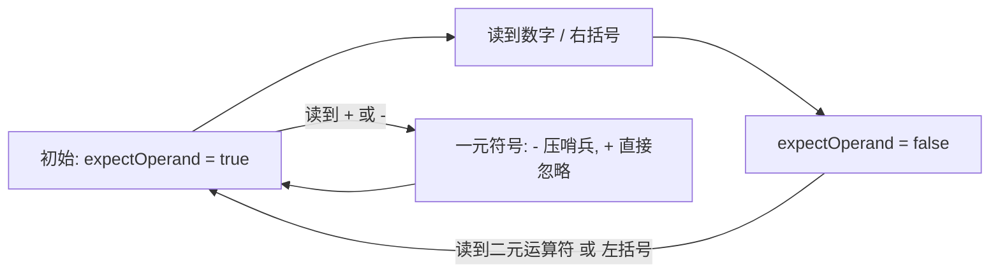

---
tags:
  - 算法
  - 栈
  - 表达式求值
  - 一元负号
created: 2026-09-23
updated: 2026-09-23
---

# 表达式求值（双栈法 + 一元负号哨兵处理）

用**两个栈**（数字栈 `nums` + 运算符栈 `ops`）直接对中缀表达式求值：读到数字入 `nums`，读到运算符时先把栈里**优先级不低于自己**的运算符结算掉再入栈，遇右括号就一路结算到左括号。核心难点是**一元负号**——`-5`、`3*-2`、`-(2+3)` 里那个 `-` 左边没有可减的操作数，不能当二元减法处理。本页解法用一个**哨兵运算符 `~`** 统一收拾所有一元负号情形。

## 基础版：双栈直接求值

先看只处理二元运算 + 括号的基础骨架。注意它其实**没有真正处理一元负号**——原注释写着"处理一元负号"是误导，那个 `while` 只是二元运算符的结算循环：

```java
import java.util.*;

public class Main {

    static int precedence(char op) {
        if (op == '+' || op == '-') return 1;
        if (op == '*' || op == '/') return 2;
        return 0;
    }

    static boolean isOpenBracket(char c) {
        return c == '(' || c == '[' || c == '{';
    }

    static boolean isCloseBracket(char c) {
        return c == ')' || c == ']' || c == '}';
    }

    static void applyOp(Deque<Integer> nums, Deque<Character> ops) {
        int b = nums.pop();
        int a = nums.pop();
        char op = ops.pop();
        switch (op) {
            case '+': nums.push(a + b); break;
            case '-': nums.push(a - b); break;
            case '*': nums.push(a * b); break;
            case '/': nums.push(a / b); break;
        }
    }

    public static void main(String[] args) {
        Scanner sc = new Scanner(System.in);
        String s = sc.next().trim();

        Deque<Integer> nums = new ArrayDeque<>();
        Deque<Character> ops = new ArrayDeque<>();

        int i = 0;
        while (i < s.length()) {
            char c = s.charAt(i);

            if (Character.isDigit(c)) {
                int num = 0;
                while (i < s.length() && Character.isDigit(s.charAt(i))) {
                    num = num * 10 + (s.charAt(i) - '0');
                    i++;
                }
                nums.push(num);
                continue;
            }

            if (isOpenBracket(c)) {
                ops.push(c);
            } else if (isCloseBracket(c)) {
                while (!ops.isEmpty() && !isOpenBracket(ops.peek())) {
                    applyOp(nums, ops);
                }
                ops.pop(); // 弹出对应的开括号
            } else if (c == '+' || c == '-' || c == '*' || c == '/') {
                // 处理一元负号（如表达式开头或括号后的负号）
                // 题目保证合法，一般不需要，但保留结构清晰
                while (!ops.isEmpty()
                        && !isOpenBracket(ops.peek())
                        && precedence(ops.peek()) >= precedence(c)) {
                    applyOp(nums, ops);
                }
                ops.push(c);
            }

            i++;
        }

        while (!ops.isEmpty()) {
            applyOp(nums, ops);
        }

        System.out.println(nums.peek());
    }
}
```

碰到 `-5`、`-(2+3)` 这类以 `-` 开头、或紧跟在 `(`/运算符后面的负号，这份代码会去 `nums` 弹两个操作数做二元减法，栈里数字不够就直接抛 `NoSuchElementException`。

## 核心思路：加一个"我在等操作数"的状态

`-` 只有两种身份，判定完全取决于**它左边最近的"有效内容"是什么**：

- 左边是数字或右括号 → 有一个完整的左操作数可结合，是**二元减号**（`5-3`、`(1+2)-3`）
- 左边是"空"（表达式开头）、左括号、或另一个运算符 → 左边没有可减的东西，是**一元负号**（`-5`、`(-5)`、`3*-5`）

用布尔变量 `expectOperand` 精确表示这个状态：**为 `true` 时说明当前位置正等着一个操作数**。数字和右括号把它置 `false`，运算符和左括号把它重置为 `true`：



有了它，"这个 `-` 是一元还是二元"就变成一个 if 判断：`expectOperand == true` 且当前是 `-` → 一元，压哨兵 `~`；是 `+` → 一元正号，直接忽略。

## 完整改法：哨兵法

哨兵字符用输入里绝不会出现的符号，这里用 `~`（也可用 `u`、`#`）。两处关键改动：`precedence` 里给 `~` 最高优先级 3；`applyOp` 先弹运算符、再判断是不是一元（一元只弹一个操作数）。

```java
import java.util.*;

public class Main {

    static int precedence(char op) {
        if (op == '~') return 3;                  // 一元负号：优先级最高
        if (op == '+' || op == '-') return 1;
        if (op == '*' || op == '/') return 2;
        return 0;
    }

    static boolean isOpenBracket(char c) {
        return c == '(' || c == '[' || c == '{';
    }

    static boolean isCloseBracket(char c) {
        return c == ')' || c == ']' || c == '}';
    }

    static void applyOp(Deque<Integer> nums, Deque<Character> ops) {
        char op = ops.pop();
        if (op == '~') {                          // 一元运算：只弹一个操作数
            nums.push(-nums.pop());
            return;
        }
        int b = nums.pop();
        int a = nums.pop();
        switch (op) {
            case '+': nums.push(a + b); break;
            case '-': nums.push(a - b); break;
            case '*': nums.push(a * b); break;
            case '/': nums.push(a / b); break;
        }
    }

    public static void main(String[] args) {
        Scanner sc = new Scanner(System.in);
        String s = sc.nextLine().replaceAll("\\s+", "");   // 顺带修掉空格问题

        Deque<Integer> nums = new ArrayDeque<>();
        Deque<Character> ops = new ArrayDeque<>();

        boolean expectOperand = true;   // 当前位置是否在等待一个操作数

        int i = 0;
        while (i < s.length()) {
            char c = s.charAt(i);

            if (c >= '0' && c <= '9') {
                int num = 0;
                while (i < s.length() && s.charAt(i) >= '0' && s.charAt(i) <= '9') {
                    num = num * 10 + (s.charAt(i) - '0');
                    i++;
                }
                nums.push(num);
                expectOperand = false;
                continue;
            }

            if (isOpenBracket(c)) {
                ops.push(c);
                expectOperand = true;
            } else if (isCloseBracket(c)) {
                while (!ops.isEmpty() && !isOpenBracket(ops.peek())) {
                    applyOp(nums, ops);
                }
                ops.pop();
                expectOperand = false;
            } else if (c == '+' || c == '-' || c == '*' || c == '/') {
                if (expectOperand && (c == '-' || c == '+')) {
                    // 一元符号：- 压哨兵，+ 直接忽略
                    if (c == '-') ops.push('~');
                    // expectOperand 保持 true
                } else {
                    while (!ops.isEmpty()
                            && !isOpenBracket(ops.peek())
                            && precedence(ops.peek()) >= precedence(c)) {
                        applyOp(nums, ops);
                    }
                    ops.push(c);
                    expectOperand = true;
                }
            } else {
                throw new IllegalArgumentException("非法字符: " + c);
            }

            i++;
        }

        while (!ops.isEmpty()) {
            applyOp(nums, ops);
        }

        System.out.println(nums.peek());
    }
}
```

## 为什么一元分支不需要那个优先级比较的 while

这是最容易写错的地方。看到一元 `~` 时**直接 `push` 就行，不要跑"弹出栈顶所有优先级不低于自己的运算符"那个循环**。两个原因：

1. **逻辑上此刻正等操作数**：栈顶若是二元运算符（`2*-3` 里的 `*`），它的右操作数还没算出来本就不能结算；若是 `(` 或另一个 `~`，更没什么可结算。循环跑了也是空转。
2. **不跑循环恰好给了一元负号右结合语义**：`--3` 会连压两个 `~`，结束时从栈顶依次弹出各取一次负得 `+3`；若循环里用 `>=` 把它提前弹掉，弹出瞬间数字栈是空的，直接抛 `NoSuchElementException`。

而 `~` 一旦压栈，会被**后面到来的二元运算符**自动结算：`-3+5` 遇 `+` 时 `precedence('~')=3 >= 1` 成立，先弹 `~` 把栈顶数字变 `-3` 再压 `+`——等价于"一元负号比乘除加减绑定更紧"，`-3*2` 也会先得 `-3` 再乘。括号侧同理：`(-3)` 遇 `)` 时清空循环先弹 `~` 取负，再停在 `(`。

## 走一遍的例子

| 输入 | 关键动作 | 结果 |
|------|---------|:---:|
| `-3+5` | `~` 先入栈，遇 `+` 时因 3 ≥ 1 被结算成 `-3` | 2 |
| `3*-2` | `*` 入栈后 `expectOperand` 仍为真，`~` 压在 `*` 上；结束时先算 `~` 再算 `*` | -6 |
| `-(2+3)` | `~` 在栈底不动，`)` 只清到 `(` 就停；最后再对 5 取负 | -5 |
| `--3` | 两个 `~` 都直接入栈，弹栈时各取负一次 | 3 |
| `3--2` | 第一个 `-` 二元、第二个一元，等价 `3-(-2)` | 5 |
| `2*(3--4)` | `)` 处先弹 `~` 得 -4，再弹 `-` 得 7 | 14 |
| `-(-(-3))` | 三个 `~` 分散在三个括号层级，各自那层被结算 | -3 |

多了 `~` 这一级后，"括号内栈上运算符链最多两级"要改成**最多三级**（`(1+2*3)` 的 `+`/`*` 再加一个 `~`），闭括号那个 `while` 的必要性更明显。

## 另外两种思路，以及为什么不如哨兵法

**① 给数字直接取负**（最省事）：在 `expectOperand && c=='-'` 时 `i++; continue` 跳过符号，置 `sign=-1`，读到数字后 `push(sign*num)` 复位。只改十来行，`-3+5`、`3*(-2)`、`--3` 都能算对。**硬伤**：符号后面若是括号组，取负就无处施加——`-(2+3)` 会变成"负号丢掉直接算 5"，`2*-(3+4)` 直接崩。因为取负发生在"读到数字"那一刻，而括号组结果要等 `)` 才产生，时间对不上。哨兵法把取负推迟到栈上结算，正是为了让作用对象可以是任意一个完整操作数。

**② 递归下降解析器**（最彻底）：`parseExpr`（加减）→ `parseTerm`（乘除）→ `parseFactor`（数字或括号），`parseFactor` 里天然可写"看到 `-` 就返回负的 `parseFactor()`"。一元负号的结合性和优先级由函数调用层级自己保证，不需要哨兵也不需要 `expectOperand`。代价是代码量翻几倍 + 递归开销。但若还要支持浮点、幂运算、括号类型校验、多字符运算符，递归下降是值得的方向——双栈法的补丁会越打越复杂（同类思路见 [[命令行解析与出现次数统计]] 的递归下降 AST 构建）。

`+` 的处理：代码里"直接忽略"，对 `+5`、`3*+2`、甚至 `++5` 都合理，不必为它压栈。

## 关联知识点

- [[150.逆波兰表达式求值]] —— 后缀表达式求值；双栈法是"边转边算"，逆波兰是"先转好再算"
- [[224.基本计算器]] —— 只含加减和括号的计算器（符号栈记括号外符号），本页是它加上乘除优先级 + 一元负号的加强版
- [[394.字符串解码]] —— 栈处理嵌套结构的同类套路
- [[20.有效的括号]] —— 括号匹配基础
- [[命令行解析与出现次数统计]] —— 递归下降语法解析（AST 构建）的完整实现
- [[Deque 方法速记（栈 vs 队列）]] —— `ArrayDeque` 当栈用的 push/pop/peek 速记
